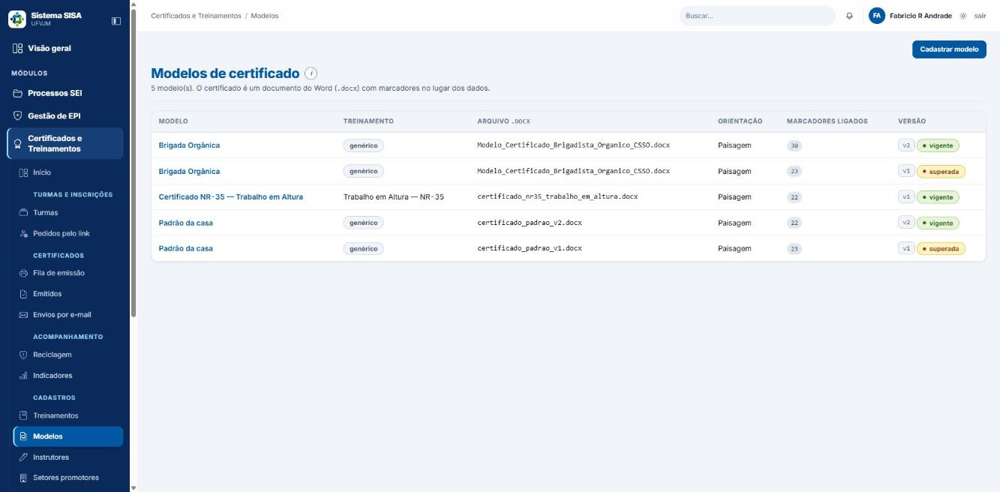
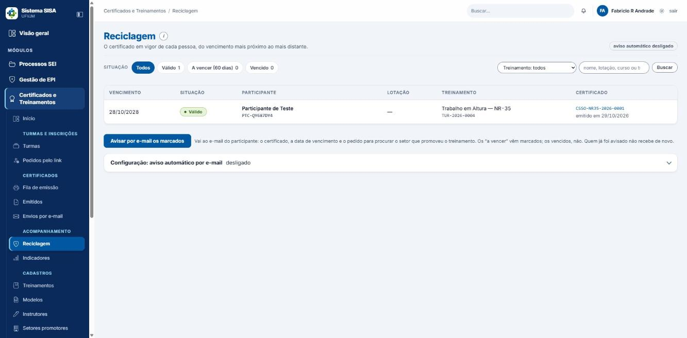

# Manual do Coordenador: Certificados (Treinamentos)

Sistema SISA (UFVJM). Módulo "Certificados e Treinamentos", parte de certificados.

## Para quem é

Para quem responde pelos certificados: concede e retira acessos, cuida dos modelos, dos instrutores e das rubricas, confere a fila de emissão, decide sobre correções e anulações, acompanha os vencimentos e os indicadores e zela pela privacidade. Este manual não ensina o dia a dia de quem só consulta o próprio certificado. Para isso, existe o manual do usuário.

Todos os exemplos usam pessoas, números e chaves fictícios.

## Antes de começar

### Quem pode fazer o quê

| Perfil | Ver fila, emitidos, reciclagem e e-mails | Emitir | Anular e corrigir | Modelos e catálogo de treinamentos | Instrutores | Indicadores |
|---|---|---|---|---|---|---|
| Coordenador | sim | sim | sim | sim | sim | sim |
| Engenheiro de segurança | sim | sim | sim | sim | sim | sim |
| Médico do trabalho | sim | sim | sim | sim | sim | sim |
| Superintendente | sim | sim | sim | sim | sim | sim |
| Técnico de segurança | sim | sim | não | sim | sim | sim |
| Secretaria | sim | sim | não | só vê o catálogo; não abre Modelos | não abre | sim |
| Consulta PROGEP e Auditor interno | sim, de todos os setores, menos "Envios por e-mail" | não | não | não | não | sim |
| Servidor comum | só "Meus treinamentos" e "Meus certificados" | não | não | não | não | não |
| Almoxarife e administrador de TI | sem acesso a nada do módulo, nem a "Meus certificados" | não | não | não | não | não |

Quem não tem conta só consegue usar a validação pública (`/validar`). O perfil Administrador do sistema (acima do superintendente) tem todas as permissões e todos os setores; não foi testado aqui.

**Recorte por setor.** Cada setor vê e gere só as turmas que promove e o que pende delas (inscrições, pedidos pelo link, emissão, envio, reciclagem, indicadores). Veem todos os setores: a coordenação, a superintendência, a Consulta PROGEP e o Auditor interno. Turma sem unidade promotora é da CSSO. Conta de equipe sem setor vinculado não vê turma alguma e a tela avisa "Sua conta não está vinculada a nenhum setor promotor...": vincule a pessoa ao setor dela.

Dois pontos de atenção sobre perfis:

- O médico do trabalho tem poder amplo (modelos, instrutores e anulação). Confirme se isso faz sentido para a sua equipe.
- O ajudante do perfil técnico, mesmo com o papel "Emissão", emite e envia, mas não anula, apesar de o texto do papel sugerir o contrário. Para anular, chame alguém do perfil que pode.

### A regra do dono da turma

Emitir, anular, corrigir e enviar certificados de uma turma só podem ser feitos por:

- o dono da turma (quem a abriu);
- a superintendência (qualquer turma);
- a coordenação **do setor promotor da turma**, quando o dono tem nível abaixo dela ou a turma não tem dono. Entre dois coordenadores, só o dono altera;
- os ajudantes que o dono designou com o papel "Emissão — emitir, anular, reemitir e enviar os certificados da turma".

As demais pessoas da equipe só consultam. Se tentarem agir, recebem: "Só consulta. Esta turma é de <Nome>; só ele ou a coordenação acima pode alterar." Turma anterior à regra diz "Esta turma não tem dono registrado (é de antes da regra de dono); só a coordenação do setor ou a superintendência pode alterar."

Como o dono designa ajudante: na aba "Turma", botão "Designar ajudante", com os papéis "Inscrições", "Presença e notas" e "Emissão". **Não se delegam**: editar a turma, concluir ou cancelar, "Registrar turma já realizada", vincular instrutor, link público, corrigir dados da turma e designar ajudantes. Ajudante não designa ninguém.

**O treinamento do catálogo também tem dono** (quem o cadastrou), com a mesma lógica e sem ajudantes: só o dono, a superintendência ou a coordenação do mesmo setor (com o dono abaixo dela) edita ou exclui. Os outros veem "só consulta" na linha, e o 403 diz "Este treinamento é de <Nome>; só ele ou a coordenação acima pode alterar." Isso inclui apontar o "Modelo do certificado" (capítulo 2). Modelos e instrutores não têm dono: quem tem a permissão edita.

Quem é titular de um certificado não pode anulá-lo nem corrigi-lo: "Este certificado é seu: anular ou corrigir o próprio certificado é ato de outra pessoa da equipe."

### Onde fica cada coisa (menu "Certificados e Treinamentos")

- Início: lista os passos na ordem do trabalho, com a contagem do que espera em cada um. Mais abaixo, "Turmas encerrando" (com a coluna "O que falta") e "Próximas turmas".
- Certificados: "Fila de emissão", "Emitidos", "Envios por e-mail".
- Acompanhamento: "Reciclagem", "Indicadores".
- Cadastros: "Treinamentos", "Modelos", "Instrutores", "Setores promotores", "Locais".
- Turmas e inscrições: "Turmas" e "Pedidos pelo link" (quem se inscreveu pelo link público e espera conferência).
- Meu espaço: "Meus treinamentos", "Meus certificados".
- Endereço público: `/validar`.

## Sumário

1. Como o certificado nasce (visão geral)
2. Cadastrar e manter os treinamentos
3. Instrutores e rubricas
4. Modelos de certificado
5. Fila de emissão e emissão
6. Certificados emitidos: ficha, segunda via, correção e anulação
7. Envios por e-mail
8. Reciclagem (vencimentos)
9. Indicadores
10. Validação pública
11. Certificados do titular
12. Rotina de acompanhamento
13. Situações e o que cada uma significa
14. Erros e mensagens comuns
15. Glossário
16. Limites conhecidos

---

## 1. Como o certificado nasce (visão geral)

O sistema só emite quando tudo isto estiver pronto, nesta ordem natural:

1. O treinamento está no catálogo, com carga horária, validade, código curto, modelo e instrutor padrão.
2. O instrutor que assina está cadastrado, com vigência em dia e, de preferência, com rubrica.
3. Existe um modelo de certificado. Sem modelo próprio, sai o modelo genérico vigente da casa.
4. A turma foi criada, o instrutor foi vinculado com "assina o certificado" marcado, os inscritos tiveram presença e nota lançadas, e a turma foi concluída.
5. Alguém com permissão emite, pela aba "Emissão" da turma ou pela "Fila de emissão".
6. O certificado pode ser enviado por e-mail e/ou baixado pelo próprio participante em "Meus certificados".

A turma não emite antes de concluída. A mensagem é: "TUR-2026-0003 está em andamento. O certificado atesta um curso que terminou: conclua a turma na aba Turma antes de emitir." Reprovado ou faltoso não recebe certificado.

**O papel emitido é congelado.** O certificado guarda tudo o que imprime (participante, treinamento, carga, período, local, frequência, instrutores, conteúdo, modelo). Mudar depois o catálogo, o modelo, o instrutor ou a rubrica não altera o que já foi emitido. Para refletir a mudança, é preciso corrigir ou reemitir (capítulo 6).

**Número e chave.** O número impresso tem a forma `<SIGLA>-<CÓDIGO CURTO>-<ANO>-<SEQUÊNCIA>`, por exemplo `SISA-NR32-2026-0001`. A sigla vem da unidade promotora da turma (por exemplo CSSO); se a turma não tem unidade promotora, sai SISA. A chave de validação é o número mais 5 caracteres sorteados (exemplo fictício: `SISA-NR32-2026-0001-8E9K2`); as letras O, I, L e U não são usadas.

Número consumido não volta. Anulação e reemissão gastam um número novo, então a sequência impressa pode ter "buracos", e isso é normal.

## 2. Cadastrar e manter os treinamentos

Caminho: Cadastros > "Treinamentos".

Campos que importam para o certificado:

- **Nome**: é o que sai impresso.
- **Carga horária** (em horas).
- **Validade da reciclagem** (em meses). Com 0, o treinamento não vence e não entra na Reciclagem.
- **Código curto**: de 2 a 10 letras ou algarismos, sem traço (exemplo: NR35). Entra no número do certificado e é único.
- **Norma de referência**, "exigido por norma", **Código**.
- **Modelo do certificado**: qual modelo este treinamento usa. **Só existe em "Editar"**, não no cadastro novo, e a lista oferece só modelos vigentes do treinamento ou genéricos (a versão superada só aparece se já for a apontada).
- **Instrutor padrão** (também só em "Editar").
- **Conteúdo programático** (um tópico por linha), que sai no verso.
- **Ativo**.

Só se exclui um treinamento que nunca teve turma ("Só para o treinamento cadastrado por engano"). Editar e excluir valem só para o dono do treinamento ou quem está acima dele (capítulo "Antes de começar"). Mensagens do cadastro: "O código curto X já é do treinamento “...”: cada treinamento tem o seu...", "Carga horária inválida: informe um número maior que zero.", "Validade inválida: informe meses inteiros, ou 0 para não expira." e "Já existe outro treinamento chamado '...'.". O "Código" é opcional, sai do nome se ficar em branco e não muda depois.

**Setores promotores** (Cadastros > "Setores promotores"): a lista decide quais setores aparecem em "Unidade promotora" ao abrir ou editar uma turma. A sigla do setor vira o prefixo do número do certificado e o setor sai no papel (", promovido por …"). "retirar da lista" só deixa de oferecer o setor em turma nova; turma e certificados existentes não mudam.

**Decisão importante: o modelo só vale quando o catálogo aponta para ele.** Cadastrar um modelo "para" um treinamento, ou publicar versão nova, não faz o treinamento passar a usá-lo. Para valer, abra o treinamento, clique em Editar e escolha o "Modelo do certificado". Sem apontamento, sai o modelo genérico vigente, e a trilha do certificado registra o Aviso "'<Treinamento>' não tem modelo próprio — sai no modelo genérico Padrão da casa v2".

Se o catálogo aponta uma versão superada, o certificado ainda sai, mas com um aviso: "o catálogo aponta <modelo vN>, que é uma versão superada — o certificado sai com esse layout; se não for o desejado, aponte a versão vigente em /treinamentos/catalogo antes de emitir". Depois de publicar uma versão nova, volte ao catálogo e aponte para ela.

**Atenção ao Código curto e à sigla.** O texto de ajuda do catálogo cita CSSO (por exemplo `CSSO-NR35-2026-0001`), mas a sigla depende da unidade promotora da turma. Turma sem unidade promotora emite SISA. Preencha a "Unidade promotora" antes de emitir; depois, só reemitindo.

## 3. Instrutores e rubricas

Caminho: Cadastros > "Instrutores". Exige a permissão de gerenciar instrutores (perfil de coordenação, engenharia, medicina, superintendência ou técnico).

### Cadastrar

1. Clique para cadastrar.
2. Para instrutor da UFVJM, escolha o servidor em "Instrutor da UFVJM" (o nome vem do cadastro). Para externo, marque "instrutor externo" e digite o Nome.
3. Preencha Título de assinatura, Conselho, Registro, Organização e, se o certificado exigir, "CPF (só se o certificado exigir)".
4. Preencha a vigência: início ("Vazio: desde sempre (assina turma já realizada)") e fim ("Vazio: sem termo").
5. Grave. Mensagem de sucesso: "Assinatura de <Nome> cadastrada."

Mensagens de erro: "Informe o nome do instrutor."; "Instrutor da UFVJM precisa estar vinculado a um servidor."; "O fim da vigência não pode ser anterior ao início."; "CPF inválido: confira os dígitos (11 números, com o verificador)."

Cuidado: o sistema aceita cadastrar o mesmo instrutor duas vezes e aceita título em branco. Confira a lista antes de cadastrar e sempre preencha o título, porque é ele que aparece embaixo da assinatura.

### Editar, desativar e excluir

- Editar: o nome só muda em instrutor externo. Desmarcar "ativa" tira o instrutor dos próximos vínculos, mas a turma já vinculada continua assinando. Mensagem: "Instrutor: alteração gravada."
- Excluir: só quem nunca esteve em turma. Se já esteve, a mensagem é "<Nome> está em 4 turma(s): não se exclui. Desmarque “ativo”, ou feche a vigência, para tirá-lo das próximas turmas."

### Rubrica

Use "enviar rubrica". Aceita imagem PNG ou JPEG (de preferência PNG com fundo transparente, na proporção de 3 para 1). Mensagens: "Rubrica de <Nome> guardada."; "A rubrica precisa ser uma imagem PNG ou JPEG."; "Escolha a imagem da rubrica (PNG ou JPEG)."

A rubrica nova vale para os certificados emitidos daqui em diante. Os antigos ficam como saíram. A imagem só abre para quem gerencia instrutores.

### Qualificações

Na ficha do instrutor, "qualificações": descrição, treinamento que habilita ou norma, instituição, data de emissão, "Válida até" e comprovante (PDF, PNG ou JPEG, até 4 MB). Sem qualificação cadastrada, a turma só mostra um aviso, não bloqueia. Se a norma exige instrutor qualificado, cadastre o comprovante. Trinta dias antes do vencimento de uma qualificação, nasce uma tarefa para o setor.

### A vigência pode travar emissão de curso já realizado

Ao vincular o instrutor à turma, o sistema confere a vigência na data de início da turma. Ao emitir, confere a vigência na data da emissão. Se a vigência já acabou, a emissão trava com: "a assinatura de <Nome> não vigora em DD/MM/AAAA". Isso acontece mesmo que o curso tenha sido dado durante a vigência.

Como resolver: abra o instrutor, clique em Editar, reabra ou estenda a vigência e emita de novo. Decida com consciência: estender a vigência vale para tudo o que for emitido dali em diante com aquela assinatura.

## 4. Modelos de certificado

*Modelos de certificado.*

Caminho: Cadastros > "Modelos". Exige a permissão de gerenciar treinamentos.

A lista mostra: Modelo, Treinamento ("genérico" ou o treinamento), Arquivo .docx, Orientação, Marcadores ligados e Versão (por exemplo "v2 vigente", "v1 superada").

### Cadastrar um modelo

1. Clique em "Cadastrar modelo".
2. Informe o "Nome do modelo".
3. Envie o "Arquivo do Word (.docx)" (até 4 MB) ou escolha "Ou use um layout pronto" (certificado_padrao_v1.docx ou certificado_padrao_v2.docx). O layout pronto só vale se nenhum arquivo for enviado.
4. Escolha a Orientação (Paisagem ou Retrato).
5. Escolha o Treinamento. Vazio significa "genérico — serve a qualquer treinamento".
6. Se quiser, escreva uma Observação. Grave.

No arquivo Word, no lugar de cada dado variável escreva um texto entre « e » (por exemplo «NOME COMPLETO DO PARTICIPANTE», «DD/MM/AAAA») ou o nome entre chaves duplas (por exemplo `{{ nome }}`).

Mensagens de erro (a tela volta com o aviso):

- "Dê um nome ao modelo."
- "Escolha o arquivo .docx do modelo."
- "O arquivo não é um documento do Word (.docx). Abra-o no Word e use “Salvar como” › Documento do Word (.docx)."
- "Envie um arquivo .docx (documento do Word). PDF, .doc e .odt não servem como modelo."
- "Não achei nenhum marcador no documento. Escreva, no lugar de cada dado, o texto entre « e » (ex.: «NOME DO PARTICIPANTE») ou o nome entre chaves duplas (ex.: {{ participante_nome }})."

Sucesso: "Modelo cadastrado com N marcador(es). Escolha o dado de cada um e salve."

### Ligar cada marcador a um dado (o mapa)

Abra a ficha do modelo, em "Marcadores e dados". A tabela mostra: Marcador no documento, Onde aparece, "O que vai no lugar", "Vazio bloqueia" e Situação. Escolha o dado de cada linha e clique em "Salvar". Mensagem: "Mapa salvo (N alteração(ões)). Todos os marcadores têm dado."

A faixa de situação diz:

- "faltam N" e "N marcador(es) ainda sem dado. Enquanto houver um, a emissão com este modelo é recusada — o marcador sairia impresso no papel."
- "o mapa cobre o arquivo".
- "N fora do arquivo ... Não atrapalham a emissão."

Dados que um marcador pode receber, em resumo: dados do participante (nome, identificador PTC, vínculo, organização, SIAPE, lotação na data da turma, CPF só se a norma exigir), do treinamento (nome, carga, conteúdo, norma), da turma (início, término, período por extenso, local, campus, cidade, unidade promotora, instrutores), do certificado (número, chave, QR Code, URL de validação, datas de emissão e de vencimento), nota, frequência, assinante (nome, título, rubrica), instrutor, setor emissor e "Deixar em branco". Há também "Texto fixo", "Campo da turma" e "Campo do participante".

**"Vazio bloqueia".** Vem marcado por padrão em vários dados. Significa que, se a pessoa não tiver aquele dado (por exemplo, lotação de uma pessoa externa, ou CPF), a emissão dela trava. Desmarque quando o dado for opcional naquele certificado.

### "Aplicar sugestões": confira linha por linha

O botão "Aplicar sugestões" liga os marcadores automaticamente, mas erra com facilidade. Casos vistos: dois «DD/MM/AAAA» viraram "data de início" e "data de término" na ordem em que aparecem, e o segundo, que era "Emitido em", saiu com a data errada; e «DATA DE HOJE» foi ligada a "Lotação na data da turma", o que trava a emissão de pessoa externa. Depois de aplicar, revise cada linha e use "Baixar exemplo preenchido" (um .docx com dados de mentira; o que não tem dado sai "[falta: …]") para ver como o papel fica.

Para marcador que o sistema não adivinhou, use "Mapear marcador": informe o Marcador no .docx (sem chaves), o Preenchimento (Campo do sistema, Texto fixo do modelo, Campo da turma ou Campo do participante) e, se quiser, marque "vazio neste campo bloqueia a emissão".

### Editar e publicar nova versão

- "Editar o modelo": nome, arquivo, orientação, treinamento, observação. Vale da v2 em diante; papel já emitido não muda. Mensagem: "Modelo: alteração gravada."
- "Publicar nova versão v2 → v3": o arquivo é opcional. A nova versão herda o mapa e aposenta a anterior. Mensagem: "Versão v2 publicada."
- Versão superada não se edita: "Versão superada não se edita — ela é o layout de certificados já emitidos."

**Lembrete decisivo:** a ficha da versão nova pode dizer "Nenhum treinamento emite com esta versão hoje." Isso é esperado até você apontar o modelo no catálogo (capítulo 2).

Modelo sem mapa completo trava a emissão com uma mensagem técnica, do tipo "o modelo <nome> não tem nenhuma tag no dicionário — o certificado sairia em branco; o .docx de <modelo> tem marcador sem linha no dicionário: ...". A mensagem não diz onde corrigir. O lugar é a ficha do modelo, em "Marcadores e dados".

## 5. Fila de emissão e emissão

Caminho: Certificados > "Fila de emissão". Mostra todas as turmas, pela etapa de cada inscrição.

### As etapas (pílulas com contagem)

- **Aguardando emissão**: aprovado em turma concluída, sem certificado, e a emissão aceitaria agora.
- **Travados**: aprovados que a emissão recusaria. O motivo aparece na linha.
- **Emitidos**: já têm certificado.
- **Em curso**: inscritos de turma que ainda não terminou.
- **Faltaram** e **Reprovados**: não recebem certificado.

Filtros: "Filtrar por treinamento" e busca por "Nome, SIAPE, PTC-… ou turma" (botão "Buscar"). CPF não é pesquisável. Se a etapa digitada no endereço for inválida, a tela cai em "Aguardando emissão".

### Emitir pela fila

1. Abra a etapa "Aguardando emissão".
2. Marque quem vai receber. O aviso na tela lembra: "Cada certificado consome um número da sequência do ano, e número consumido não volta. Desmarque quem não deve sair agora."
3. Clique em "Emitir os certificados marcados".

Resultados possíveis:

- "N certificado(s) emitido(s)." e, se alguém travou, ", M travado(s) — o motivo está abaixo." com o bloco "Travados nesta emissão".
- "Nenhum dos marcados pôde ser emitido. O motivo de cada um está abaixo."
- "Marque quem vai receber o certificado."
- "N marcado(s) já não estava(m) apto(s) na fila (certificado já emitido, resultado mudado ou fora do seu escopo) — atualize a lista."

### Emitir pela turma

Na aba "Emissão" da turma: botão "emitir" por linha ou "Emitir os N agora" em lote (só aparece quando há aptos). Também há "Baixar todos em PDF" (modelo da casa) ou "Baixar todos em Word (.zip)" (modelo enviado), quando já existe certificado.

Se o modelo tem marcador "Campo da turma" ou "Campo do participante", a aba mostra os cartões **"Dados do certificado desta turma"** e **"Dados do certificado por participante"**. Quem tem o papel de emissão (e de lançar nota, no caso de nota por pessoa) preenche e clica em "Salvar" antes de emitir; campo "(obrigatório para emitir)" vazio trava a emissão. O valor é congelado no certificado; quem já tem certificado não muda aqui (anule e reemita). As alterações ficam em "Alterações nestes dados".

Atalho para turma de um só dia que já passou: "Registrar turma já realizada" marca todos presentes pela carga inteira e conclui. A conclusão ("Concluir turma…" e depois "Concluir e apurar os N") não tem volta.

### Data base e vencimento

O vencimento é a "Data base do vencimento" da turma (vazio significa o término da turma) mais a validade do treinamento em meses. Exemplo fictício: validade de 12 meses e data base 28/10/2026 dão vencimento em 28/10/2027. Treinamento sem validade sai como "não expira" na lista de emitidos, "validade indeterminada" na ficha e na validação pública, e "Sem prazo de validade" em "Meus certificados". A data base não pode ser anterior ao início da turma: "A data base do vencimento não pode ser anterior ao início da turma."

### Por que um aprovado fica "Travado"

Motivos vistos e como resolver:

| Motivo mostrado | O que fazer |
|---|---|
| "a assinatura de <Nome> não vigora em DD/MM/AAAA" | Estender a vigência do instrutor (capítulo 3). |
| modelo sem mapa ("não tem nenhuma tag no dicionário...", "marcador sem linha no dicionário") | Completar o mapa na ficha do modelo (capítulo 4). |
| "o modelo exige e falta: CPF do participante" | Informar o CPF na aba "Inscrições" da turma: botão "CPF" na linha da pessoa e depois "Gravar". |
| "o modelo exige e falta: Lotação na data da turma" | Conferir o cadastro da pessoa ou desmarcar "Vazio bloqueia" no marcador, se o dado for opcional. |
| "Esta turma é de <Nome>; só ele ou a coordenação acima pode alterar." | Pedir ao dono, à coordenação ou à superintendência. |
| sem instrutor assinante | Na aba "Turma", "Vincular instrutor" com "assina o certificado" marcado. Sem alguém marcado, a emissão é recusada. |

O CPF nunca aparece na tela (sai como `***.***.***-**`), só no documento.

**Atenção a um defeito de aviso:** quem não é dono da turma vê "pronto para emitir" com caixa de marcação, mas a emissão é recusada depois. Antes de orientar a equipe a emitir, confira quem é o dono da turma.

## 6. Certificados emitidos: ficha, segunda via, correção e anulação

Caminho: Certificados > "Emitidos". O título é "Certificados emitidos". O certificado não nasce nesta tela; emite-se na turma ou na fila.

### Lista

Colunas: Nº, Participante (nome e PTC), Treinamento (e turma), Emissão, Vencimento e Situação (Válido, Vencido, Anulado). Pílulas: Todos, Emitido, Anulado. Filtro "Filtrar por treinamento" e busca por "Nome, SIAPE, PTC-…, turma, número ou chave" (sem acento nem diferença de maiúscula).

Atenção:

- A busca por CPF não funciona; a tela avisa "O sistema não busca por CPF. Procure pelo nome, pelo SIAPE, ..." e não filtra.
- Busque pelo **número impresso completo** (`SISA-NR32-2026-0001`) ou pela **chave**. A busca no formato "1/2026" usa o número interno do sistema, que é outro: pode trazer um certificado diferente do esperado. "nr32" sem traço não encontra.
- O filtro "Emitido" ainda inclui os vencidos. "Vencido" é calculado na hora.

### Ficha do certificado

Mostra: cabeçalho (número, nome, treinamento, turma, situação); "O documento" (Número, Chave de validação, Endereço público, Emitido em, Data base, Vencimento, Modelo e versão, SHA-256 do modelo e do texto); "Segunda via"; "Envio por e-mail"; "O que foi congelado"; "Conteúdo programático congelado"; "O dicionário de tags congelado"; e a Trilha. Os botões "Corrigir certificado" e "Anular certificado" só aparecem para quem pode e é dono da turma.

### Segunda via

Na ficha, em "Segunda via": "Baixar PDF" e "Word (.docx)". Para certificado anulado: "Baixar cópia anulada" e "Word (.docx) anulado", com tarja "ANULADO em … — substituído por …". A segunda via sai sempre do conteúdo congelado, então é igual ao original. Cada download gera na trilha o evento "Segunda via de certificado".

O PDF da casa sai em duas páginas (frente e verso com o conteúdo programático), em tamanho Carta, não A4. Se o modelo foi enviado pela equipe, o PDF fiel ao Word só existe quando o conversor de PDF do servidor está ligado. Sem o conversor, a ficha mostra só "Baixar Word (.docx)" (não há botão de PDF; no anulado, "Baixar cópia anulada" entrega o Word), o **e-mail leva o Word como anexo**, e o titular, em "Meus certificados", baixa o PDF da casa, com layout diferente. Avise o participante sobre o formato.

### Anular

Use para papel errado. A anulação não apaga: o certificado continua consultável, a cópia sai com tarja e a reemissão fica liberada.

1. Abra a ficha e clique em "Anular certificado".
2. Preencha o "Motivo da anulação". É obrigatório: "Anular exige o motivo: é o único registro que sobra para quem receber o papel antigo e perguntar por que ele não vale mais."
3. Confirme. Sucesso: "Certificado SISA-NR32-2026-0001 anulado. Para reemitir, volte à turma e emita de novo."

Depois de anular:

- O participante volta à fila, em "Aguardando emissão".
- A reemissão sai com número novo e chave nova; o número antigo não é devolvido.
- Se você anular e emitir de novo pela fila ou pelo botão "emitir" da aba "Emissão", a ficha do anulado continua dizendo "Nenhum substituto está apontado neste certificado. Para reemitir, volte à turma ... e emita de novo", e a validação pública do antigo não mostra qual o substituto. "Corrigir certificado" (um) e "Reemitir os certificados…" (a turma inteira) ligam o novo ao antigo; prefira um deles quando a ideia for substituir.
- A validação pública passa a responder "Anulado". O motivo não é público.
- **Anular não cancela o e-mail do certificado que já estava na fila.** Antes de anular, abra "Envios por e-mail" e use "Cancelar" nesse pedido; senão, ele falhará depois com "certificado anulado depois do pedido de envio".

**Cuidado com o motivo.** O motivo fica na trilha e em "Auditoria" como texto livre. Não escreva nome, CPF nem dado de saúde. Além disso, o sistema aceita motivo de um só caractere ("x"); a exigência de um motivo útil depende de você e da sua equipe. Combine uma regra: dizer o que estava errado, em uma frase.

### Corrigir (retificar e reemitir)

Use quando um dado do participante estava errado. A correção anula o certificado e emite um substituto com número novo, ligando um ao outro.

1. Na ficha, clique em "Corrigir certificado".
2. Preencha o que muda. Para participante externo: Nome do participante, Vínculo e Organização. Para servidor, o nome vem do cadastro de servidores: "Servidor: o nome vem do cadastro de servidores. Corrija-o lá e volte aqui para reemitir." Para CPF: "CPF (só se o certificado exigir)" ou "Novo CPF", e a opção "apagar o CPF".
3. Preencha o "Motivo da correção" (obrigatório).
4. Clique em "Corrigir e reemitir".

Sucesso (exemplo): "Certificado SISA-NR32-2026-0003 anulado e substituído por SISA-NR32-2026-0004 (corrigido: CPF)." A ficha do antigo diz "Foi substituído pelo certificado ... — é ele que vale", e a validação pública do antigo mostra que foi substituído. A correção também é gravada no cadastro.

Se nada for alterado nos campos, a ação só reemite com o cadastro e o modelo de hoje. Isso é útil depois de trocar rubrica ou modelo.

Se a pessoa tem outros certificados em vigor com o dado antigo, a mensagem avisa: "A pessoa tem mais N certificado(s) em vigor com o dado antigo; corrija cada um pela ficha dele."

Erros comuns: "Nada foi alterado. CPF inválido: confira os dígitos (11 números, com o verificador)."; "Nada foi alterado. Corrigir exige o motivo: ..."; "Nada foi alterado. O certificado ... já está anulado: emita o novo pela turma, na aba Emissão."

### Quando o erro é da turma (data, carga, local, unidade, data base)

1. Na aba "Turma", corrija os dados da turma concluída, com motivo (se nada mudou, a tela diz "Nada a corrigir: os dados são os mesmos.").
2. Na aba "Emissão", clique em "Reemitir os certificados…", escreva o motivo e clique em "Anular e reemitir os N". Isso anula e reemite todos os que estão em vigor, com os dados de hoje. O que travar fica como estava, com o motivo na tela.

Corrigir presença ou nota de quem já tem certificado é recusado. O caminho é anular e reemitir.

### Trilha e auditoria

A trilha do certificado registra: "Certificado emitido" (com número, PTC, turma, treinamento e chave; nunca CPF, nome nem e-mail), "Aviso" (modelo genérico, aparece em toda emissão desse tipo), "Segunda via de certificado", "Certificado anulado" (com o motivo digitado), "Certificado retificado (substituto emitido)", "CPF do participante (certificado) alterado" (só informa que houve alteração, sem o valor) e o pedido de envio. Ler a ficha de outra pessoa entra no registro de acesso a dado sensível.

## 7. Envios por e-mail

Caminho: Certificados > "Envios por e-mail".

### Quem envia e como

Quem tem permissão de emitir e é dono ou ajudante com papel "Emissão" da turma. Há três lugares:

- Na ficha do certificado: "Enviar para <e-mail>" ou "Enviar de novo para <e-mail>".
- Na aba "Emissão" da turma: "Enviar por e-mail os não enviados".
- Na "Fila de emissão", etapa "Emitidos": "Enviar por e-mail os marcados" (mensagem se nada for marcado: "Marque os certificados a enviar.").

O e-mail tem o assunto "Certificado — <Treinamento>", traz nome, número, link de validação e a orientação de pedir segunda via no endereço `/certificados/acesso`. O anexo é montado na hora do envio.

O destinatário é o e-mail registrado **na inscrição**, e não o do cadastro do servidor. Sem e-mail: "O participante não tem e-mail cadastrado." (ficha) ou "N sem e-mail cadastrado" (lote). Certificado anulado: "Este certificado não pode ser enviado."

Mensagem típica do lote: "N certificado(s) na fila de envio; M já enviado(s) antes (reenvie pela ficha do certificado); K sem e-mail cadastrado." Podem vir ainda "N anulado(s) ou fora do seu escopo" e "N de turma que você só consulta (...)", que não saem. O anexo é o PDF da casa, o PDF fiel (modelo enviado com conversor) ou, sem conversor, o **Word (.docx)**.

### Tela "Envios por e-mail"

Mostra os contadores "N na fila · N enviado(s) · N com falha", as pílulas Todas, Na fila, Enviado, Falhou e Cancelado, e as colunas Pedido em, Para, Assunto e Situação. Botões: "Cancelar" (para e-mail na fila ou que falhou), "Tentar de novo" (só para o que falhou) e "Enviar a fila agora".

Mensagens: "Envio cancelado."; "De volta à fila."; "Só e-mail que falhou volta para a fila."; "Só e-mail na fila ou que falhou pode ser cancelado."; "E-mail não encontrado." (o pedido é de turma de outro setor).

Regras: o sistema tenta até 5 vezes, com espera crescente, e depois marca "Falhou" com o motivo. O texto do e-mail é apagado após 90 dias. Cada setor vê só a caixa das suas turmas.

Se o envio de e-mail não estiver ligado no ambiente, aparece a faixa "O envio de e-mail não está configurado. Os pedidos ficam na fila e saem quando o SMTP for ligado..." e tudo fica em "Na fila". Quem liga o envio é a equipe técnica do sistema, não o coordenador do módulo.

### Armadilhas do envio (leia antes de orientar a equipe)

1. **Servidor inscrito sem e-mail nunca recebe o certificado por e-mail.** O e-mail do participante é copiado do cadastro do servidor só no ato da inscrição. Preencher o e-mail no cadastro depois não atualiza o participante, e turma concluída não aceita nova inscrição para digitar o e-mail. A ficha manda "Cadastre-o na inscrição da turma", mas não existe tela para isso depois. Oriente a equipe a conferir o e-mail **antes** de inscrever. Para quem ficou sem e-mail, a saída é entregar o certificado pelo "Meus certificados" (o próprio servidor baixa) ou, se for o caso, anular e reemitir.
2. **O aviso de reciclagem conta como envio do certificado.** O aviso fica na mesma fila. O lote pode responder "1 já enviado(s) antes" mesmo que a pessoa nunca tenha recebido o certificado, e a ficha lista o aviso como se fosse o certificado. Na dúvida, confira a lista em "Envios por e-mail", olhando o assunto.
3. **"Já enviado" inclui o que ainda está só na fila**, e "Enviar de novo" na ficha cria um segundo pedido sem avisar. Antes de reenviar, veja se já existe pedido "Na fila" para o mesmo certificado e cancele o duplicado.
4. **Anular não cancela e-mail já na fila** (capítulo 6).

## 8. Reciclagem (vencimentos)

*Reciclagem: quem está válido, a vencer ou vencido.*

Caminho: Acompanhamento > "Reciclagem". A tela mostra "O certificado em vigor de cada pessoa, do vencimento mais próximo ao mais distante", uma linha por pessoa e treinamento.

- Pílulas: **Válido**, **A vencer (60 dias)** e **Vencido**, com contagem. Filtro por treinamento e busca por "Nome, lotação, curso ou turma".
- Colunas: Vencimento, Situação, Participante (PTC), Lotação, Treinamento (turma), Certificado (número e "emitido em").
- Treinamento com validade 0 não entra.
- Quem entra na janela de 60 dias gera uma tarefa em Pendências para o setor, sem nome, que se fecha sozinha quando sai o certificado novo (isso roda na varredura noturna).

A janela real é de **60 dias**. Alguns textos do sistema (item "Reciclagem" do menu, cartão 9 do Início) falam em 30 dias; vale o número 60.

### Avisar por e-mail

- "Avisar por e-mail os marcados": só as linhas "A vencer" e "Vencido" têm caixa (as "Válido" não); os "a vencer" vêm marcados, os vencidos não; quem já foi avisado mostra a marca "avisado". O e-mail do aviso tem o assunto "Reciclagem — <Treinamento>". Cada certificado é avisado uma vez. Mensagens: "Marque quem vai receber o aviso."; "N aviso(s) de reciclagem na fila de envio; M sem e-mail cadastrado..."; "0 aviso(s) de reciclagem na fila de envio; 1 já avisado(s) antes."
- "Configuração: aviso automático por e-mail" ("Avisar sozinho quem entra na janela de reciclagem"). Exige a permissão de gerenciar treinamentos. Ao ligar: "Aviso automático ligado: a partir da próxima madrugada, quem entrar na janela de reciclagem recebe um e-mail." Ao desligar: "Aviso automático desligado." Ligar e desligar fica na trilha. Quem já estava na janela antes de ligar não recebe.

### Como ler a Reciclagem sem se enganar

- **Ela considera "em vigor" o último certificado emitido, não o do curso mais recente.** Se a secretaria emitir hoje, com atraso, o certificado de um curso antigo da pessoa, ele passa a ser o "em vigor" e a pessoa aparece "Vencido" mesmo tendo outro certificado mais novo e válido. Oriente a equipe a emitir na ordem cronológica das turmas. Ao ver um "Vencido" que não faz sentido, abra a pessoa em "Emitidos" e compare as datas.
- **A tela não mostra quem nunca fez o treinamento.** Apesar de o resumo do módulo prometer isso, a Reciclagem só lista quem já tem certificado. Para achar quem nunca fez, use outro levantamento (por exemplo, a lista de servidores e as turmas).

## 9. Indicadores

Caminho: Acompanhamento > "Indicadores". Exige a permissão de ver indicadores.

Filtros: Período ("Ano atual", "Ano anterior", "Todo o período", "De… até…"), De, Até e Setor promotor. O recorte usa a data de **início** da turma e o setor.

Cartões: Turmas (com N cancelada(s)), Turmas ativas, Turmas concluídas, Participantes ("inscrições · N pessoa(s) distinta(s)"), Aguardando confirmação, Certificados emitidos (sem os anulados), Pendentes de emissão (aprovados sem certificado), Faltas e Taxa de aprovação (aprovados divididos por aprovados mais reprovados). Mais "Turmas por setor promotor" e "Treinamentos com mais participantes".

O padrão é "Ano atual": turma de 2025 não aparece. Para ver o histórico, escolha "Todo o período".

Como usar: "Pendentes de emissão" acima de zero por muito tempo indica certificado parado (confira a "Fila de emissão", etapa "Travados"). Taxa de aprovação baixa merece conversa com o instrutor.

## 10. Validação pública

Endereço público, sem conta: `/validar`. Qualquer pessoa digita a "Chave de validação" (maiúsculas, espaços e traços não importam) e clica em "Validar". O QR Code do papel abre `/validar/{chave}`.

O que a pessoa vê:

- **Válido**: "Certificado <número> — Válido — Certificado autêntico. CSSO/Sisa confirma: ele foi emitido pelo Sistema SISA." Com Treinamento, Norma de referência, Carga horária, Término do treinamento, Vencimento (ou "validade indeterminada"), Instrutor(es), Emissor (o setor, por extenso), Participante (somente o código PTC) e Chave. **Não mostra** nome, e-mail, SIAPE, nota nem frequência. Se estiver vencido, mostra "Vencido".
- **Anulado**: "Este certificado foi anulado. Ele existiu e foi cancelado — não use como comprovação. O motivo da anulação não é público; ..." Se foi corrigido: "Ele foi substituído pelo certificado X, emitido com a correção."
- **Chave errada**: "Não foi possível confirmar este certificado. A chave digitada (...) não corresponde a nenhum certificado emitido pelo Sistema SISA. Confira a digitação ..." Quem digita só o número é orientado a usar o código completo.
- **"Confira o titular"**: o campo "Nome que consta no certificado" e o botão "Conferir o nome" respondem só "Confere." ou "Não confere". Acento, maiúscula e partículas não importam, mas é preciso o nome completo.

Limite: mais de 10 consultas em 60 segundos, ou 100 em uma hora, por endereço de rede, geram bloqueio temporário com texto de espera. Como a rede do campus costuma sair com um único endereço, um conjunto de pessoas validando ao mesmo tempo (por exemplo, numa fiscalização) pode atingir o limite. Se isso acontecer, é só aguardar o tempo indicado na tela.

Se alguém lhe pedir para confirmar um certificado, oriente a usar `/validar`. Você não precisa e não deve passar nome, CPF ou e-mail de ninguém.

## 11. Certificados do titular

O que o participante enxerga (para você saber orientar e conferir):

- **Meus certificados** (`/certificados/meus`): exige conta ligada a servidor ou participante. Mostra "N certificados emitidos · N h de capacitação", as pílulas Todos, Válidos, A vencer e Vencidos, filtro por ano e busca. Cada cartão traz Norma, Período, carga, "Emitido em", "Baixar certificado" (somente PDF), Conteúdo programático e o Código e Link de validação ("Copiar link"). Anulados ficam em seção própria.
- **Comprovante de treinamentos** (`/certificados/meus/comprovante`): página para imprimir com nome, Lotação, Campus e os "Treinamentos em vigor". Não mostra CPF nem SIAPE.
- Quem tenta abrir o certificado de outra pessoa volta a `/certificados/meus`, sem mensagem de erro.
- Abrir o próprio certificado não gera registro de acesso a dado sensível. Abrir o de outra pessoa gera.
- **Sem conta** (terceirizado, estudante, visitante): `/certificados/acesso` pede o e-mail e envia um link. Quando o e-mail do sistema não está ligado, a página diz "O acesso por e-mail está indisponível no momento. Peça o seu certificado diretamente ao setor que promoveu o treinamento." Nesse caso, entregue a segunda via pelo botão da ficha. O envio real desse link de acesso não foi testado.

Almoxarife e administrador de TI não têm acesso nem a "Meus certificados". Se alguém desses perfis pedir o próprio certificado, entregue por outro meio (segunda via da ficha).

## 12. Rotina de acompanhamento

### Todo dia (ou a cada turma encerrada)

- Abra o **Início** e olhe a contagem de cada passo, em especial "Turmas encerrando" e a coluna "O que falta".
- Na **Fila de emissão**, veja "Aguardando emissão" e "Travados". Resolva os travados conforme o capítulo 5 ou delegue.
- Confira se quem vai emitir é o dono da turma ou ajudante com papel "Emissão".

### Toda semana

- **Envios por e-mail**: olhe "Falhou" e "Na fila" parados. Use "Tentar de novo" ou "Cancelar" conforme o caso. Procure pedidos duplicados e pedidos de certificados já anulados.
- **Reciclagem**: veja "A vencer (60 dias)" e envie os avisos, ou confirme que o aviso automático está ligado.
- **Pendências** do setor: tarefas de reciclagem e de qualificação de instrutor perto do vencimento.

### Todo mês

- **Indicadores**: Certificados emitidos, Pendentes de emissão, Taxa de aprovação, por setor e por treinamento.
- **Instrutores**: vigências que vão vencer, rubricas faltando, duplicados, títulos em branco, qualificações com validade chegando.
- **Modelos e catálogo**: o catálogo aponta a versão vigente do modelo? Há treinamento emitindo com o modelo genérico sem querer? (Veja os Avisos na trilha.)
- **Acessos**: quem ainda precisa de perfil com poder de anular, de gerenciar modelos e instrutores? Retire o que não é mais necessário.
- **Auditoria**: confira anulações e correções do mês e se os motivos estão claros e sem dado pessoal.

### Como saber que o módulo está saudável

- A fila "Travados" tende a zero e os motivos são resolvidos em poucos dias.
- "Pendentes de emissão" nos Indicadores não cresce.
- "Envios por e-mail" tem poucos "Falhou" e nenhum pedido antigo parado.
- Os "Vencido" da Reciclagem correspondem a pessoas que realmente precisam refazer o curso.
- Cada treinamento ativo tem modelo apontado na versão vigente, instrutor padrão com vigência em dia e rubrica enviada.
- A validação pública de um certificado de teste responde "Válido".

## 13. Situações e o que cada uma significa

**Do certificado**

- **Válido**: dentro do prazo ou sem prazo de validade.
- **Vencido**: passou do vencimento. Calculado na hora; o filtro "Emitido" ainda o inclui.
- **Anulado**: cancelado com motivo; continua consultável, com tarja.

**Do envio por e-mail**

- **Na fila**: pedido registrado, ainda não enviado.
- **Enviado**: saiu.
- **Falhou**: esgotou as 5 tentativas; o motivo fica na linha.
- **Cancelado**: parado por alguém.

**Da reciclagem**

- **Válido**, **A vencer (60 dias)**, **Vencido**.

**Da fila de emissão**

- **Aguardando emissão**, **Travados**, **Emitidos**, **Em curso**, **Faltaram**, **Reprovados** (capítulo 5).

**Da versão do modelo**

- **vigente**: a que emite hoje, se o catálogo apontar para ela.
- **superada**: layout de certificados antigos; não se edita.

## 14. Erros e mensagens comuns

| Mensagem ou situação | O que significa e o que fazer |
|---|---|
| "... está em andamento. O certificado atesta um curso que terminou: conclua a turma na aba Turma antes de emitir." | Concluir a turma primeiro. |
| "Emissão bloqueada: <Nome> está reprovado(a): ..." | Reprovado ou faltoso não recebe. Não há exceção. |
| "Só consulta. Esta turma é de <Nome>; ..." | Falta ser dono, ajudante com papel "Emissão" ou coordenação acima. |
| "o modelo exige e falta: CPF do participante" | Informar o CPF na aba "Inscrições": botão "CPF" na linha da pessoa, "Gravar". |
| Treinamento "só consulta" no catálogo / "Este treinamento é de <Nome>..." | Só o dono do treinamento ou a coordenação acima edita. Peça a eles, ou faça você (coordenação do mesmo setor). |
| "o modelo exige e falta: Lotação na data da turma" | Dado da pessoa não existe; completar ou desmarcar "Vazio bloqueia". |
| "a assinatura de <Nome> não vigora em ..." | Estender a vigência do instrutor. |
| Modelo sem mapa / "marcador sem linha no dicionário" | Completar o mapa na ficha do modelo. |
| "Anular exige o motivo..." / "Corrigir exige o motivo..." | Escrever o motivo, sem dado pessoal. |
| "O certificado ... já está anulado." | Emitir o novo pela turma. |
| "O participante não tem e-mail cadastrado." | Não há como enviar por e-mail; veja a armadilha 1 do capítulo 7. |
| "O envio de e-mail não está configurado." | Fila fica parada até a equipe técnica ligar o envio. |
| Pessoa aparece "Vencido" mas tem curso novo | Veja o capítulo 8 (último emitido, não o curso mais recente). |
| Consulta pública bloqueada | Limite de consultas por minuto; esperar. |

## 15. Glossário

- **Anular**: cancelar um certificado sem apagá-lo, com motivo.
- **Chave de validação**: código impresso no papel e no QR Code, usado em `/validar`.
- **Congelado**: o que o certificado guardou na hora da emissão.
- **Corrigir (retificar)**: anular e emitir um substituto com número novo, ligado ao antigo.
- **Data base**: data a partir da qual se conta a validade.
- **Dono da turma**: quem abriu a turma e responde por emitir, anular e enviar.
- **Marcador (tag)**: o texto entre « » ou `{{ }}` no Word que o sistema troca por um dado.
- **Mapa**: a ligação de cada marcador a um dado do sistema.
- **PTC**: código que identifica o participante, sem mostrar o nome.
- **Reciclagem**: refazer o treinamento antes de o certificado vencer.
- **Rubrica**: imagem da assinatura do instrutor.
- **Segunda via**: nova cópia do mesmo certificado, sempre igual ao original.
- **Trilha**: histórico de eventos do certificado.

## 16. Limites conhecidos

Para planejar a rotina com realismo, saiba o que o módulo ainda não faz bem.

**Envio e e-mail**

- Servidor inscrito sem e-mail não recebe o certificado por e-mail e não há tela para corrigir depois. Confira o e-mail antes de inscrever.
- O aviso de reciclagem é contado como envio do certificado, e "já enviado" inclui o que só está na fila.
- "Enviar de novo" pode duplicar o pedido na fila.
- Anular não cancela o e-mail já na fila.

**Reciclagem**

- Usa o último certificado emitido, não o do curso mais recente.
- Não mostra quem nunca fez o treinamento.
- Os textos de menu e do cartão 9 do Início dizem 30 dias; a janela real é de 60.

**Busca e arquivos**

- A busca "N/AAAA" e o nome dos arquivos baixados usam o número interno, diferente do impresso. Procure pelo número impresso completo ou pela chave.

**Modelos e catálogo**

- Modelo ou versão nova não vale até ser apontado no catálogo, e a tela de modelos não diz isso claramente.
- "Aplicar sugestões" liga dados errados com frequência. Revise tudo.
- A mensagem de modelo sem mapa é técnica e não diz onde corrigir.

**Instrutores**

- A vigência é conferida na data da emissão, e pode travar curso já realizado.
- O sistema aceita instrutor duplicado e título em branco.
- A tela de Instrutores cita um sistema anterior (IntegraSST e Google Drive), que não é mais referência para o usuário final.

**Anulação e correção**

- Aceitam motivo de um só caractere, e o motivo fica na trilha como texto livre.
- Anular e emitir de novo pela fila ou pelo botão "emitir" da aba "Emissão" não liga o certificado novo ao antigo; "Corrigir certificado" e "Reemitir os certificados…" ligam.
- "Reemitir os certificados…" só aparece para quem também pode anular.
- A trilha ganha um evento "Aviso" de modelo genérico em toda emissão desse tipo; é ruído esperado.

**Papéis**

- Na fila, quem não é dono vê "pronto para emitir" e só descobre a recusa depois.
- O ajudante técnico com papel "Emissão" não anula.

**Outros**

- O PDF da casa sai em tamanho Carta, não A4.
- A validação pública limita as consultas por endereço de rede, o que pode atingir o campus inteiro.
- O texto de ajuda do catálogo cita CSSO, mas turma sem unidade promotora emite SISA.
- Algumas frases de resultado e erro da fila e da reciclagem são vagas; confira os números antes de acreditar na frase.
- Modelo enviado pela equipe só tem PDF fiel com o conversor de PDF ligado no servidor; sem ele, a ficha e o e-mail entregam o Word, e o titular só baixa o PDF da casa.
- Só o dono do treinamento (ou a coordenação do mesmo setor acima dele) altera o catálogo, inclusive o apontamento do modelo.

**O que este manual não pôde confirmar**

Não foram testados: envio real de e-mail, o acesso sem conta por e-mail (`/certificados/acesso`), o conversor de PDF, certificados de outros setores promotores, a varredura noturna da Reciclagem e a leitura visual do PDF. Quando um desses pontos falhar na prática, registre com a equipe técnica.
