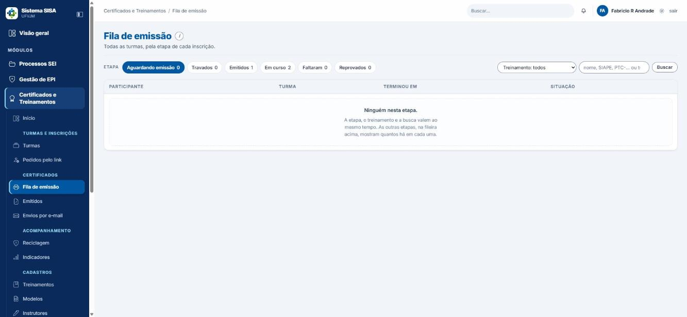
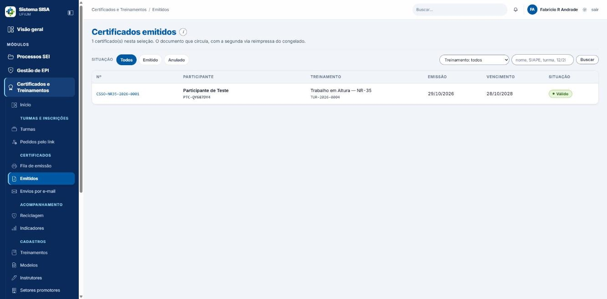

# Manual do usuário: Treinamentos, parte Certificados (Sistema SISA)

Este manual ensina a operar os certificados no dia a dia: emitir, enviar, consultar, baixar a segunda via, corrigir, anular, acompanhar vencimentos e validar um certificado. Todos os nomes de menus e botões aparecem entre aspas, como na tela. Os exemplos usam dados fictícios.

## Para quem é

- **Equipe que opera os certificados** (técnico de segurança, secretaria e coordenação): os capítulos 3 a 11.
- **Servidor ou participante**: capítulo 12 ("Meus certificados") e capítulo 11 (validação).
- **Qualquer pessoa, sem conta**: capítulo 11 (validação pública).

Este manual não trata de configuração do módulo nem de decisões de gestão.

## Antes de começar

### Acesso e perfis

O que você enxerga e consegue fazer depende do seu perfil.

| Perfil | Ver fila, emitidos, reciclagem, e-mails e indicadores | Emitir e enviar | Anular e corrigir | Modelos e Instrutores |
|---|---|---|---|---|
| Coordenador, engenheiro de segurança, médico do trabalho, superintendente | sim | sim | sim | sim |
| Técnico de segurança | sim | sim | **não** | sim |
| Secretaria | sim | sim | **não** | **não** (só lê o catálogo de Treinamentos) |
| Servidor comum | só "Meus treinamentos" e "Meus certificados" | não | não | não |
| Almoxarife e administrador de TI | sem acesso ao módulo, nem a "Meus certificados" | não | não | não |
| Consulta PROGEP e Auditor interno | sim, de todos os setores, **menos "Envios por e-mail"** (exige poder emitir) | não | não | não |
| Sem login | só a página pública de validação | não | não | não |

Se a tela mostrar "403" ou uma recusa, o seu perfil não tem essa permissão. Fale com a coordenação.

**Cada setor vê as turmas e os certificados do seu setor promotor.** Só a coordenação, a superintendência, a Consulta PROGEP e o Auditor interno enxergam os de todos os setores. Turma sem unidade promotora é tratada como da CSSO. Se a sua conta não está vinculada a nenhum setor promotor, as telas aparecem vazias e avisam: "Sua conta não está vinculada a nenhum setor promotor, por isso as turmas e os certificados dos setores não aparecem aqui. Peça à coordenação para vincular você ao seu setor." O perfil Administrador do sistema (acima do superintendente) tem todas as permissões e todos os setores; esse perfil não pôde ser testado.

### Regra do dono da turma

Quem emite, envia, anula e corrige os certificados de uma turma é:

- o **dono da turma** (quem a abriu);
- a superintendência (qualquer turma);
- a **coordenação do setor promotor da turma**, quando o dono tem nível abaixo dela (ou a turma não tem dono). Entre dois coordenadores, só o dono altera;
- os **ajudantes** que o dono designou com o papel "Emissão".

As demais pessoas da equipe só consultam. Se tentar alterar, aparece: "Só consulta. Esta turma é de <Nome>; só ele ou a coordenação acima pode alterar." Turma antiga, de antes da regra, diz "Esta turma não tem dono registrado (é de antes da regra de dono); só a coordenação do setor ou a superintendência pode alterar."

O ajudante só recebe os papéis "Inscrições", "Presença e notas" e "Emissão". **Concluir a turma, "Registrar turma já realizada", vincular instrutor e corrigir os dados da turma não se delegam**: são do dono e de quem está acima dele.

Ajudante com papel "Emissão" que seja do perfil técnico emite e envia, mas **não anula**, mesmo que o texto do papel diga o contrário.

Também não é possível anular nem corrigir um certificado em que você mesmo é o titular: "Este certificado é seu: anular ou corrigir o próprio certificado é ato de outra pessoa da equipe."

### Onde fica no menu

Menu "Certificados e Treinamentos":

- Início
- Turmas e inscrições: "Turmas", "Pedidos pelo link"
- **Certificados**: "Fila de emissão", "Emitidos", "Envios por e-mail"
- Acompanhamento: "Reciclagem", "Indicadores"
- Cadastros: "Treinamentos", "Modelos", "Instrutores", "Setores promotores", "Locais"
- Meu espaço: "Meus treinamentos", "Meus certificados"

A página "Validação de certificado" é pública e não exige login.

O "Início" mostra os passos na ordem do trabalho, cada cartão com a contagem do que está esperando (por exemplo "0 aguardando", "2 emitido(s)", "0 na fila").

## Sumário

1. Visão geral: do curso ao certificado
2. O que precisa estar pronto antes de emitir
3. Emitir pela turma (aba "Emissão")
4. Emitir pela "Fila de emissão"
5. Consultar certificados emitidos e abrir a ficha
6. Segunda via: baixar PDF ou Word
7. Corrigir um certificado e reemitir
8. Anular um certificado
9. Enviar certificados por e-mail
10. Reciclagem (vencimentos) e Indicadores
11. Validar um certificado (página pública)
12. Meus certificados (para o participante)
13. Modelos e Instrutores (para quem tem acesso)
14. Situações e o que significam
15. Erros e mensagens comuns
16. Glossário
17. Limites conhecidos

---

## 1. Visão geral: do curso ao certificado

O caminho completo é este:

1. O treinamento existe no catálogo, com instrutor e modelo de certificado.
2. A **turma** é aberta, o instrutor que assina é vinculado, os participantes são inscritos e a presença é lançada.
3. A turma é **concluída**.
4. O certificado é **emitido**, pela aba "Emissão" da turma ou pela "Fila de emissão".
5. O certificado é **enviado por e-mail** (opcional) e/ou o participante o baixa em "Meus certificados".
6. Qualquer pessoa pode **validar** o certificado pela chave impressa, e o sistema avisa quando ele estiver perto de vencer (Reciclagem).

Duas regras valem sempre:

- **A turma só emite depois de concluída.** O certificado atesta um curso que terminou.
- **Quem reprovou ou faltou não recebe certificado.**

## 2. O que precisa estar pronto antes de emitir

Confira nesta ordem. O sistema recusa a emissão se algo faltar, e a mensagem diz o quê (capítulo 15).

1. **Treinamento no catálogo** com nome, carga horária, validade da reciclagem, código curto e, de preferência, o "Modelo do certificado" apontado. Quem tem acesso a "Cadastros > Treinamentos" faz isso (a secretaria só lê). **O treinamento também tem dono** (quem o cadastrou): só o dono, a superintendência ou a coordenação acima dele (do mesmo setor) edita ou exclui. Para os demais a linha mostra "só consulta", e quem precisa trocar o modelo apontado pede ao dono ou à coordenação. O campo "Modelo do certificado" e o "Instrutor padrão" só existem em "Editar", não no cadastro novo.
2. **Instrutor que assina**, com rubrica quando houver, e com a assinatura em vigor na data em que você vai emitir.
3. Na turma, aba "Turma": instrutor vinculado com a opção "assina o certificado" marcada. Sem alguém marcado para assinar, a emissão é recusada.
4. **Unidade promotora** preenchida na turma. Ela define o prefixo do número do certificado (capítulo 3). Se ficar em branco, o prefixo sai "SISA".
5. Participantes inscritos, **com o e-mail conferido ANTES de inscrever** (veja o capítulo 17).
6. Presença e notas lançadas, na aba "Presença e notas".
7. Turma **concluída**, pelo dono da turma ou por quem está acima dele (ajudante não conclui): aba "Turma", botão "Concluir turma…", depois "Concluir e apurar os N". **Não tem volta.**
   - Atalho para turma de um dia que já passou: "Registrar turma já realizada". Ele marca todos presentes pela carga inteira e conclui.
8. Se o modelo do certificado exigir CPF do participante, informe-o na aba "Inscrições": na linha da pessoa, botão "CPF" (vira "CPF ✓" quando já tem), digite e clique em "Gravar". O CPF nunca aparece em tela (aparece como `***.***.***-**`); só sai no documento.

## 3. Emitir pela turma (aba "Emissão")

Use quando você está cuidando de uma turma só.

1. Abra "Turmas e inscrições" > "Turmas" e entre na turma.
2. Abra a aba **"Emissão"**.
3. Para emitir uma pessoa, clique em **"emitir"** na linha dela. Para emitir todos de uma vez, clique em **"Emitir os N agora"**.
4. Confira a mensagem de resultado. Quem não pôde ser emitido fica com o motivo na linha.

O que você recebe: um certificado com número, chave de validação e vencimento (quando o treinamento tem validade).

### Como é o número e a chave

- **Número impresso**: `SIGLA-CÓDIGO CURTO-ANO-SEQUÊNCIA`, por exemplo `SISA-NR32-2026-0001` ou `CSSO-NR32-2026-0003`. A sigla vem da unidade promotora da turma. Sem unidade promotora, a sigla é **SISA**.
- **Chave de validação**: o número impresso mais 5 caracteres, por exemplo `SISA-NR32-2026-0001-8E9K2`. As letras O, I, L e U não são usadas.
- **Vencimento**: data-base mais a validade do treinamento em meses. A data-base é o término da turma, a menos que a turma tenha outra data-base. Treinamento sem validade aparece como "não expira" na lista "Emitidos", "validade indeterminada" na ficha e na validação pública, e "Sem prazo de validade" em "Meus certificados". A data-base não pode ser anterior ao início da turma.

### Um certificado emitido não muda

O certificado guarda tudo o que foi impresso naquele dia (participante, treinamento, carga, período, local, instrutores, modelo). Mudar depois o catálogo, o modelo, o instrutor ou a rubrica **não altera** o papel já emitido. Para refletir uma mudança, é preciso corrigir ou reemitir (capítulos 7 e 8).

### Numeração

Cada certificado emitido gasta um número da sequência do ano, e **número gasto não volta**. Anular e reemitir gera novo número e nova chave. Por isso a sequência impressa pode ter "buracos". Isso é normal.

### Outros recursos da aba "Emissão"

- "Baixar todos em PDF" (turmas com o modelo padrão da casa) ou "Baixar todos em Word (.zip)" (turmas com modelo enviado pela equipe). Aparecem quando já há certificado emitido.
- "Enviar por e-mail os não enviados" (capítulo 9).
- "Reemitir os certificados…" (capítulo 7). **Só aparece para quem também pode anular** (técnico e secretaria não veem).
- **"Dados do certificado desta turma"** e **"Dados do certificado por participante"**: aparecem acima da lista quando o modelo da turma tem marcador "Campo da turma" ou "Campo do participante" (por exemplo, o local de atuação do brigadista). Preencha e clique em "Salvar" **antes de emitir**; o que vem marcado "(obrigatório para emitir)" trava a emissão se ficar vazio. Quem já tem certificado não muda aqui: anule e reemita. As alterações ficam listadas em "Alterações nestes dados".
- A faixa de aviso do modelo genérico ("... não tem modelo próprio — sai no modelo genérico ...") aparece uma vez no alto da aba.

## 4. Emitir pela "Fila de emissão"

*Fila de emissão, com as etapas de cada inscrição.*

Use quando quer ver todas as turmas juntas.

1. Abra "Certificados" > **"Fila de emissão"**.
2. Escolha a etapa pelas abas com contagem (veja abaixo). A etapa inicial é **"Aguardando emissão"**.
3. Se quiser, use "Filtrar por treinamento" ou a busca "Nome, SIAPE, PTC-… ou turma" e clique em "Buscar". A busca por CPF não existe.
4. Na etapa "Aguardando emissão", marque as pessoas. Cada linha mostra "pronto para emitir".
5. Clique em **"Emitir os certificados marcados"**.

Atenção ao aviso da tela: "Cada certificado consome um número da sequência do ano, e número consumido não volta. Desmarque quem não deve sair agora."

### As etapas da fila

| Etapa | O que mostra |
|---|---|
| Aguardando emissão | Aprovados em turma concluída, sem certificado, que a emissão aceitaria agora |
| Travados | Aprovados que a emissão recusaria. O motivo aparece na linha |
| Emitidos | Quem já tem certificado, com o número (link para a ficha) e o último envio |
| Em curso | Inscritos de turma que ainda não terminou |
| Faltaram | Não recebem certificado |
| Reprovados | Não recebem certificado |

### Resultado da emissão

- Sucesso: "N certificado(s) emitido(s)." Se alguém travou, vem junto ", M travado(s) — o motivo está abaixo." e o bloco "Travados nesta emissão", com turma, PTC e motivo.
- "Nenhum dos marcados pôde ser emitido. O motivo de cada um está abaixo."
- "Marque quem vai receber o certificado." (você não marcou ninguém)
- "N marcado(s) já não estava(m) apto(s) na fila (certificado já emitido, resultado mudado ou fora do seu escopo) — atualize a lista."

Se você não é o dono da turma (ou ajudante com papel "Emissão"), a fila ainda mostra "pronto para emitir", mas a emissão é recusada com a frase do dono da turma. Peça ao dono, ou à coordenação, que emita.

## 5. Consultar certificados emitidos e abrir a ficha

*Certificados emitidos.*

### A lista "Certificados emitidos"

Menu "Certificados" > **"Emitidos"**.

Colunas: Nº, Participante (nome e PTC), Treinamento (e turma), Emissão, Vencimento, Situação.

Filtros:
- Pílulas "Todos", "Emitido", "Anulado".
- "Filtrar por treinamento".
- Busca por "Nome, SIAPE, PTC-…, turma, número ou chave". Não diferencia acento nem maiúscula.

Pontos de atenção:
- **Não existe busca por CPF.** A tela avisa e não filtra.
- Pelo número impresso, busque **o número completo** (por exemplo `SISA-NR32-2026-0001`) ou a **chave**. Não use "1/2026": esse formato procura o número interno do sistema, que é outro, e pode trazer o certificado errado. "nr32" sem o traço também não encontra.
- O filtro "Emitido" inclui os que já venceram. A situação "Vencido" é calculada no dia.
- O certificado **não nasce nesta tela**. Emite-se pela turma ou pela fila.

### A ficha do certificado

Clique no número. A ficha tem:

- cabeçalho com número, nome, treinamento, turma e situação;
- "O documento": número, chave, endereço público, datas, modelo e versão;
- "Segunda via": "Baixar PDF" e "Word (.docx)" (veja o capítulo 6 para o caso de modelo enviado sem conversor);
- "Envio por e-mail";
- "O que foi congelado", "Conteúdo programático congelado" e "O dicionário de tags congelado";
- "Trilha": o histórico de eventos do certificado;
- os botões **"Corrigir certificado"** e **"Anular certificado"**, só para quem pode e é dono da turma.

A trilha registra emissão, segunda via, anulação, retificação, envios e o CPF alterado (sem mostrar o valor). Abrir a ficha de outra pessoa fica registrado, por tratar de dado pessoal.

## 6. Segunda via: baixar PDF ou Word

1. Abra a ficha do certificado (capítulo 5).
2. Em "Segunda via", clique em **"Baixar PDF"** ou **"Word (.docx)"**.

Se o certificado estiver anulado, os botões mudam para **"Baixar cópia anulada"** e **"Word (.docx) anulado"**, e a cópia sai com a tarja "ANULADO em … — substituído por …".

Em certificado de **modelo enviado pela equipe**, quando o conversor de PDF do servidor não está ligado, a ficha mostra **só "Baixar Word (.docx)"** (e, no anulado, "Baixar cópia anulada" também entrega o Word). Não há botão de PDF nesse caso.

Observações:
- Cada download é registrado na trilha como "Segunda via de certificado".
- O PDF padrão da casa tem 2 páginas, paisagem: frente e verso (com o "Conteúdo programático"). Está em tamanho Carta, não A4. Para imprimir em A4, escolha "ajustar à página" na impressão.
- O nome do arquivo é `Certificado_<número>-<ano>_<TURMA>_<Nome>.pdf`. O número que aparece no nome do arquivo é o **número interno**, que é diferente do número impresso no papel (por exemplo, o certificado impresso `SISA-NR32-2026-0001` pode baixar como `Certificado_0003-2026_...`). O número impresso é o que vale; o do nome do arquivo serve só para organizar seus arquivos.
- Em turma com **modelo enviado pela equipe** (Word próprio), o PDF só fica igual ao Word se o conversor de PDF estiver ligado. Sem ele, a equipe só baixa o Word, e o participante, em "Meus certificados", baixa o PDF padrão da casa, com layout diferente. **O e-mail leva o anexo no mesmo critério da equipe: com conversor, PDF fiel; sem conversor, o Word (.docx), não o PDF.** Avise o participante do formato que ele vai receber.

## 7. Corrigir um certificado e reemitir

Use quando o certificado saiu com dado errado (nome de participante externo, organização, vínculo ou CPF). Quem pode: coordenação, engenharia, medicina do trabalho e superintendência, sendo dono da turma ou acima dele. Técnico e secretaria **não** corrigem.

1. Abra a ficha e clique em **"Corrigir certificado"**. O aviso diz: "Corrigir certificado anula este e emite o substituto, com número novo".
2. Preencha só o que mudou:
   - "Nome do participante", "Vínculo" e "Organização": só para participante **externo**. Para servidor, o nome vem do cadastro de servidores: "Servidor: o nome vem do cadastro de servidores. Corrija-o lá e volte aqui para reemitir."
   - "CPF (só se o certificado exigir)" ou "Novo CPF". Há a opção de apagar o CPF.
3. Escreva o **"Motivo da correção"** (obrigatório). Veja a dica no fim deste capítulo.
4. Clique em **"Corrigir e reemitir"**.

Resultado: "Certificado SISA-NR32-2026-0003 anulado e substituído por SISA-NR32-2026-0004 (corrigido: CPF)."

O que acontece:
- O antigo fica "Anulado", e a ficha dele diz "Foi substituído pelo certificado ... — é ele que vale".
- Na validação pública, o antigo informa que foi substituído.
- A correção também grava no cadastro. Se a pessoa tem outros certificados em vigor com o dado antigo, a mensagem avisa: "A pessoa tem mais N certificado(s) em vigor com o dado antigo; corrija cada um pela ficha dele."
- Se você não mudar nenhum dado, o sistema só reemite com o cadastro e o modelo de hoje.

### Mudou algo da turma (data, carga, local, unidade, data-base)?

1. Na aba "Turma", corrija os dados da turma concluída (exige um motivo).
2. Na aba "Emissão", clique em **"Reemitir os certificados…"**.
3. Escreva o motivo e clique em **"Anular e reemitir os N"**.

Isso anula e reemite todos os certificados em vigor da turma com os dados de hoje. Quem travar fica como estava, com o motivo na tela.

Corrigir **presença ou nota** de quem já tem certificado é recusado. O caminho é anular e reemitir.

### Dica sobre o motivo (vale também para anulação)

O motivo é texto livre e **fica registrado na trilha e na auditoria**. Escreva de forma objetiva (por exemplo, "CPF digitado errado na inscrição"), com mais de uma letra, e **não escreva nome, CPF nem dado de saúde**.

## 8. Anular um certificado

Use quando o papel não pode mais valer (emitido para a pessoa errada, em turma errada etc.). A anulação **não apaga** o certificado: ele continua consultável, com a marca de anulado. Quem pode: coordenação, engenharia, medicina do trabalho e superintendência. Técnico e secretaria **não** anulam.

1. Abra a ficha e clique em **"Anular certificado"**.
2. Escreva o **"Motivo da anulação"**.
3. Confirme.

Resultado: "Certificado SISA-NR32-2026-0001 anulado. Para reemitir, volte à turma e emita de novo."

O que acontece depois:
- A validação pública passa a responder "Anulado" (o motivo **não** é público).
- O número **não é devolvido**.
- O participante volta à "Fila de emissão", etapa "Aguardando emissão". Se emitir de novo, sai com **novo número e nova chave**.
- Atenção: se você anulou e depois emitiu de novo pela **fila** ou pelo botão "emitir" da aba "Emissão", o novo certificado **não é ligado** ao antigo. A ficha do anulado continuará dizendo "Nenhum substituto está apontado neste certificado...". Só "Corrigir certificado" (um certificado) e "Reemitir os certificados…" (a turma toda) fazem essa ligação. Se quiser que o antigo aponte para o novo, use um deles no lugar de anular e emitir.
- Se já havia um e-mail desse certificado esperando na fila, **ele não é cancelado sozinho**. Antes de anular, abra "Envios por e-mail" e clique em "Cancelar" nesse pedido (capítulo 9).

Mensagens: "Anular exige o motivo: é o único registro que sobra para quem receber o papel antigo e perguntar por que ele não vale mais." e "O certificado ... já está anulado."

## 9. Enviar certificados por e-mail

O e-mail leva o assunto "Certificado — <Treinamento>", o nome, o número, o link de validação e o certificado anexo em PDF. Quem envia: quem emite (dono da turma, ajudante com papel "Emissão", coordenação acima). A secretaria, quando é dona da turma ou ajudante, também envia.

**O envio vai para o e-mail registrado na inscrição do participante**, não para o cadastro atual do servidor. Veja o capítulo 17 sobre isso.

### Três lugares para enviar

1. **Ficha do certificado**, seção "Envio por e-mail": botão **"Enviar para <e-mail>"** (primeira vez) ou **"Enviar de novo para <e-mail>"**.
2. **Aba "Emissão" da turma**: **"Enviar por e-mail os não enviados"**.
3. **"Fila de emissão"**, etapa "Emitidos": marque os certificados e clique em **"Enviar por e-mail os marcados"**.

Mensagens do envio em lote:
- "Marque os certificados a enviar."
- "N certificado(s) na fila de envio; M já enviado(s) antes (reenvie pela ficha do certificado); K sem e-mail cadastrado." Podem vir também "N anulado(s) ou fora do seu escopo" e "N de turma que você só consulta (...)", que não saem.
- Se o e-mail do sistema ainda não estiver ligado, acrescenta: "O envio de e-mail ainda não está ligado: eles saem quando for configurado."

Mensagens na ficha: "O participante não tem e-mail cadastrado." e "Este certificado não pode ser enviado." (certificado anulado).

### A tela "Envios por e-mail"

Menu "Certificados" > **"Envios por e-mail"**. Mostra os contadores "N na fila · N enviado(s) · N com falha", as abas Todas, Na fila, Enviado, Falhou e Cancelado, e as colunas Pedido em, Para, Assunto e Situação.

Botões:
- **"Cancelar"**: tira da fila um e-mail na fila ou que falhou. Mensagem: "Envio cancelado."
- **"Tentar de novo"**: só para e-mail que falhou. Mensagem: "De volta à fila."
- **"Enviar a fila agora"**: aparece quando o e-mail está ligado.

Situações: **Na fila** (aguardando sair), **Enviado**, **Falhou** (o motivo aparece), **Cancelado**. O sistema tenta enviar até 5 vezes, com espera maior a cada tentativa, antes de marcar "Falhou". Se o e-mail do sistema estiver desligado, aparece a faixa "O envio de e-mail não está configurado. Os pedidos ficam na fila e saem quando o SMTP for ligado..." e tudo fica "Na fila". Cada setor vê só a caixa das suas turmas.

Mensagens de recusa: "Só e-mail que falhou volta para a fila.", "Só e-mail na fila ou que falhou pode ser cancelado.", "E-mail não encontrado." (a turma é de outro setor).

### Cuidados com o envio

- "Já enviado" inclui o que **ainda está só na fila**. Confira a situação em "Envios por e-mail" antes de concluir que o participante recebeu.
- "Enviar de novo para..." na ficha cria **um segundo e-mail na fila**, sem avisar. Se já existe um pedido "Na fila", prefira esperar ou cancelar o duplicado.
- O **aviso de reciclagem** (capítulo 10) usa a mesma fila e conta como "enviado" para a ficha e para o envio em lote. Por isso você pode ver "já enviado(s) antes" para quem nunca recebeu o certificado em si. Confira o assunto na tela "Envios por e-mail": o certificado tem o assunto "Certificado — <Treinamento>" e o aviso de reciclagem tem "Reciclagem — <Treinamento>".

## 10. Reciclagem (vencimentos) e Indicadores

*Reciclagem: quem está válido, a vencer ou vencido.*

### Reciclagem

Menu "Acompanhamento" > **"Reciclagem"**. A tela mostra uma linha por pessoa e treinamento, do vencimento mais próximo ao mais distante. Treinamento sem validade não entra.

Abas com contagem: **"Válido"**, **"A vencer (60 dias)"** e **"Vencido"**. A janela é de **60 dias**, embora alguns textos do menu e do Início ainda digam 30 dias. Há filtro por treinamento e busca por "Nome, lotação, curso ou turma".

Colunas: Vencimento, Situação, Participante (PTC), Lotação, Treinamento (turma), Certificado (número e "emitido em").

Para avisar por e-mail quem está perto de vencer:
1. Marque as pessoas. Só as linhas "A vencer" e "Vencido" têm caixa de marcação (as "Válido" não); os "a vencer" já vêm marcados, os vencidos não. Quem já foi avisado aparece com a marca "avisado".
2. Clique em **"Avisar por e-mail os marcados"**.

Cada certificado é avisado **uma vez**. Mensagens: "Marque quem vai receber o aviso.", "N aviso(s) de reciclagem na fila de envio; M sem e-mail cadastrado..." e "0 aviso(s) de reciclagem na fila de envio; 1 já avisado(s) antes." Podem vir também "N anulado(s), que não recebe(m) aviso", "N sem vencimento (treinamento que não expira)" e "N fora do seu escopo ou inexistente(s)".

Quem tem permissão de gerenciar treinamentos também vê "Configuração: aviso automático por e-mail" (ligar ou desligar). Isso é decisão da gestão. Quem já estava na janela antes de ligar não recebe.

Limitações que afetam o uso:
- **A tela mostra o "último certificado emitido"** de cada pessoa e treinamento, não o do curso mais recente. Se você emitir hoje um certificado de uma turma antiga, ele passa a ser o "em vigor" e a pessoa pode aparecer **"Vencido"** mesmo tendo outro certificado mais novo e válido. **Emita as turmas na ordem cronológica** para evitar isso.
- A tela **não mostra quem nunca fez** o treinamento, apesar do resumo do módulo sugerir isso.

### Indicadores

Menu "Acompanhamento" > **"Indicadores"**. Filtros: "Período" (Ano atual, Ano anterior, Todo o período, De… até…), "De", "Até" e "Setor promotor". O recorte vale pela **data de início da turma**.

Cartões: Turmas (com canceladas), Turmas ativas, Turmas concluídas, Participantes, Aguardando confirmação, Certificados emitidos (sem os anulados), Pendentes de emissão (aprovados sem certificado), Faltas, Taxa de aprovação. Mais "Turmas por setor promotor" e "Treinamentos com mais participantes".

O padrão é "Ano atual": turma de ano anterior some. Use "Todo o período" para ver tudo.

## 11. Validar um certificado (página pública)

Qualquer pessoa, **sem login**, pode conferir um certificado.

1. Abra a página **"Validação de certificado"** (ou leia o QR Code do papel, que já abre a página certa).
2. Digite a **"Chave de validação"** e clique em **"Validar"**. Maiúsculas, espaços e traços não importam.

### Possíveis respostas

- **Válido**: "Certificado <número> — Válido — Certificado autêntico..." com Treinamento, Norma de referência, Carga horária, Término do treinamento, Vencimento (ou "validade indeterminada"), Instrutor(es), Emissor (o setor, por extenso), Participante (apenas o **código PTC**) e a Chave. A página **não mostra o nome**, e-mail, SIAPE, nota nem frequência. Se estiver vencido, mostra "Vencido".
- **Anulado**: "Este certificado foi anulado. Ele existiu e foi cancelado — não use como comprovação." O motivo não é público. Se foi corrigido: "Ele foi substituído pelo certificado X, emitido com a correção."
- **Chave que não existe**: "Não foi possível confirmar este certificado. A chave digitada (...) não corresponde a nenhum certificado emitido pelo Sistema SISA." Confira a digitação (as letras O, I, L e U não são usadas nos cinco caracteres finais; nas chaves antigas, que começam por CSSO- e o ano, a regra vale para a chave inteira). Digitar só o número, sem os 5 caracteres finais, não basta: use o código completo.

### Conferir o titular

Para confirmar que o certificado é de uma pessoa específica, use **"Confira o titular"**: digite o "Nome que consta no certificado" e clique em **"Conferir o nome"**. A resposta é apenas **"Confere."** ou **"Não confere"**. Acentos, maiúsculas e partículas não importam, mas é preciso o **nome completo**.

### Limite de consultas

Há um limite de consultas por endereço de rede (10 por minuto e 100 por hora). Passou disso, a página pede para esperar. Como a rede do campus pode sair com um endereço só, várias pessoas validando ao mesmo tempo podem ser barradas. Aguarde alguns instantes e tente de novo. Uma tentativa conta mesmo quando a chave é válida.

## 12. Meus certificados (para o participante)

Quem tem conta ligada a servidor ou participante vê os seus certificados em "Meu espaço" > **"Meus certificados"**.

A tela mostra "N certificados emitidos · N h de capacitação", com as abas **Todos**, **Válidos**, **A vencer** e **Vencidos**, filtro por ano e busca. Os cartões ficam agrupados por validade ("Sem prazo de validade", "Válido até …"). Em cada um: Norma, Período, carga, "Emitido em", o botão **"Baixar certificado"** (somente PDF), o "Conteúdo programático" e "Validar o certificado de ...", com o código e o link de validação ("Copiar link"). Certificados anulados ficam em uma seção à parte. "A vencer" usa a janela de 60 dias.

Abrir o certificado de outra pessoa leva de volta à sua própria lista.

### Comprovante de treinamentos

Para um documento único com tudo o que está em vigor, use o botão **"Comprovante de treinamentos"** no alto de "Meus certificados". É uma página feita para imprimir (Ctrl+P), com nome, lotação, campus, "Emitido em" e a lista de "Treinamentos em vigor", cada um com norma, número, validade e endereço de validação. Não traz CPF nem SIAPE.

### Sem conta (terceirizado, estudante, visitante)

Quem não tem conta pode pedir o acesso por e-mail na página de acesso a certificados. Nesta versão do manual, esse fluxo **não foi testado**. Se a página disser "O acesso por e-mail está indisponível no momento. Peça o seu certificado diretamente ao setor que promoveu o treinamento.", faça exatamente isso.

## 13. Modelos e Instrutores (para quem tem acesso)

*Modelos de certificado.*

Estas telas são de cadastro, e a secretaria não as acessa. Aqui só o essencial para quem as usa no dia a dia.

### Modelos (Cadastros > "Modelos")

- **Cadastrar modelo**: botão "Cadastrar modelo". Informe "Nome do modelo", o "Arquivo do Word (.docx)" (até 4 MB) ou "Ou use um layout pronto", a "Orientação" e, se for o caso, o treinamento (vazio = genérico, serve a qualquer treinamento).
- **Marcadores**: no Word, escreva no lugar de cada dado um texto entre « e » (por exemplo «NOME COMPLETO DO PARTICIPANTE») ou `{{ nome }}`. Sem nenhum marcador, o cadastro é recusado com "Não achei nenhum marcador no documento...".
- **Mapa**: na ficha do modelo, em "Marcadores e dados", escolha **"O que vai no lugar"** de cada marcador e clique em **"Salvar"**. Com marcador sem dado, a emissão é recusada.
- **"Vazio bloqueia"**: se marcado, quem não tem aquele dado (por exemplo lotação de externo, ou CPF) fica travado na emissão.
- **"Baixar exemplo preenchido"**: gera o Word com dados de mentira, ótimo para conferir. O que não tiver dado sai como "[falta: …]".
- **"Publicar nova versão"**: cria a v2, v3 etc. A anterior vira "superada" e não se edita. O papel já emitido não muda.

Dois cuidados:
- **"Aplicar sugestões" pode ligar dados errados.** Dois «DD/MM/AAAA» viram "início" e "término" na ordem em que aparecem, e «DATA DE HOJE» pode ser ligada a "Lotação na data da turma", o que trava terceirizados. **Confira cada linha** e use "Baixar exemplo preenchido".
- **Modelo novo ou versão nova não vale sozinho.** O certificado usa o modelo apontado em Cadastros > Treinamentos > Editar > "Modelo do certificado". Sem apontamento, usa o genérico vigente (e a trilha registra um "Aviso" a cada emissão). Se o catálogo aponta uma versão superada, o certificado sai com esse layout, e a tela avisa. A ficha da versão nova diz "Nenhum treinamento emite com esta versão hoje." até alguém apontá-la.

### Instrutores (Cadastros > "Instrutores")

- **Cadastrar**: escolha o "Instrutor da UFVJM" (o nome vem do cadastro de servidores) ou marque "instrutor externo" e digite o nome. Preencha "Título de assinatura" e, se houver, Conselho, Registro, Organização, CPF e a vigência (início e fim). Vigência vazia significa "desde sempre" e "sem termo".
- **Rubrica** ("enviar rubrica"): imagem PNG ou JPEG (de preferência PNG com fundo transparente). Vale só para certificados emitidos **daqui em diante**.
- **Editar**: desmarcar "ativa" tira o instrutor das próximas turmas, mas turmas já vinculadas continuam assinando.
- **Excluir**: só quem nunca esteve em turma. Caso contrário: "<Nome> está em N turma(s): não se exclui. Desmarque “ativo”, ou feche a vigência...".
- **Qualificações**: comprovantes (PDF, PNG ou JPEG, até 4 MB). Sem qualificação, a turma só mostra um aviso e não bloqueia.

Dois cuidados:
- **A vigência é conferida na data da emissão**, não na data do curso. Se a vigência do instrutor já encerrou, a emissão trava ("a assinatura de <Nome> não vigora em DD/MM/AAAA"), mesmo para curso realizado quando ele ainda estava em vigor. Resolva em "Editar" o instrutor, reabrindo ou estendendo a vigência, e emita de novo.
- O cadastro aceita o mesmo instrutor **duas vezes** e aceita título em branco. Confira antes de salvar.

## 14. Situações e o que significam

| Situação | Onde aparece | Significado |
|---|---|---|
| Válido | Emitidos, Meus certificados, validação | Certificado em vigor |
| A vencer | Reciclagem, Meus certificados | Vence em até 60 dias |
| Vencido | Emitidos, Reciclagem, validação | Passou da data de vencimento. O certificado continua existindo |
| Anulado | Emitidos, ficha, validação | Cancelado. Não vale como comprovação |
| Aguardando emissão | Fila | Aprovado em turma concluída, pronto para emitir |
| Travados | Fila | Aprovado, mas a emissão recusaria. O motivo está na linha |
| Em curso | Fila | A turma ainda não terminou |
| Faltaram, Reprovados | Fila | Não recebem certificado |
| Na fila, Enviado, Falhou, Cancelado | Envios por e-mail | Estados do pedido de e-mail |

## 15. Erros e mensagens comuns

| Mensagem ou situação | O que significa | O que fazer |
|---|---|---|
| "TUR-… está em andamento. O certificado atesta um curso que terminou: conclua a turma na aba Turma antes de emitir." | Turma não concluída | Conclua a turma, depois emita |
| "Emissão bloqueada: <Nome> está reprovado(a)..." | Frequência ou nota abaixo do mínimo (75% de presença) | Não há certificado. Se o lançamento estava errado, a correção depende do que a turma permite |
| "a assinatura de <Nome> não vigora em DD/MM/AAAA" | Vigência do instrutor encerrada | Peça a quem cuida de Instrutores para ajustar a vigência |
| Instrutor sem "assina o certificado" | Ninguém marcado para assinar | Na aba "Turma", vincule o instrutor com a opção marcada |
| "o modelo exige e falta: CPF do participante" | O modelo pede CPF | Informe na aba "Inscrições" (botão "CPF" na linha da pessoa, "Gravar") e emita de novo |
| Campo "(obrigatório para emitir)" vazio em "Dados do certificado..." | O modelo pede um dado da turma ou do participante que ninguém preencheu | Preencha na aba "Emissão" e clique em "Salvar" |
| "Este certificado é seu: anular ou corrigir o próprio certificado é ato de outra pessoa da equipe." | Você é o titular | Peça a outra pessoa da equipe com permissão |
| "Esta turma não tem dono registrado..." | Turma antiga, sem dono | Só a coordenação do setor ou a superintendência altera |
| "Este treinamento é de <Nome>; só ele ou a coordenação acima pode alterar." | Você tentou editar o treinamento de outra pessoa no catálogo | Peça ao dono ou à coordenação |
| "o modelo exige e falta: Lotação na data da turma" | Participante sem lotação (comum em externos) | Peça a quem cuida de Modelos para tirar a exigência do modelo, ou informe o dado, se possível |
| "o modelo ... não tem nenhuma tag no dicionário" / "tem marcador sem linha no dicionário" | O mapa do modelo está incompleto | Avise quem cuida de Modelos (capítulo 13). A mensagem é técnica, mas o conserto é no mapa do modelo |
| "Só consulta. Esta turma é de <Nome>; só ele ou a coordenação acima pode alterar." | Você não é o dono da turma | Peça ao dono, a um ajudante com papel "Emissão" ou à coordenação |
| "Esta turma é de <Nome>..." na fila | O mesmo, descoberto só ao emitir | O mesmo |
| "A data base do vencimento não pode ser anterior ao início da turma." | Data-base errada | Corrija a data-base na turma |
| "O participante não tem e-mail cadastrado." | Sem e-mail na inscrição | Veja o capítulo 17 |
| "Nada foi alterado. CPF inválido..." | CPF com dígitos errados | Confira os 11 números |
| "Nada foi alterado. Corrigir exige o motivo..." | Motivo em branco | Escreva o motivo |
| "O certificado ... já está anulado." | Já foi anulado | Emita o novo pela turma, aba "Emissão" |
| Busca por "1/2026" traz outro certificado | O formato N/AAAA usa o número interno | Busque pelo número impresso completo ou pela chave |
| 403 em uma tela | Perfil sem permissão | Fale com a coordenação |

## 16. Glossário

- **Anular**: cancelar um certificado sem apagá-lo.
- **Chave de validação**: código que acompanha o número impresso e permite confirmar o certificado na página pública.
- **Congelado**: o que o certificado guardou no dia da emissão e que não muda mais.
- **Data-base do vencimento**: data de onde se conta a validade. Se não for informada, é o término da turma.
- **Dono da turma**: quem abriu a turma e responde pelos certificados dela.
- **Ficha**: a página de um certificado.
- **Modelo**: o arquivo Word que define o layout do certificado.
- **Número impresso**: o número que está no papel, por exemplo `SISA-NR32-2026-0001`.
- **Número interno**: número do sistema, diferente do impresso, que aparece em buscas no formato "N/AAAA" e no nome dos arquivos baixados.
- **PTC**: código que identifica o participante em telas e na validação pública, sem expor o nome.
- **Reciclagem**: nova capacitação antes do vencimento.
- **Trilha**: histórico de eventos do certificado (emissão, segunda via, anulação etc.).
- **Unidade promotora**: setor que promove a turma. Define o prefixo do número (CSSO, ou SISA quando não há unidade).

## 17. Limites conhecidos

Estes pontos afetam o uso hoje. Conhecê-los evita retrabalho.

1. **Servidor sem e-mail na inscrição nunca recebe o certificado por e-mail.** O e-mail do participante é copiado do cadastro do servidor só no momento da inscrição. Atualizar o e-mail depois no cadastro não corrige o participante, e uma turma já concluída não aceita nova inscrição. A ficha manda "Cadastre-o na inscrição da turma", mas não existe tela para isso depois. **Confira o e-mail de cada servidor antes de inscrevê-lo.** Quem ficou sem e-mail pode baixar o certificado em "Meus certificados".
2. **O aviso de reciclagem conta como "envio" do certificado** na ficha e no envio em lote (capítulo 9).
3. **"Já enviado" inclui e-mail ainda na fila**, e "Enviar de novo" na ficha duplica o pedido (capítulo 9).
4. **Anular não cancela e-mail já na fila.** Cancele antes em "Envios por e-mail".
5. **A Reciclagem usa o último certificado emitido**, não o do curso mais recente (capítulo 10). Emita as turmas em ordem cronológica.
6. **A Reciclagem não mostra quem nunca fez** o treinamento.
7. **A janela de reciclagem é de 60 dias**, mas alguns textos do menu e do Início dizem 30.
8. **Número "N/AAAA" na busca e o nome dos arquivos usam o número interno**, não o impresso.
9. **Prefixo SISA ou CSSO** depende da unidade promotora da turma. Preencha antes de emitir; depois, só reemitindo. O texto de ajuda do catálogo cita o formato `CSSO-...`, mas turma sem unidade promotora emite `SISA-...`.
10. **Cada anulação seguida de reemissão gasta um número** e gera nova chave.
11. **Anular e depois emitir de novo, pela fila ou pelo botão "emitir" da aba "Emissão", não liga o certificado novo ao antigo.** "Corrigir certificado" e "Reemitir os certificados…" fazem a ligação.
12. **Instrutor com vigência encerrada trava a emissão**, mesmo para curso realizado dentro da vigência. A vigência é conferida na data da emissão.
13. **Modelo novo ou versão nova só vale depois de apontado no cadastro do treinamento.**
14. **"Aplicar sugestões" do mapa do modelo pode ligar dados errados.** Confira linha a linha.
15. **Quem não é dono da turma vê "pronto para emitir" na fila**, mas a emissão é recusada.
16. **Anulação e correção aceitam motivo muito curto**, até uma letra, e o texto fica na trilha. Escreva um motivo claro e sem dado pessoal.
17. **Tela de Instrutores** menciona o sistema anterior (IntegraSST/Google Drive); ignore, é texto antigo.
18. **O PDF padrão é em tamanho Carta**, não A4.
19. **Modelo enviado pela equipe sem conversor de PDF**: a equipe e o e-mail entregam o Word; o participante, em "Meus certificados", só consegue o PDF padrão da casa, com layout diferente do Word.
20. **A validação pública limita as consultas** por endereço de rede, o que pode atingir várias pessoas do campus ao mesmo tempo.
21. **Certificados antigos** (anteriores a 22/10/2026) exibem o número no formato `27/2026`.
22. **Partes não verificadas nesta versão**: o envio real de e-mail, o acesso a certificado sem conta por e-mail, a fidelidade visual do PDF de modelo enviado e certificados de outros setores promotores. Se algo se comportar diferente do descrito, avise a coordenação.
