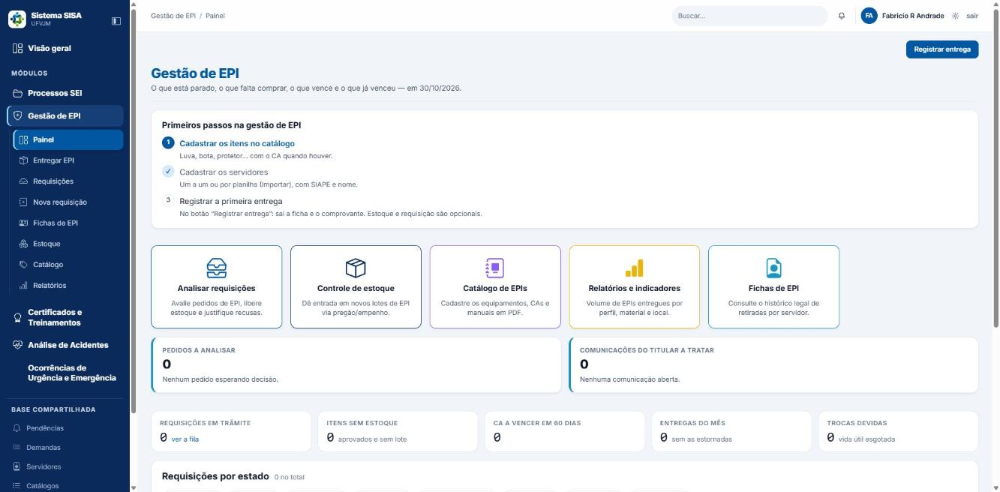

# Manual do Usuário — Gestão de EPI (Sistema SISA)

## Para quem é este manual

Para quem usa o módulo **Gestão de EPI** no dia a dia:

- **Servidor**: pede EPI, acompanha o pedido, consulta a própria ficha e avisa quando perde ou desgasta um equipamento.
- **Secretaria**: abre pedidos para outros servidores e acompanha a fila (sem ver o nome do servidor).
- **Técnico de segurança, engenheiro e médico do trabalho**: analisam pedidos (aprovam, recusam ou indeferem).
- **Almoxarife e técnico**: dão entrada no estoque, separam, entregam, registram devolução, estorno e comprovante.

Este manual ensina "como faço X". Decisões de gestão e configuração ficam no manual do coordenador.

## Antes de começar

- Entre no Sistema SISA com o seu login. No menu lateral, abra o módulo **Gestão de EPI**.
- O que você vê no menu depende do seu perfil. Se um item não aparece, ou a tela mostra "somente leitura", falta a permissão para aquela tarefa. Fale com a coordenação.

| Perfil | O que pode fazer no módulo |
|---|---|
| Servidor | Pedir EPI, ver os próprios pedidos, ver a própria ficha, consultar o catálogo (só leitura) |
| Secretaria | Abrir pedidos, ver a fila e o Painel (sem nome do servidor, sem fichas), ver Relatórios |
| Médico do trabalho | Pedir, analisar pedidos, ver fichas e Relatórios |
| Engenheiro de segurança | Pedir, analisar, cuidar do catálogo, ver fichas e Relatórios (não entrega e não mexe em estoque) |
| Almoxarife | Estoque, entrega, devolução, estorno, comprovante, fichas (não pede, não analisa, não vê Relatórios) |
| Técnico de segurança, coordenador e superintendente | Tudo do módulo |
| Auditor interno e Consulta PROGEP | Somente leitura: pedidos, fichas e Relatórios |
| Administrador do sistema (TI) | Sem acesso ao módulo (a tela responde "403") |

- Se você é servidor e a tela "Minha ficha de EPI" disser que a conta não está ligada a um cadastro de servidor, vá em **Meu perfil** e use **Sou servidor da UFVJM**, informando seus dados. A ligação é feita na hora.
- Nunca digite CPF, CID, diagnóstico ou detalhe clínico em campos de texto. O sistema recusa vários desses termos, mas não todos (ver seção 16).
- Quem pode ler uma tela mas não alterá-la (o Catálogo, por exemplo) vê a etiqueta "somente leitura" e nenhum botão de edição. O Estoque e as fichas só abrem para quem tem permissão: o servidor comum recebe "403" se tentar abrir o Estoque ou a lista de Fichas.

## Sumário

1. O menu do módulo
2. Painel
3. Pedir EPI (Nova requisição)
4. Acompanhar e cancelar o pedido
5. Analisar um pedido
6. Separar e entregar o pedido (almoxarife)
7. Entregar EPI no balcão
8. Fichas de EPI e comprovante
9. Devolução, estorno e comunicação de perda
10. Estoque
11. Catálogo
12. Relatórios
13. Situações (estados) e o que significam
14. Erros e mensagens comuns
15. Glossário
16. Limites conhecidos

---

## 1. O menu do módulo

No módulo **Gestão de EPI** a barra lateral tem, nesta ordem:

1. **Painel**: requisições, falta de estoque, CA a vencer, entregas e trocas devidas.
2. **Entregar EPI**: entrega direta no balcão, sem pedido; imprime o comprovante.
3. **Requisições**: a fila de pedidos.
4. **Nova requisição**: pedido formal para análise (opcional; a entrega direta não depende dele).
5. **Minha ficha de EPI**: o que você recebeu.
6. **Fichas de EPI**: a prova de entrega de cada servidor.
7. **Estoque**: lotes e saldos.
8. **Catálogo**: itens, categorias e motivos de recusa.
9. **Relatórios**: indicadores.

O servidor comum encontra, no seu "Meu espaço", o bloco EPI com **Minha ficha de EPI**, **Meus pedidos de EPI** e **Pedir EPI**.

---

## 2. Painel

*Painel da Gestão de EPI.*

Abra **Painel**. O título é "Gestão de EPI". Os números são calculados na hora em que a tela abre; nada é gravado.

**Equipe** (quem não é servidor comum) vê:

- Atalhos conforme a permissão: "Analisar requisições" (com contador "N novas"), "Controle de estoque", "Catálogo de EPIs", "Relatórios e indicadores", "Fichas de EPI". No alto há o botão **Registrar entrega**.
- Cartões: **Pedidos a analisar**, **Comunicações do titular a tratar**, **Requisições em trâmite**, **Itens sem estoque**, **CA a vencer em 60 dias**, **Entregas do mês**, **Trocas devidas**. O "i" de cada cartão explica a regra.
- Gráfico **Requisições por estado**: cada barra leva à fila já filtrada.
- Tabelas: **Trocas devidas**, **Itens esperando estoque**, **CA a vencer**, **Entregas do mês**.
- A secretaria vê o Painel sem nomes ("A lista nominal fica na ficha de cada servidor.").

**Servidor** vê "Meu EPI": cartões **Meus pedidos**, **Minhas trocas vencidas**, **Falta assinar**, a tabela "Últimos pedidos" e os botões "Fazer requisição", "Visualizar requisições" e "Ficha de EPI".

---

## 3. Pedir EPI (Nova requisição)

Vale para quem tem permissão de requisitar. O servidor pede por si. A equipe pode pedir por outro servidor.

### 3.1 Como fazer o pedido

1. No menu, clique em **Nova requisição** (o servidor também pode usar **Pedir EPI**).
2. Em "Quem vai usar o equipamento":
   - **Servidor**: o campo já vem preenchido e travado ("O pedido é seu. Para pedir por outra pessoa, fale com a sua chefia ou com a secretaria."). Abaixo aparece o seu cargo e a sua lotação; se estiverem errados, corrija em **Meu perfil**. Se o seu cadastro estiver sem cargo ou sem lotação, a tela pede os dois ("Seu cargo e sua lotação"), e o que você informar fica no seu cadastro.
   - **Equipe**: em **Buscar servidor**, digite o SIAPE e escolha a pessoa na lista. A busca por nome só funciona para quem pode ver identificação nominal; a secretaria deve usar o SIAPE (e vê os servidores como "SRV-xxxx"). Se a busca não achar ninguém, aparece o bloco **Cadastrar servidor agora** (SIAPE de 7 dígitos e Nome, botão **Cadastrar e escolher**); ele não aparece enquanto a busca encontra alguém. Se o SIAPE já existe, o sistema avisa e não duplica. Opcional: **Chefia responsável**. Se o cadastro do servidor escolhido estiver sem cargo ou lotação, a tela pede os dois ("Cargo e lotação de quem vai usar").
3. Escolha a **Finalidade**: Primeira entrega, Reposição de rotina, Substituição por desgaste, Dano ou Perda.
4. Escolha a **Urgência**: Normal ou Urgente. Se for Urgente, preencha **Por que é urgente** (obrigatório).
5. Preencha **O que você faz no trabalho** e **A que riscos você fica exposto**. Escreva só o necessário, sem diagnóstico, CID ou detalhe clínico.
6. Em **Equipamento**, escolha o EPI. Aparecem:
   - **Quantidade**, com o "Padrão do catálogo" e o máximo (por exemplo, "Máximo: 2 por 12 meses, contado pelo que já foi entregue");
   - **Tamanho** (quando o item tem tamanhos, é obrigatório: "pedir sem dizer qual é pedir o que não se pode separar da prateleira"), com o saldo por tamanho;
   - **Motivo do item**: Nova função / uso inicial; Substituição: desgaste natural; Substituição: dano ou quebra; Extravio ou perda;
   - **Justificativa** (opcional, mas obrigatória em itens que a exigem).
7. Para pedir mais de um EPI, clique em **Salvar e acrescentar outro item**. O pedido fica como rascunho ("Rascunho salvo com '…'. Acrescente outros itens abaixo e envie quando terminar."). A regra da urgência (passo 4) vale também para salvar o rascunho.
8. Marque a caixa **Declaração (NR-06)** ("Li e declaro").
9. Clique em **Enviar pedido**.

**O que acontece depois:** a tela mostra "Pedido enviado ao SESMT com o protocolo EPI-AAAA-NNNN. Você acompanha a análise por aqui." O número do protocolo só nasce no envio. Lotação, cargo e função ficam congelados como estavam no dia do envio. Se você enviar a partir do rascunho (seção 3.2), a mensagem é "Pedido protocolado como EPI-AAAA-NNNN…". Um pedido recém-enviado fica **Enviada** até alguém da análise pegá-lo.

Você pode pedir mais do que o máximo do catálogo; quem analisa decide.

### 3.2 Rascunho

Enquanto não enviado, o pedido aparece como "Rascunho #n" (sem protocolo). Nele você pode:

- editar o cabeçalho (**Editar o cabeçalho**);
- acrescentar item (o mesmo item duas vezes é recusado);
- editar ou remover uma linha;
- **Excluir o rascunho** (some de verdade, sem gastar número de protocolo);
- **Enviar pedido** (a tela do rascunho tem a sua própria caixa "Li e declaro", que também precisa ser marcada).

Depois de enviado, o pedido é um documento: não se edita, só se cancela.

---

## 4. Acompanhar e cancelar o pedido

1. Abra **Requisições** (o servidor vê "Meus pedidos de EPI", só os seus).
2. Use as abas por estado ou a busca por protocolo, nome, SIAPE ou e-mail. **Nunca digite CPF**: a busca recusa.
3. Clique em **Abrir** na linha do pedido.

Na ficha do pedido você vê: "Quem pediu, e por quê", "Quem tocou, e quando", "Trâmite", "Itens do pedido" e "Histórico do pedido". Depois da análise aparecem o **Parecer da análise** e a decisão item a item, com o texto da recusa quando houver. Você também recebe aviso no sino quando há decisão a ler ou retirada disponível.

Abrir a ficha de um pedido que não é seu fica registrado (leitura nominal), porque ela mostra a rotina de trabalho e os riscos declarados.

**Cancelar o pedido:** abra o pedido, clique em **Cancelar o pedido** (na seção "Trâmite") e escreva o **Motivo** (obrigatório). Quem pode: o servidor que vai usar o equipamento, quem abriu o pedido e quem analisa pedidos. A secretaria só cancela os pedidos que ela mesma abriu. Vale para o pedido em Rascunho, Enviada, Em análise, Analisada ou Em atendimento. Itens ainda não entregues são cancelados e a reserva volta ao estoque. Pedido Indeferido ou Atendido não se cancela ("a resposta já foi dada").

**Cancelar só uma linha:** em **ações** da linha, **Cancelar a linha**, com motivo. Cancelar é desistência; recusar é decisão técnica de quem analisa.

---

## 5. Analisar um pedido

Para quem tem permissão de analisar (técnico, engenheiro, médico, coordenação). A regra do sistema é que ninguém analisa o pedido **em que é o próprio beneficiário** (a conta ligada ao servidor que vai usar o equipamento). O sistema não confere quem abriu o pedido: se você abriu o pedido para outro servidor, combine com a coordenação que outra pessoa o analise.

1. Em **Requisições**, abra o pedido (estado Enviada).
2. Clique em **Iniciar análise** (janela "Pegar para análise"). O pedido passa a **Em análise** com o seu nome.
3. Em cada item, clique em **ações** e escolha:
   - **Aprovar**: informe a **Quantidade aprovada** (em branco vale a quantidade pedida; não se aprova mais do que foi pedido, e zero não é aprovar) e, se quiser, a **Justificativa da decisão**; clique em **Aprovar item**. Se a soma passar do máximo do catálogo (contado pela ficha dos últimos meses), o sistema avisa. Para aprovar assim mesmo, marque **Autorizar a exceção ao máximo** e escreva a justificativa, que fica registrada com o seu nome.
   - **Recusar**: escolha o **Motivo do catálogo**, escreva o **Complemento** (obrigatório no motivo "Outro motivo") e clique em **Recusar item**. O texto do motivo é o que o requerente recebe.
   - **Cancelar a linha**: com motivo.
4. Quando todos os itens tiverem decisão e ao menos um estiver aprovado, clique em **Concluir análise** e, se quiser, escreva o **Parecer**. O pedido vira **Analisada**; passa a **Em atendimento** na primeira reserva ou entrega e a **Atendida** quando tudo sai. Qualquer analista consegue concluir a análise de um pedido que outro colega pegou (ver seção 16, item 10).

### Atalhos e outras saídas

- **Aprovar tudo como pedido**: aprova todos os itens na quantidade pedida e conclui, de uma vez. O botão aparece já no pedido **Enviada**, sem precisar de **Iniciar análise** (quem clica assume o pedido). Tudo ou nada: se algum item passar do máximo, a operação inteira é recusada, nada é aprovado e o pedido continua como estava; decida então item a item.
- **Indeferir o pedido inteiro**: só vale com a análise iniciada e **nenhum** item aprovado. Informe o motivo, o complemento e o parecer. Itens sem decisão são recusados com o mesmo motivo.
- **Devolver à fila**: escreva o **Motivo**. O pedido volta a Enviada e outro analista pode pegá-lo.
- **Reabrir para análise** (pedido Indeferido; botão que abre a janela "Reconsiderar", com motivo): veja os limites na seção 16. Não conte com isso para mudar uma recusa. Se reabriu por engano, use **Devolver à fila** ou cancele o pedido.

**Atenção:** depois de **Concluir análise**, uma aprovação não pode ser corrigida. Só dá para cancelar a linha ou o pedido. Confira quantidades antes de concluir.

---

## 6. Separar e entregar o pedido (almoxarife)

Para quem tem permissão de estoque (separar) e de entregar. Na seção "Itens do pedido" aparecem os botões.

### 6.1 Separar (reservar) o lote

A reserva só vale depois da análise concluída (pedido **Analisada** ou **Em atendimento**). Ela é opcional: um item **Aprovado** também pode ser entregue direto (seção 6.2), escolhendo o lote na hora. Reservar serve para garantir que outro pedido não prometa o mesmo saldo.

- **Separar todos**: reserva cada item no lote que vence primeiro. A tela informa o que foi separado e o que faltou e por quê (por exemplo, "não há lote deste item no tamanho M no estoque").
- Por item, em **ações**, **Reservar lote**: informe **Quantidade** (pode ser menos do que o aprovado, nunca mais) e **Lote**.
- **Marcar como sem estoque**: use quando não há lote para o item aprovado; **Complemento** é opcional. Se existe lote com saldo, o sistema recusa e manda reservar o que houver, mesmo que seja menos do que o pedido.
- **Soltar reserva**: escreva o **Motivo**; o item volta a "Sem estoque".

Reservar não tira do estoque físico; apenas separa o saldo para aquele pedido. Lote com CA vencido, sem CA ou inativado não pode ser reservado.

### 6.2 Entregar

1. Em **ações** do item, clique em **Entregar**.
2. Informe **Quantidade**, **Lote** e **Observação** (a observação sai impressa no comprovante). Se o item está **Reservado**, a entrega tem de sair do lote reservado (o sistema recusa outro lote: solte a reserva com motivo e reserve no lote certo) e não pode passar da quantidade reservada. Se o item está só **Aprovado**, escolha o lote que saiu da prateleira. Evite deixar "Sem lote — entrega de balcão": nesse caso o estoque não é baixado (ver seção 16).
3. Se aparecer a caixa **Entrego mesmo sem treinamento em vigor**, marque só se a coordenação orientou a entregar assim. A confirmação fica registrada com o seu nome.
4. Confirme.

**O que acontece depois:** "Entrega registrada na ficha (registro N). Imprima o comprovante na ficha do servidor, colha a assinatura e anexe o digitalizado — sem ele a entrega tem registro e não tem prova." A entrega grava a linha na ficha do servidor, baixa o lote e abre a pendência do comprovante assinado (prazo de 10 dias). Imprima o comprovante na ficha (seção 8). O pedido só aceita entrega enquanto estiver **Analisada** ou **Em atendimento**.

Entrega parcial é permitida: cada entrega tem registro e comprovante próprios. O pedido fica **Em atendimento** até tudo ser entregue e vira **Atendida** sozinho.

### 6.3 Guia de entrega

Na ficha do pedido, clique em **Imprimir guia** (o botão só existe depois que há item aprovado; abre outra aba) e, na guia, em **Imprimir**. A guia é uma página para imprimir do navegador (não é Word). A impressão fica registrada. É uma folha de conferência no balcão (quem recebe, o que foi decidido, quanto falta entregar, linhas "Separou / Conferiu / Data"). **Ela não é a prova de entrega**; a prova é o comprovante da ficha. A guia mostra "Reservado" mas não indica o lote.

---

## 7. Entregar EPI no balcão

Para quem tem permissão de entregar. Não exige pedido.

1. No menu, clique em **Entregar EPI**.
2. Em "Buscar servidor", digite o SIAPE (o nome só funciona para quem pode ver identificação nominal) e escolha em **Quem recebe**; sem busca, a lista traz todos os servidores cadastrados. Se a busca não achar ninguém, aparece **Cadastrar servidor agora** (SIAPE com exatamente 7 dígitos e Nome, botão **Cadastrar e escolher**); cargo e lotação se completam depois na ficha. Quem não tem permissão de entregar não cadastra por aqui.
3. Escolha o **Equipamento**. Aparecem: **Quantidade** (com o padrão e o máximo do catálogo), **Tamanho**, **Data da entrega** (em branco vale hoje), **Lote de estoque**, **Justificativa da exceção ao máximo** (quando o item tem máximo) e **Observação** (sai impressa no comprovante; nada de saúde). Com lote escolhido, o CA que vale é o do lote; sem lote, é o do catálogo.
4. No **Lote de estoque**, escolha o lote do qual o EPI saiu. **Não deixe em "Sem lote — entrega de balcão" se existe lote com saldo**: assim o estoque não baixa e você terá de acertar depois com **Ajustar**.
5. Clique em **Registrar entrega**.

**O que acontece depois:** "Entrega registrada (registro N). Imprima o comprovante, colha a assinatura e anexe o digitalizado." A ficha do servidor se abre.

### Avisos que podem aparecer

- **CA vencido**: não se entrega. Se o vencido é o do lote, escolha outro lote. Se é o do catálogo, a mensagem traz o link "Corrigir o CA deste item no catálogo"; quem não tem permissão de catálogo deve avisar o responsável.
- **Máximo atingido**: "… já recebeu 2 de '…' nos últimos 12 meses, e o máximo é 2." Só entregue assim mesmo com uma justificativa por escrito no campo de exceção, que fica registrada com o seu nome.
- **Sem treinamento em vigor**: marque **Entrego mesmo sem treinamento em vigor** só com autorização, ou recuse com o motivo "Treinamento não comprovado".
- **Data da entrega**: não pode ser futura. Use a data real da entrega.

### Recusa fundamentada

Para negar fornecimento (por exemplo, a terceirizado, estudante ou bolsista), use a seção **Recusa fundamentada** da mesma tela: **Motivo** (da lista do catálogo), **A quem se dirige** (descreva o pedido, sem nome de quem não está no cadastro), **Unidade**, **Item pedido** e **Complemento** (obrigatório em "Outro motivo"); botão **Registrar recusa**. Mensagem: "Recusa registrada com o motivo …". A recusa fica registrada e conta em Relatórios, mas não gera documento impresso.

---

## 8. Fichas de EPI e comprovante

### 8.1 Ver fichas

- **Servidor**: abra **Minha ficha de EPI**.
- **Equipe com permissão**: abra **Fichas de EPI**, busque por nome ou SIAPE e clique em **Abrir ficha**. Toda abertura da ficha de outra pessoa fica registrada.

Na ficha da equipe os cartões são **Registros**, **Sem comprovante**, **CA vencido no lote entregue** e **Troca devida**. Na **Minha ficha de EPI** do servidor são **Equipamentos recebidos**, **Falta assinar** (procure o SESMT para assinar o comprovante) e **Troca vencida**, com o link **Pedir troca**. Em ambas, a tabela com Equipamento, Data (e "troca: dd/mm/aaaa"), Evento (entrega, devolução, estorno, "registro corrigido"), CA · lote, Qtd., Entregou e Comprovante. Cada linha é congelada no ato da entrega e não é alterada nem apagada; correção se faz por estorno.

### 8.2 Imprimir o comprovante

1. Na linha da entrega, clique em **Imprimir**.
2. O sistema baixa um arquivo **Word (.docx)** (não é PDF), com o termo de responsabilidade e duas linhas de assinatura.
3. Imprima, colha a assinatura de quem recebeu e de quem entregou.

O arquivo traz os dados congelados da linha (quem recebeu, equipamento, CA, lote, tamanho, quantidade, data, previsão de troca, nota fiscal e a observação). Pode ser reimpresso; cada impressão fica na trilha de auditoria. O servidor comum não baixa o comprovante em branco (a tela responde "403"): ele assina o papel com o SESMT e vê "Falta assinar" na sua ficha até o digitalizado ser anexado.

### 8.3 Anexar o comprovante assinado

1. Digitalize o papel assinado (PDF, PNG ou JPEG).
2. Na linha da ficha, clique em **Anexar** (janela "Anexar o comprovante assinado") e escolha o arquivo.
3. Resultado: "Comprovante anexado (SHA-256 …). A entrega está completa." A coluna Comprovante passa a mostrar "Ver o assinado". Outro tipo de arquivo (por exemplo, texto) é recusado: "o arquivo enviado não é um PDF nem uma imagem PNG ou JPEG … nada foi anexado".

**Cuidado:** o comprovante não se troca. Confira o arquivo antes de enviar. Se anexar o arquivo errado, a única saída é estornar a entrega (ver seção 9), com as consequências descritas lá.

### 8.4 Troca devida

Quando a vida útil do EPI vence sem substituição, a ficha avisa "N item(ns) com troca vencida" e o servidor vê o botão **Pedir troca**, que abre um pedido já preenchido.

---

## 9. Devolução, estorno e comunicação de perda

### 9.1 Devolução (equipe)

1. Na linha da ficha, clique em **mais** e escolha a devolução (janela "Registrar devolução").
2. Informe **Quantidade**, **Data**, **Motivo** (Extraviado, Desgaste físico, Tempo de uso, Perda de eficácia, Alterações no trabalho, Desligamento ou mudança de lotação, Outro) e **Por que voltou** (obrigatório).
3. Confirme.

Resultado: "Devolução registrada (registro N) e o saldo voltou ao lote. A entrega continua na ficha: devolver não desfaz o que aconteceu." A entrega original continua na ficha. A devolução vira uma linha nova. A data não pode ser futura nem anterior à entrega. Só se devolve linha de entrega que não foi estornada. Se havia comunicação do servidor aberta para aquela linha, a devolução já a trata sozinha (não precisa usar **Tratar**).

**O saldo volta ao lote sempre que a entrega teve lote, seja qual for o motivo.** Isso vale também para "Extraviado" e "Desgaste físico": o sistema soma a unidade ao saldo do lote como se estivesse novamente na prateleira. Se o equipamento não voltou ao estoque utilizável (perdido, danificado, gasto), corrija o saldo logo depois em **Estoque > Descartar** (equipamento que voltou imprestável) ou **Ajustar** (contagem). Devolução de entrega feita "Sem lote" não mexe no estoque.

Atenção: confira você mesmo a quantidade da linha. O sistema só barra a devolução acima do que a pessoa tem em seu poder no total daquele item, não da linha.

### 9.2 Estorno (equipe)

Use quando o **registro foi lançado errado**.

1. Na linha, clique em **mais** e escolha **Estornar**.
2. Escreva o **Motivo** (obrigatório) e confirme.
3. Resultado: "Registro N estornado pelo registro M. A linha original continua na ficha, marcada." Aparece o aviso "O saldo do lote … não foi reposto", com o link **Ajustar o inventário do lote** (para quem tem permissão de estoque; os demais devem avisar o almoxarifado). A linha original fica marcada e uma nova linha aponta para ela.

Importante:

- O estorno **não devolve saldo** ao lote, porque o sistema entende que nada voltou da prateleira. Se a mercadoria não saiu de fato, acerte o saldo em **Estoque > Ajustar**.
- Registro que já teve devolução não pode ser estornado.
- Registro já estornado não se estorna de novo.

### 9.3 Comunicar perda ou desgaste (servidor)

1. Na sua ficha, na linha do equipamento, clique em **Comunicar** (só aparece em entrega vigente e sem comunicação aberta).
2. Na janela "Comunicar sobre o equipamento", em **O que aconteceu**, escolha a situação: Extraviado (não está mais comigo), Troca por desgaste físico, Troca por tempo de uso, Troca por perda de eficácia ou Troca por alterações no trabalho. Acrescente observação, sem dado de saúde.
3. Confirme. Aparece "Comunicação registrada… O almoxarifado foi avisado. Você pode retirá-la nas próximas 24 horas."
4. Se precisa de outro equipamento, use **Pedir a troca** (na própria linha, ou no aviso "Precisa de outro equipamento?"): abre um pedido já preenchido com o item, o tamanho e o motivo, ligado à comunicação.

Só há uma comunicação aberta por linha. Para desistir, use **Retirar**.

A comunicação **não altera a ficha nem o estoque**: a devolução ou o substituto são registrados à parte pela equipe.

### 9.4 Tratar a comunicação (equipe)

Quem tem permissão de entregar clica em **Tratar** (janela "Tratar a comunicação"), escreve "O que foi feito" e clica em **Gravar**. Mensagem: "Comunicação nº N tratada. A pendência do almoxarifado foi fechada." Registre a devolução ou a entrega do substituto separadamente (registrar a devolução da mesma linha já trata a comunicação). A equipe pode **Retirar** a comunicação a qualquer tempo; o servidor, só nas primeiras 24 horas.

---

## 10. Estoque

Abra **Estoque** (a equipe com permissão de ver lê; só quem tem permissão de estoque altera; o servidor comum não tem acesso).

**Lista:** use a busca ("Buscar por item, lote, empenho, pregão, CA ou fornecedor") e o botão **Buscar**. Os cartões mostram **Itens com lote**, **Unidades em estoque**, **Podem ser entregues hoje** e **Presas em lote impedido**. Cada lote mostra Físico, Reservado, **Disponível** (físico menos reservado) e Situação ("pode sair" ou o impedimento). Lote com CA vencido ou sem CA fica "impedido": mantém saldo, mas não sai nem se reserva.

### 10.1 Dar entrada em lote

1. Clique em **Dar entrada em lote**.
2. Em "A caixa que chegou": **Item do catálogo**, **Quantidade recebida**, **Tamanho** (obrigatório se o item tem tamanhos), **Data de entrada**, **Número do CA do lote**, **Validade do CA**, **Fabricação**, **Lote**.
3. Em "O papel da compra": **Pregão**, **Item do pregão**, **Empenho**, **Quantidade empenhada**, **Nota fiscal**, **Nº do ofício**, **Valor unitário (R$)**, **Fornecedor**, **CNPJ**, **Contato do fornecedor**, **Observação**.
4. Clique em **Dar entrada em lote**.

Resultado: "Lote X de '…' registrado com N em estoque." Se o mesmo item, lote e tamanho já têm entrada, o sistema recusa e orienta: chegou mais da mesma caixa, use **Ajustar**; é outra compra, informe a nota fiscal diferente. Se o lote nasce impedido, a mensagem traz "ATENÇÃO: o lote não pode ser entregue…". Se há pedido esperando aquele EPI, a mensagem avisa; a reserva não é automática, é preciso abrir o pedido e reservar.

**Confira tudo antes de gravar.** Depois de gravado não se corrigem CA, validade, lote, tamanho, item, quantidade nem empenho (ver seção 16).

### 10.2 Ajustar (inventário)

1. No lote, clique em **Ajustar**.
2. Na janela "Ajuste de inventário", informe **Contei** (quantas unidades você contou) e o **Motivo** (obrigatório).
3. Resultado: "Inventário registrado no lote …: -1, saldo agora N." Se a contagem confere com o saldo, o sistema avisa que não há ajuste a registrar.

### 10.3 Descartar

1. No lote, clique em **Descartar** (janela "Descartar do lote").
2. Informe a **Quantidade** e o **Motivo** (obrigatório). Não se descarta mais do que o saldo; se a prateleira discorda do sistema, use **Ajustar**. Resultado: "N unidade(s) descartada(s) do lote …".

### 10.4 Corrigir nota, contato ou situação

Clique em **Corrigir nota, contato ou situação**. Dá para alterar **Nota fiscal**, **Nº do ofício**, **Contato do fornecedor**, **Observação** e a caixa "lote ativo". Para inativar o lote, escreva o **Motivo da inativação**; inativar solta todas as reservas do lote. Lote não se exclui.

### 10.5 Extrato

Clique em **Extrato** para ver cada movimento do lote (entrada, saída, devolução, ajuste, descarte), com saldo depois, motivo, vínculo e quem registrou. Nenhuma linha do extrato se altera ou apaga.

---

## 11. Catálogo

Abra **Catálogo**. Há três abas: **Itens de EPI**, **Categorias (NR-6)** e **Motivos de recusa**. Quem não tem permissão de catálogo vê "somente leitura" e nenhuma ação de edição. Qualquer pessoa com permissão de ver pode baixar a foto e o PDF de orientação do item.

### 11.1 Itens de EPI (quem tem permissão de catálogo)

- **Cadastrar EPI**: preencha **Nome**, **Categoria (NR-6)**, **Unidade de medida**, "Exige Certificado de Aprovação (CA)", **Número do CA**, **Validade do CA**, **Quantidade padrão**, **Quantidade máxima** e **Período da máxima (meses)** (os dois andam juntos), **Vida útil (meses)**, fabricante, marca, modelo, CATMAT, e-Campus, **Tamanhos** (um por linha, ou "P, M, G"), **Normas**, **Descrição**, e as caixas de justificativa e de treinamento. Clique para gravar.
- **Editar**: na edição existe a caixa "ativo". Desmarcada, o item sai do pedido e do balcão.
- **Foto e orientação**: um arquivo por vez. Foto JPEG, PNG ou WEBP até 2 MB; PDF até 4 MB. O sistema confere o conteúdo, não só o nome.
- **Treinamentos**: **Vincular** ou **Desvincular** um certificado exigido para o item. Com o vínculo, a análise e a entrega mostram "sem treinamento em vigor" para quem não tem o certificado.

O sistema aceita cadastrar um CA já vencido sem avisar na hora; só a faixa vermelha da lista acusa depois. Confira a validade ao digitar.

### 11.2 Categorias e motivos de recusa

- **Categorias (NR-6)**: as nove categorias do Anexo I da NR-6 já existem; só se edita nome, ordem e referência (**Editar**, **Salvar**).
- **Motivos de recusa**: **Cadastrar** e **Editar**. O código usa letras maiúsculas, números e sublinhado e não se edita depois. Motivo não se exclui, só se inativa. Texto novo não reescreve negativa já emitida.

---

## 12. Relatórios

Abra **Relatórios** (perfis com permissão de indicadores; o almoxarife e o servidor não têm acesso).

1. Em **Recorte**, escolha um **Exercício** (2026 e os anos anteriores, até 2019) ou **Período livre** (De, Até) e clique em **Ver**.
2. Leia os blocos, nesta ordem: Peças entregues, Servidores atendidos, Entregue por EPI, Entregue por cargo, Entregue por categoria da NR-6, Recusas por motivo, Entregue por campus e por unidade, Custo por empenho, Recusas por unidade, Devoluções e extravios.
3. Para baixar, clique em **Exportar (CSV)** (arquivo com separador ";"). A secretaria não tem esse botão.

Observações: as células de entrega contam **servidores atendidos**, não peças (a quantidade de peças vem em cinza ao lado). Duas exceções: "Recusas por motivo" e "Recusas por unidade" contam **negativas** (dois pedidos recusados da mesma pessoa são duas), e "Custo por empenho" é de execução orçamentária e nunca é suprimido. "Extravios" são as devoluções cujo motivo codificado é "Extraviado". Quem não vê dados nominais (secretaria) enxerga "—" nas células com menos de 5 servidores. "Peças entregues" não conta entregas estornadas e não abate devoluções. "—" em custo significa lote sem valor informado.

---

## 13. Situações (estados) e o que significam

### Pedido

| Estado | Significado |
|---|---|
| Rascunho | Ainda não enviado; sem protocolo; pode ser editado ou excluído |
| Enviada | Aguardando alguém pegar para análise |
| Em análise | Um analista está decidindo item a item |
| Analisada | Análise concluída; vai a separação e entrega |
| Em atendimento | Começa na primeira reserva ou entrega; há itens sendo separados ou entregues |
| Atendida | Tudo entregue (muda sozinha) |
| Indeferida | Nenhum item foi concedido |
| Cancelada | Desistência, com motivo |

### Item

| Estado | Significado |
|---|---|
| Solicitado | Pedido, sem decisão |
| Aprovado | Concedido; falta separar |
| Recusado | Negado com motivo (situação final) |
| Reservado | Lote separado para o pedido |
| Sem estoque | Aprovado, mas sem lote disponível |
| Entregue | Já saiu (final) |
| Cancelado | Desistência (final) |

---

## 14. Erros e mensagens comuns

| Mensagem (resumo) | O que fazer |
|---|---|
| "Escolha o equipamento antes de enviar" | Escolha ao menos um EPI |
| "pedido urgente exige a justificativa da urgência" | Preencha "Por que é urgente" ou volte para Normal |
| "diga o motivo do item" | Escolha o "Motivo do item" |
| "marque a declaração do termo NR-06" | Marque "Li e declaro" |
| "O campo … menciona dado de saúde" (ou "contém termo proibido") | Reescreva sem diagnóstico, CID, gestação ou detalhe clínico. A mensagem manda marcar "confirmo que a menção é necessária", mas **as telas de EPI não têm essa caixa**: o texto só passa se for reescrito sem o termo |
| "A busca não aceita CPF" | Busque por protocolo, nome, SIAPE ou e-mail |
| "Transição proibida: …" ou "… exige a requisição analisada, e … está em …" | A ação não vale no estado atual do pedido ou do item; confira o estado |
| "… tem tamanho cadastrado (M, G): pedir sem dizer qual …" | Escolha o tamanho |
| "está reservado no lote …, e a entrega tem de sair dele" | Entregue do lote reservado, ou solte a reserva com motivo |
| "motivo do cancelamento é obrigatório" | Escreva o motivo |
| "ainda há item sem decisão" | Decida todos os itens antes de concluir |
| "nenhum item foi aprovado" | Aprove ao menos um item, ou indefira o pedido |
| "aprovar zero não é aprovar" | Para não conceder, use **Recusar** com motivo |
| Excesso do máximo na aprovação ou entrega | Só prossiga com exceção justificada por escrito |
| "o lote não pode ser prometido" / CA vencido | Escolha outro lote; avise o responsável pelo lote |
| "foram aprovados N… e a reserva pede M" | Reserve só o aprovado |
| "Escolha o lote da reserva" | Selecione o lote |
| "EPI com CA vencido não se entrega" | Use lote com CA válido; avise o catálogo se o CA do item venceu |
| "A entrega não pode ter data futura" | Use a data real |
| "… exige treinamento … quem recebe não tem certificado" | Confirme com autorização ou recuse por "Treinamento não comprovado" |
| "o registro N já tem comprovante anexado, e o comprovante não se troca" | Só estornando a entrega e registrando de novo |
| "está com N e a devolução registra M" | Devolva no máximo o que está com a pessoa |
| "estornar exige o motivo" / "já teve N devolvido(s)" | Escreva o motivo; registro com devolução se corrige por ajuste de inventário |
| "Não cadastrado: a matrícula SIAPE tem exatamente 7 dígitos, sem ponto nem traço" | Digite 7 números |
| "Não cadastrado: o SIAPE … já está cadastrado — busque por ele" | Busque pelo SIAPE na lista |
| "Pedido recusado: veio de outra origem" | Abra a página de novo pelo menu do sistema e repita |
| 403 / "somente leitura" | Falta a permissão; fale com a coordenação |

---

## 15. Glossário

- **CA**: Certificado de Aprovação do EPI; tem validade. CA vencido impede a entrega.
- **Lote**: caixa ou remessa recebida, com CA, validade, nota e empenho.
- **Físico / Reservado / Disponível**: o que existe, o que está prometido a pedidos, e a diferença.
- **Reserva**: separar um lote para um pedido, sem baixar o estoque.
- **Estorno**: corrigir um registro lançado errado, sem apagá-lo.
- **Troca devida**: vida útil do EPI esgotada sem substituto.
- **Comprovante**: documento assinado que prova a entrega; é anexado à ficha.
- **Ficha**: histórico de entregas, devoluções e estornos do servidor, congelado no ato.
- **Protocolo**: número EPI-AAAA-NNNN do pedido, criado no envio.
- **NR-6**: norma sobre EPI.
- **Empenho / Pregão**: documentos da compra que trouxe o lote.

---

## 16. Limites conhecidos

Estas situações existem hoje. Saiba delas para não perder tempo.

1. **Reabrir pedido indeferido não reabre as linhas recusadas.** O botão **Reabrir para análise** devolve o pedido a "Em análise", mas as linhas continuam Recusadas e não podem ser aprovadas. Para a pessoa ser atendida, abra um pedido novo.
2. **Lote com dado errado não se corrige.** Depois da entrada não se alteram CA, validade, lote, tamanho, item, quantidade nem empenho. "Corrigir nota, contato ou situação" mexe só em nota fiscal, ofício, contato, observação e situação. Se digitou errado, será preciso descartar o lote e dar nova entrada com nota fiscal diferente (o sistema bloqueia entrada repetida com a mesma nota). Não existe "renovar o CA". Confira antes de gravar.
3. **Aprovação concluída não se corrige.** Só se cancela a linha ou o pedido.
4. **Entrega de balcão sem lote não baixa o estoque.** O padrão do campo é "Sem lote". Escolha sempre o lote real.
5. **Devolução limitada pelo total em poder da pessoa**, não pela quantidade da linha. Confira a quantidade.
6. **Comprovante errado não se troca**; a saída é o estorno, que não devolve saldo ao lote (acerte em Ajustar se for o caso).
7. **A ficha pode mostrar "troca vencida" mesmo depois de entregue o substituto**, enquanto o cartão "Trocas devidas" do Painel já mostra 0. Considere o Painel como a situação atual e avise a coordenação se a divergência atrapalhar.
8. **Entrega com data antiga é aceita**, mesmo antes da entrada do lote. Use a data real; a troca prevista é calculada a partir dela.
9. **Filtro de dados de saúde é incompleto.** Alguns termos passam. Não escreva nada de saúde nos textos, mesmo que o sistema aceite.
10. **Pegar o pedido não é exclusivo.** Outro analista pode decidir itens de um pedido que está em análise com um colega; "Analisado por" mostra só quem assumiu. Combine entre a equipe.
11. **O comprovante sai em Word (.docx), não em PDF**, e o rodapé ainda diz "Sistema CSSO".
12. **A guia de entrega não traz o lote reservado**; confira o lote na tela do pedido.
13. **Algumas mensagens de erro são técnicas ou pouco precisas** (por exemplo, a de termo proibido fala de saúde mesmo quando o problema é CPF). Releia o campo apontado.
14. **No pedido, "Motivo do item" e "Finalidade" se repetem em parte.** Preencha os dois com coerência.
15. **Cadastro rápido de servidor** aceita qualquer SIAPE de 7 dígitos, sem conferência. Digite com cuidado, conferindo o número.
16. **Rascunhos de pedido** de outras pessoas aparecem na fila da equipe.
17. **E-mails do módulo estão desligados.** Não espere aviso por e-mail; acompanhe pela fila, pelo Painel e pelo sino de pendências.
18. **O Painel e os avisos não usam relógio**: os números são calculados quando a tela abre e as pendências nascem quando algo é registrado.
19. **A devolução sempre devolve saldo ao lote**, mesmo com motivo "Extraviado" ou "Desgaste físico". Depois de registrar, descarte ou ajuste o lote se o equipamento não está utilizável (seção 9.1).
20. **O aviso de dado de saúde manda marcar uma caixa de confirmação que não existe nas telas de EPI.** Reescreva o texto sem o termo.
21. **Entrega de pedido pode sair de qualquer lote do item enquanto o item não está reservado.** Depois de reservado, só do lote reservado.
