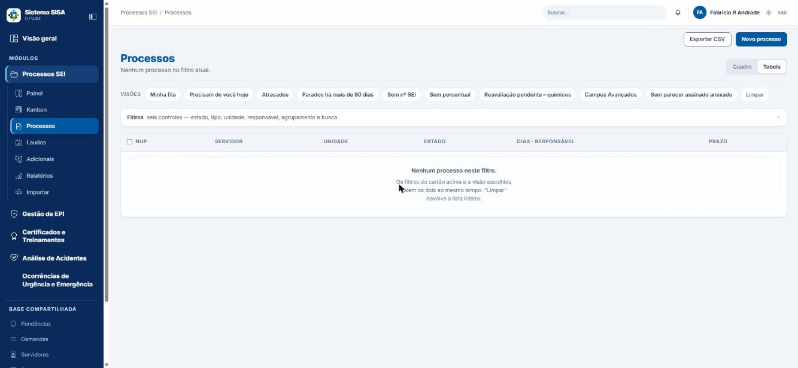
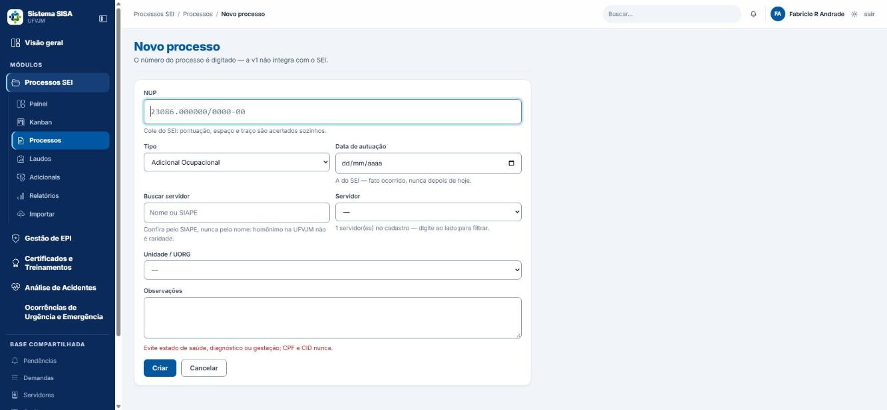
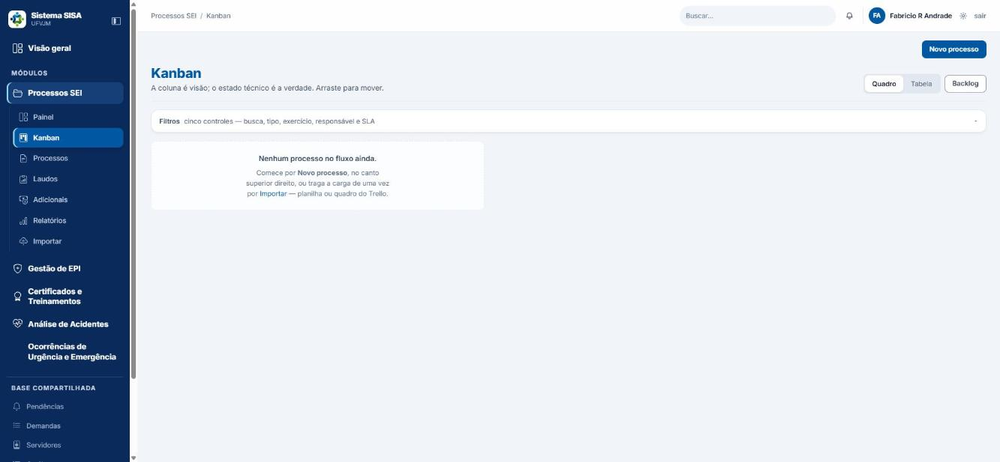
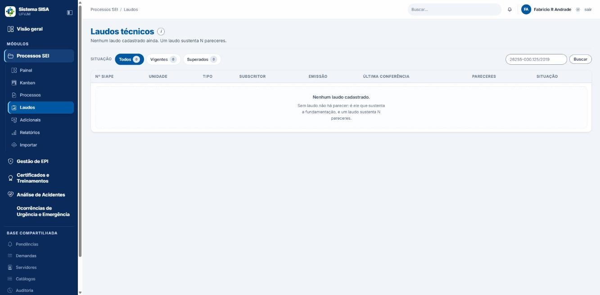
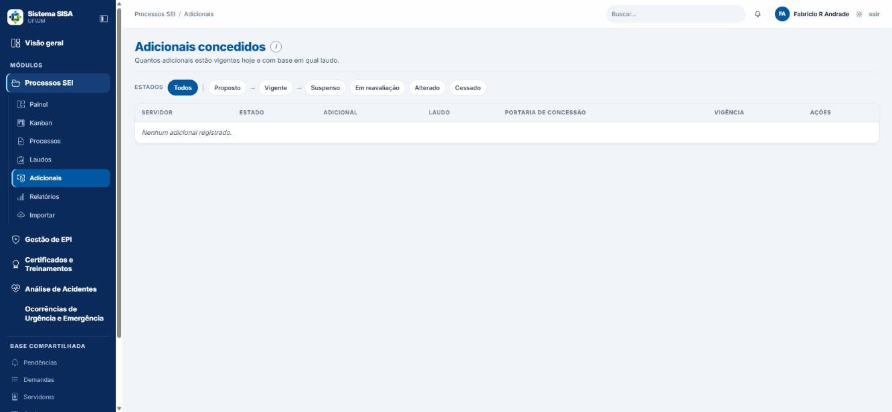

# Manual do Usuário — Módulo "Processos SEI" (Sistema SISA)

## Para quem é este manual

Para quem trabalha no dia a dia com os processos de adicional ocupacional (insalubridade, periculosidade, irradiação ionizante e raios X) e com os outros processos da Comissão (PGR, RITS, acidente, consulta, parecer técnico etc.): técnico de segurança, secretaria, engenheiro, médico do trabalho, coordenador e superintendente.

Este manual responde à pergunta "como faço X?". Decisões de gestão e configuração do sistema estão no manual do coordenador.

Os exemplos usam dados inventados.

## Antes de começar

### Como entrar

Entre no Sistema SISA com o seu login e escolha o módulo **Processos SEI**. O menu lateral mostra só o que o seu perfil pode abrir.

### O que o sistema é (e não é)

- O sistema **não conversa com o SEI**. O número do processo (NUP) é digitado por você, e o link do SEI é colado por você.
- O parecer técnico é escrito e numerado aqui, mas **assinado no SEI**. Aqui você só registra que foi assinado.
- O sistema **não gera PDF** do parecer. Ele gera um arquivo Word (.docx); você abre no Word, usa "Salvar como PDF" e sobe no SEI.

### Quem pode o quê

| Perfil | O que consegue fazer no módulo |
|---|---|
| Coordenador, engenheiro de segurança, médico do trabalho | Tudo do módulo. Cadastram laudo (precisam de habilitação técnica vigente). Assinam parecer só se forem o signatário, ou se substituírem declarando o motivo. Anulam parecer emitido ou assinado. |
| Técnico de segurança | Cria e instrui processos, move estados, anexa arquivos, escreve e emite parecer, propõe e concede adicional. **Não** cadastra laudo, **não** marca parecer como assinado e **não** anula parecer. |
| Secretaria | Cria e instrui processos, move estados, anexa arquivos. Só **lê** parecer e laudo. Não exporta a planilha (CSV). Não atribui responsável em lote. Não vê o nome do servidor (veja abaixo). |
| Superintendente | Como o coordenador, sem assinar parecer e sem cadastrar laudo (anula parecer, atribui responsável, importa e vê a Reconciliação). |
| Almoxarife e administrador de TI | Sem acesso às telas do módulo Processos SEI. |
| Servidor (consulta) | Sem acesso às telas do módulo. |

Importar e Reconciliação: só coordenador e superintendente.

### Atalhos de teclado

Fora de campo de texto: **Ctrl+K** abre a busca (a da lista, onde houver; senão a busca geral do sistema), **/** vai ao filtro da lista, **n** aciona o primeiro botão de "novo" da tela e **?** mostra a lista de atalhos. **Esc** limpa a busca, tira o foco do campo ou fecha uma janela. **Ctrl+B** recolhe o menu lateral.

### Privacidade: o que a secretaria vê

Quem tem o perfil de secretaria não lê o nome do servidor. Em vez do nome aparece um código como `SRV-0042`, e a busca é só pelo SIAPE. No **Histórico** do processo, as linhas aparecem como "Estado alterado — conteúdo suprimido". Isso é normal e proposital. Técnico, engenheiro, médico e coordenador veem nome e SIAPE, e cada leitura fica registrada.

### Quando aparece "403 — acesso negado"

Você tentou abrir uma tela ou fazer uma ação que o seu perfil não permite. A página cita o nome técnico da permissão que falta (por exemplo, "Permissão necessária: parecer.anular"). Nada foi alterado. Peça a quem tem o perfil adequado.

## Sumário

1. [Painel](#1-painel)
2. [Lista de processos](#2-lista-de-processos)
3. [Criar um processo novo](#3-criar-um-processo-novo)
4. [A ficha do processo](#4-a-ficha-do-processo)
5. [Mover o processo de estado](#5-mover-o-processo-de-estado)
6. [Anexos](#6-anexos)
7. [Checklist e comentários](#7-checklist-e-comentários)
8. [Ações em lote](#8-ações-em-lote)
9. [Kanban](#9-kanban)
10. [Laudos](#10-laudos)
11. [Parecer técnico](#11-parecer-técnico)
12. [Adicionais (o direito concedido)](#12-adicionais-o-direito-concedido)
13. [Pendências](#13-pendências)
14. [Demandas](#14-demandas)
15. [Relatórios](#15-relatórios)
16. [Importar e Reconciliação](#16-importar-e-reconciliação)
17. [Roteiro completo de um adicional, do início ao fim](#17-roteiro-completo-de-um-adicional-do-início-ao-fim)
18. [Estados do processo e o que cada um significa](#18-estados-do-processo-e-o-que-cada-um-significa)
19. [Erros e mensagens comuns](#19-erros-e-mensagens-comuns)
20. [Glossário](#20-glossário)
21. [Limites conhecidos](#21-limites-conhecidos)

---

## 1. Painel

**Onde:** menu "Painel" (é a tela inicial do módulo).

**O que você vê:**

- Cartões: "Em andamento", "Aguardando" (laudo, documento ou SEI), "Acima do SLA", "Concluídos em 2026", "Dias médios até a emissão", "Subscritores habilitados" e "Precisam de você hoje". Quem também opera o módulo Gestão de EPI vê ainda "EPI · pedidos a analisar" (atalho "Abrir a fila"), que pertence àquele módulo.
- Gráficos: "Pareceres emitidos por mês" e "Distribuição por tipo de risco".
- Blocos: "Laudos sem conferência" e "Últimos eventos".
- Botão **"Novo processo"** no topo.
- O sino **"Minhas pendências"** com o número de tarefas suas.

**Dicas:**

- "Acima do SLA" tem o link **"ver a fila"**: abre os processos que passaram do prazo de permanência no estado.
- "Precisam de você hoje" tem o link **"Ver todos"**. Entram aqui os processos acima do SLA ou ainda em "A fazer".
- "Laudos sem conferência" é fila de trabalho, não vencimento: o laudo não tem prazo de validade.

---

## 2. Lista de processos

*Lista de processos (aqui vazia, num ambiente de teste).*

**Onde:** menu "Processos".

### Ver a lista

A tela mostra "N processo(s) no filtro atual." Use o alternador **Quadro | Tabela** para trocar a forma de ver. Colunas: NUP, Servidor, Unidade, Estado, "Dias · responsável" (por exemplo, "95d · SLA 20d") e Prazo.

### Visões prontas

Clique em uma destas para filtrar de uma vez:

- "Minha fila"
- "Precisam de você hoje"
- "Atrasados"
- "Parados há mais de 90 dias"
- "Sem nº SEI"
- "Sem percentual"
- "Reavaliação pendente – químicos"
- "Campus Avançados"
- "Sem parecer assinado anexado"

Use **"Limpar"** para voltar à lista completa.

### Filtros

1. Preencha um ou mais campos: "Buscar (servidor, SIAPE, NUP, laudo)" (atalho Ctrl+K), "Estado técnico", "Tipo", "Unidade", "Responsável".
2. Se quiser, escolha "Agrupar por" (Estado técnico, Unidade, Responsável ou Tipo de processo).
3. Clique em **"Filtrar"**. Para zerar, clique em **"Limpar"**.

**Atenção:** os cartões que vieram do Trello ("Campus Avançados") ficam fora da lista padrão. Só aparecem pela visão "Campus Avançados".

---

## 3. Criar um processo novo

*Formulário "Novo processo".*

**Quem pode:** coordenador, engenheiro, médico, técnico, secretaria e superintendente.

### Passo a passo

1. Clique em **"Novo processo"** (no Painel ou na lista de processos).
2. Preencha:
   - **NUP:** cole o número do SEI. Pontuação, espaço e traço são acertados sozinhos. Formato: `23086.123456/2026-12`.
   - **Tipo:** Acidente em Serviço, Adicional Ocupacional (já vem escolhido), Aposentadoria Especial, Consulta Normativa, Parecer Técnico, PGD, PGR, Revezamento ou RITS.
   - **Data de autuação:** a data do SEI. É a data do fato ocorrido, nunca depois de hoje.
   - **Buscar servidor** e **Servidor:** confira sempre pelo SIAPE, nunca só pelo nome, porque pode haver homônimo. O servidor é opcional.
   - **Unidade / UORG:** muito importante. O laudo vale pela unidade; sem ela, o processo não chega a "Laudo emitido".
   - **Observações:** escreva só o necessário. Evite estado de saúde, diagnóstico ou gestação. CPF e CID nunca.
3. Clique em **"Criar"** (ou **"Cancelar"**).

### O que acontece depois

O processo nasce no estado **Recebido**, com você como responsável, e o sistema abre a ficha dele.

### Confira antes de criar

**O NUP e o tipo do processo não podem ser corrigidos depois** (veja "Limites conhecidos"). Um NUP já usado, até de processo arquivado, impede criar outro igual.

### Caixa "dígito verificador diverge, mas confirmei o número no SEI"

Use só se o sistema recusar o NUP por causa do dígito verificador e você tiver conferido o número no SEI. A escolha fica registrada com seu nome. O processo aparece depois em Importar > Reconciliação como NUP com dígito inválido.

### Erros nesta tela

| Mensagem | O que fazer |
|---|---|
| "NUP deve ter 17 digitos (encontrados 3): '123'" | Cole o número inteiro do SEI. |
| "NUP dígito verificador não confere confirme no SEI. Marque 'confirmei no SEI' para prosseguir." | Confira o número no SEI. Se estiver certo, marque a caixa. Se errado, corrija. |
| "NUP já existe processo com este NUP" | Clique em "Abrir o processo que já tem este NUP". |
| "Data de autuação: ... não pode ser posterior a hoje." | Use a data do SEI. |
| "O campo observações menciona dado de saúde (...)" | Reescreva sem dado de saúde. Só marque "confirmo que a menção é necessária" se for indispensável; a confirmação fica registrada. |

Quando a tela volta com erro, o que você digitou continua lá.

---

## 4. A ficha do processo

**Onde:** clique no processo na lista, ou abra `/processos/N`.

### O que há na ficha

No topo: nome do servidor (ou `SRV-xxxx`), NUP, tipo, estado e há quantos dias está nele. O botão **"Abrir no SEI ↗"** só aparece depois de salvar o link do SEI.

Abas: **Dados**, **Parecer**, **Anexos**, **Checklist** e **Histórico**.

### Aba Dados

- **Identificação:** NUP, servidor (e SIAPE), unidade, responsável, autuação, "Solicitação no SEST", prazo e observações.
- **Estado técnico:** o estado atual e o botão **"Mover de estado"**. Se faltar algo para sair do estado, aparece "Pendências para sair deste estado:" com a lista. Enquanto elas existirem, o sistema recusa a saída e nada é gravado.
- **Caminho até o SEI:** lembrete de como incluir o parecer no SEI (veja o capítulo 11) e o **"NUP para copiar"**.

### Corrigir dados

1. Em "Identificação", clique em **"Corrigir dados"**.
2. Altere o que precisar: trocar o servidor (busca e lista), "Unidade / UORG", "Data de autuação", "Solicitação no SEST" ou "Observações".
3. Clique em **"Salvar"**.

Resultado: "Dados do processo corrigidos." Cada campo alterado vira uma linha no Histórico. Se nada mudou: "Nada mudou: os dados já eram esses."

**Não se corrigem aqui:** NUP, tipo do processo e responsável.

### Salvar o link do SEI

1. Copie, no SEI, o "link para acesso direto" do processo.
2. Na aba Dados, clique em **"Salvar link do SEI"**.
3. Cole em "Link permanente no SEI". O link tem de começar com `https://sei.`
4. Salve. Mensagem: "Link do SEI salvo." Campo vazio remove o link.

Se der erro ("Link do SEI inválido: ele começa com https://sei. ..."), copie de novo o link direto no SEI.

### Aba Histórico

Mostra tudo o que aconteceu: processo criado, campo alterado, mudança de estado (com comentário), anexo enviado, pendência aberta, parecer emitido ou assinado, comentários. Saltos de etapa aparecem como "salto X -> Y".

---

## 5. Mover o processo de estado

**Quem pode:** coordenador, engenheiro, médico, técnico, secretaria e superintendente.

### Passo a passo

1. Na aba Dados, clique em **"Mover de estado"**.
2. Em **"Próximo passo"**, escolha o destino. A lista mostra só o que é permitido agora (mais "Sobrestar").
3. Se for avançar vários estados de uma vez: abra **"Avançar vários passos"**, escolha em "Ir direto para" e marque **"Confirmo pular etapas"**.
4. Para indeferimento técnico, escolha o **"Inciso do art. 11"** (veja o capítulo 18).
5. Escreva um **"Comentário"** se quiser (em alguns casos ele é exigido).
6. Clique em **"Mover"**.

Sucesso: `Processo movido para “Estado”.`

### Regras que você precisa saber

- **Cada tipo anda por um caminho.** O Adicional Ocupacional usa a cadeia longa (capítulo 18). Os demais tipos (inclusive Aposentadoria Especial) usam um caminho curto: Recebido, Em triagem, Pendente de documento, Concluído ou Arquivado. No caminho curto não há exigência de anexo para sair de nenhum estado; Recebido e Em triagem vão e voltam; dá para ir direto de Recebido a Concluído; Concluído só volta a Em triagem; não existe "Em recurso". No Kanban, o caminho curto põe "Em triagem" na coluna **Em andamento** (e "Recebido" em A fazer).
- **Não existe voltar atrás.** Não dá para voltar de "Inspecionado" para "Aguardando inspeção", nem de "Parecer assinado" para "Parecer em elaboração". Só dá para "Sobrestar".
- **"Arquivado" é definitivo.** Não tem saída e não reabre.
- **Depois de "Aguardando inspeção"**, o único caminho é "Inspecionado". Daí em diante não se arquiva nem se indefere a partir dali (veja "Limites conhecidos").
- **Alguns estados vêm sozinhos.** "Parecer pronto para assinatura" vem quando você emite o parecer; "Parecer assinado" vem quando o signatário marca "Marcar como assinado". **Só vêm se o processo ainda estiver atrás** e se as exigências do caminho estiverem cumpridas (se ele estiver mais atrás, o sistema tenta avançar os estados que faltam de uma vez). Se não puder avançar, o parecer é emitido (ou assinado) do mesmo jeito, o processo **fica onde estava** e a mensagem de sucesso não avisa. Depois de emitir ou assinar, olhe o estado na ficha; se não mudou, cumpra a exigência que falta e mova à mão. Isso acontece, por exemplo, quando o processo já está em "Parecer assinado" e se emite um parecer novo depois de anular o antigo: o processo não "volta".
- **Sobrestar** pausa o processo. Não pede motivo. Para retomar, escolha **"Voltar do sobrestamento"**: o processo volta ao estado em que estava.

### O que o sistema exige para sair de cada ponto

| Situação | Exigência |
|---|---|
| Sair de Recebido ou Em triagem (para qualquer lugar, exceto Arquivado, Sobrestado, Pendente de documento ou Em triagem) | Anexar a **"Portaria de localização"** e o **"Formulário"** (assinado pelo servidor e pela chefia, art. 17). Vale também para indeferir. |
| Sair de "Aguardando quantificação" | Anexar um **"Relatório de campo"** OU escrever, no comentário da mudança, a justificativa da avaliação qualitativa com **pelo menos 20 caracteres**. |
| Ir para "Laudo emitido" | Existir um laudo cadastrado em Laudos que sirva ao processo: laudo vinculado a ele, laudo usado por parecer dele (não anulado) ou laudo **vigente da mesma unidade** do processo. |
| Ir para "Parecer em elaboração" direto de Recebido/Em triagem (atalho por reúso de laudo) | Laudo **vigente** da unidade do processo. Fica registrado na trilha como "Reuso de laudo". |
| Indeferido tecnicamente | Escolher o inciso do art. 11, anexar portaria e formulário. |
| Ir para "Inserido no SEI" ou "Concluído" | Ter um parecer assinado no processo. |

### Erros comuns ao mover

| Mensagem | O que significa |
|---|---|
| "Transição proibida: Parecer em elaboração → Inspecionado. De “Parecer em elaboração” dá para ir a: ..." | Esse caminho não existe. A mensagem lista os destinos possíveis. |
| "Para avançar vários passos de uma vez, marque “Confirmo pular etapas”." | Você escolheu um destino à frente: marque a caixa. Atenção: a mesma frase aparece, de forma enganosa, se você tentar mover para o estado em que o processo **já está** ou para um estado sem saída. |
| "anexe a portaria de localização" / "anexe o formulário assinado pelo servidor e pela chefia (art. 17)" | Vá à aba Anexos e envie os dois arquivos com a categoria certa. |
| "“Laudo emitido” exige o laudo no sistema: cadastre-o em Laudos, na mesma unidade do processo" | Peça o cadastro do laudo a quem tem habilitação (capítulo 10) e confira a unidade do processo. |
| "“Parecer pronto para assinatura” vem da emissão: emita o parecer deste processo e ele avança sozinho" | Esse estado não se escolhe à mão. Emita o parecer. |
| "“Parecer assinado” vem da assinatura: marque o parecer como assinado ..." | Peça ao signatário para marcar o parecer como assinado. |
| "sem parecer assinado neste processo: ele só segue para o SEI e para a conclusão depois da assinatura" | Falta registrar a assinatura do parecer. |
| "indeferimento técnico exige o inciso do art. 11" | Escolha o inciso. |

---

## 6. Anexos

**Onde:** ficha do processo, aba **Anexos**.

### Enviar um arquivo

1. Clique em **"Enviar anexo"**.
2. Escolha o **"Arquivo"** (até 4 MB).
3. Escolha a **"Categoria"**: Parecer assinado, Laudo, Portaria de localização, Despacho, Formulário, Relatório de campo, Foto ou Outro.
4. Se tiver, preencha o **"Nº do documento SEI"**.
5. Confirme o envio. Mensagem: "Anexo enviado."

A tabela mostra: Arquivo, Categoria, Acesso (público ou restrito), SHA-256 e data de envio. Formulário e documentos sensíveis ficam como "restrito". Esse rótulo define por quanto tempo o arquivo é guardado; **não** muda quem consegue baixar (quem enxerga o processo baixa).

Para **baixar**, clique no nome do arquivo na tabela. Cada download fica registrado na auditoria.

### Situações comuns

| Mensagem | O que fazer |
|---|---|
| "Arquivo idêntico já anexado neste processo — ignorado." | O arquivo já estava lá. Nada foi duplicado. |
| "Anexado. Este mesmo arquivo também está em outro processo." | É só um aviso. |
| "Este arquivo já está anexado como “X” — nada foi duplicado. Se a categoria certa é “Y”, reclassifique abaixo." | Use a opção de reclassificar. Resultado: "Anexo reclassificado como “Y”." |
| "O arquivo tem 4,3 MB e o limite é 4 MB por arquivo nesta instalação. Reduza o PDF ... e envie de novo." | Reduza o arquivo e envie de novo. |

**Atenção:** não há botão para remover ou trocar um anexo já enviado. Confira o arquivo e a categoria antes de enviar.

---

## 7. Checklist e comentários

### Checklist (aba "Checklist")

- Se o processo não tem lista: aparece "Sem checklist." Clique em **"Criar checklist avulso"**, dê um **"Nome do checklist"**, escreva os **"Itens (um por linha)"** e clique em **"Criar checklist"**. Se a coordenação cadastrou modelos (Catálogos > Checklists modelo), aparece também **"Aplicar modelo"**: escolha o modelo e os itens entram como um checklist novo.
- Cada item tem o botão **"Marcar como feito"** (e depois **"Desmarcar"**). O sistema grava a data e quem marcou. A aba mostra o contador, por exemplo "0/3".
- O checklist é só um lembrete: **não trava nenhuma mudança de estado**.
- A aba também mostra "Pendências abertas deste processo", com o link "Ver todas".

### Comentários (aba "Histórico")

1. Clique em **"Comentar"**.
2. Escreva no campo "Comentário".
3. Salve. O comentário vira uma linha do Histórico.

**Cuidado:** o comentário vai para a trilha de auditoria. Descreva o agente nocivo e o ambiente de trabalho, não a pessoa. O sistema barra termos como "CID-10" e "CPF", e pede confirmação para termos como "gestante". Mensagem: "O campo comentário contém termo proibido (cid-10). Estado de saúde, gestação, CID e diagnóstico não podem ser registrados (LGPD art. 11) ..."

**Importante:** o filtro não reconhece tudo. Códigos como "F32" ou nomes de doenças como "depressão" passam sem aviso. Você precisa se policiar: nunca escreva diagnóstico, doença ou código de doença.

---

## 8. Ações em lote

**Onde:** lista de processos (menu "Processos").

### Passo a passo

1. Marque as caixas de seleção à esquerda das linhas desejadas. O painel **"Ações em lote"** mostra "N selecionados".
2. Em **"Ação"**, escolha uma: **"Mover estado"**, **"Atribuir responsável"** ou **"Definir prazo"**.
3. Preencha os campos correspondentes: "Estado de destino", "Inciso do art. 11", "Responsável", "Prazo", "Comentário".
4. Clique em **"Aplicar aos selecionados"**.

Cada processo é avaliado sozinho: o que o sistema recusar volta com o motivo, e o resto passa.

### Mensagens

| Mensagem | Significado |
|---|---|
| "N processo(s) atualizado(s)." | Deu certo. |
| "N não passaram — #99: fora do seu escopo" (ou "NUP: motivo", até 5) | Alguns não foram alterados; o motivo vem ao lado. |
| "Nenhum processo selecionado: marque ao menos um na lista." | Marque pelo menos um. |
| "Você não tem permissão para atribuir responsável: nenhum processo foi alterado." | Só coordenador, engenheiro, médico e superintendente atribuem. |
| "Responsável inválido: escolha uma conta ativa que trabalhe processos ..." | Escolha outra pessoa. |

**Atenção:**

- Deixar o **"Responsável"** em branco **remove** o responsável dos processos selecionados.
- Esta é a única forma de trocar o responsável de um processo; a ficha não tem esse campo.
- O **"Prazo"** só aparece na lista e na planilha CSV. Ele não dispara alerta nenhum, e o sistema aceita data passada.

---

## 9. Kanban

*Kanban dos processos.*

**Onde:** menu "Kanban". Só para a equipe.

O quadro mostra os processos em colunas: **Não iniciado, A fazer, Em andamento, Aguardando, Concluído**. A coluna é só uma forma de ver; o estado técnico é a verdade.

### O que há em cada cartão

Estado, dias, NUP, servidor, "N anexo(s)", "obs." e botões **"Mover para…"** com as colunas possíveis.

### Mover um cartão

- Arraste o cartão para outra coluna, **ou** clique em "Mover para…" e escolha a coluna.
- Mensagem: `Processo NUP movido para “Aguardando”.`
- Ao soltar numa coluna, o sistema usa o **primeiro passo permitido**: em "A fazer" vai para "Em triagem"; em "Aguardando" vai para "Pendente de documento". Nos processos de caminho curto (tudo que não é adicional), "Em triagem" fica na coluna "Em andamento" e "A fazer" leva a "Recebido".
- As mesmas exigências de anexo valem (por exemplo, "anexe a portaria de localização · anexe o formulário ... (art. 17)").
- Estados que dependem de documento (parecer) não aparecem como destino. Para esses, use a ficha do processo.

### Filtros

Buscar, Tipo, Exercício, Responsável, caixa "só acima do SLA". O link **"Backlog"** mostra os cartões vindos do Trello. O alternador **"Tabela"** troca para a lista.

---

## 10. Laudos

*Lista de laudos técnicos.*

**Onde:** menu "Laudos".

O laudo técnico descreve as condições ambientais de um local. Um laudo sustenta vários pareceres. O laudo **não tem prazo de validade**; a lista é só uma fila de trabalho.

### 10.1 Consultar a lista

- Filtro de situação: **Todos, Vigentes, Superados**.
- Busca: "Buscar por número SIAPE, unidade ou subscritor".
- Colunas: Nº SIAPE, Unidade, Tipo, Subscritor, Emissão, Última conferência, Pareceres, Situação.

### 10.2 Cadastrar um laudo

**Quem pode:** só quem tem habilitação técnica vigente (coordenador, engenheiro, médico). Técnico e secretaria recebem 403.

1. Clique em **"Cadastrar laudo"**.
2. Preencha:
   - **Nº SIAPE:** formato `26255-000.125/2019` (o ano no fim é o ano do laudo).
   - **Data de emissão.**
   - **Tipo de adicional:** Adicional de Insalubridade, Adicional de Periculosidade, Adicional de Irradiação Ionizante ou Gratificação por Trabalhos com Raios X.
   - **Unidade:** deve ser a mesma do processo.
   - **Subscritor habilitado:** só aparecem profissionais com habilitação vigente.
   - Caixa **"laudo coletivo (cobre um posto inteiro, não um servidor)"**, se for o caso.
3. Salve.

Erros:

| Mensagem | O que fazer |
|---|---|
| "Número de laudo inválido — o formato do laudo SIAPE é 26255-000.125/2019." | Corrija o número. |
| "O ano do número do laudo (2030) ainda não chegou — confira o número." | Confira o ano. |
| "Já existe laudo com este número." | Procure o laudo na lista. |
| "Escolha o subscritor do laudo entre os profissionais com habilitação vigente." | Escolha alguém da lista. |

### 10.3 A ficha do laudo

Mostra o cabeçalho (número, unidade, tipo, selo "vigente" ou "superado") e o bloco "Dados do laudo": subscritor, emissão, avaliação, última conferência e nº do documento SEI.

**Editar dados do laudo:** altere data de emissão, "Data da avaliação" (quando o ambiente foi avaliado, antes da emissão ou no mesmo dia), subscritor e "Nº do documento SEI" (só dígitos, até 10). **Número, tipo e unidade não se editam**: para corrigir esses, é preciso cadastrar um laudo novo que supere o antigo. Sucesso: "Laudo: alteração gravada."

**Registrar conferência:** clique no botão, escreva o **"Motivo"** (obrigatório) e salve. Mensagem: "Conferência registrada." A data de hoje fica gravada.

**Postos cobertos / Vincular posto:** escolha o posto na lista e vincule. Mensagens: "Posto vinculado." / "Este posto já está vinculado ao laudo." Para desvincular, confirme: "Posto desvinculado." Sem posto vinculado, o laudo não alcança ninguém.

**Marcar como superado:** use quando um laudo novo substitui o antigo.
1. Clique em **"Marcar como superado"**.
2. Escreva o **"Motivo"** (obrigatório).
3. Se houver pareceres derivados, marque a caixa de ciência. Opcionalmente, indique o laudo substituto.
4. Confirme. Mensagem, por exemplo: "Laudo superado; 2 parecer(es) em reavaliação."

Efeitos: o laudo vira "superado", cada adicional vigente que dependia dele passa para "Em reavaliação" e nasce a pendência "Reavaliação por laudo superado" (prazo de 90 dias). **Não há como desfazer**; cada parecer volta a ser tratado um a um.

O bloco **"Pareceres derivados"** lista os pareceres do laudo, com link.

---

## 11. Parecer técnico

O parecer é criado a partir de um processo, na aba **Parecer**. Quem pode redigir e emitir: coordenador, engenheiro, médico e técnico. A secretaria só lê (a tela avisa "Somente leitura").

### 11.1 Criar o rascunho

1. Abra o processo e vá à aba **"Parecer"**.
2. Clique em **"Novo parecer"**.
3. O sistema cria um rascunho já com o servidor, a unidade, os postos da lotação, o destinatário (Pró-Reitora de Gestão de Pessoas) e o signatário (você, se for habilitado).
4. Clique em "abrir" na tabela (colunas: Nº, Situação, Emissão, Laudo, Signatário).

Situações do parecer: **Rascunho, Emitido, Assinado, Anulado**.

**Cuidado:** cada clique em "Novo parecer" cria um rascunho novo. Evite criar rascunhos repetidos.

### 11.2 Preencher o editor

Use **"Salvar rascunho"** quantas vezes quiser. Salvar não consome número nem congela nada.

**Identificação:** Nº (deixe em branco: o sistema dá o próximo na emissão), Ano, Data de emissão, Setor emissor, Modelo (use o mais recente, v3).

**Objeto:**
- **Tipo de adicional.**
- **Movimento:** concessão, revisão, redução, cancelamento ou reavaliação.
- **Laudo técnico:** os laudos vigentes da unidade do processo aparecem no grupo "Sugerido".
- **Unidade, UORG e Postos de trabalho** (Ctrl para vários).

**Exposições** (botão **"Adicionar exposição"**):
- Agente nocivo e percentual.
- "Classificação (art. 9º)": calcular pelas horas, Eventual, Habitual ou Permanente.
- "Horas de exposição/mês" e "Jornada mensal (h)". Se informar as horas, a classificação é calculada por elas.
- Caixa "principal" (a primeira exposição já vira principal).
- Caixa "invocar a exceção do art. 9º, parágrafo único", com justificativa.
- Cada agente só entra uma vez: "Esse agente já está no parecer."
- Para tirar uma exposição, use a lixeira da linha e confirme "Remover a exposição". **Some junto e não volta**: horas, jornada, classificação, fundamentação e avaliação de EPI daquele agente. Se o agente estava errado, acrescente o certo (o rascunho aceita os dois até a emissão) e remova o errado.

**Painel de EPI de cada exposição** (aparece abaixo da tabela de exposições): "EPI recebido até DD/MM/AAAA · agente". Mostra as entregas de EPI do servidor (equipamento, CA, validade do CA, troca prevista, data de entrega) e, na coluna "Sustenta?", se aquela entrega pode sustentar a alegação de que o EPI neutraliza o agente. Entrega com CA vencido na data da avaliação, troca vencida ou equipamento já devolvido aparece como "não", com o motivo.
- Pergunta **"O EPI neutraliza este agente?"** e "Justificativa técnica", botão **"Registrar avaliação"**. Opções: não avaliado (padrão), não neutraliza, neutraliza parcialmente, neutraliza.
- Alegar neutralização (parcial ou total) exige justificativa escrita e **habilitação técnica vigente** (o técnico só consegue "não avaliado" ou "não neutraliza"). Para **periculosidade** o sistema só aceita "não avaliado" ou "não neutraliza", porque EPI não cessa periculosidade.
- A avaliação de EPI vale por exposição e trava na emissão; em parecer emitido só muda em versão nova.
**Marco inicial** (data a partir da qual o direito vale):
- Se a portaria ainda não está cadastrada, clique em **"Cadastrar portaria"**. Preencha o texto da portaria, a unidade emissora, o nº e a publicação, e clique em **"Cadastrar e vincular"**. O sistema só entende o mês por extenso ("12 DE MARÇO DE 2026"). Com "12 DE 03 DE 2026" ele avisa: "não consegui ler a data no texto da portaria — informe a data de publicação no campo ao lado".
- Escolha a **"Portaria de localização"**, o **"Tipo de marco"** e a **"Data do marco"**.
- Se o marco não for a portaria, a **"Justificativa"** é obrigatória.

**Textos:** escolha o **"Modelo de recomendação"** e confira os campos "Recomendação", "Alteração" e "Reavaliação" (obrigatória para agente químico). O modelo só funciona depois de haver exposição principal, tipo de adicional e data do marco; senão: "Rascunho salvo, sem o modelo. Adicione a exposição principal antes de aplicar o modelo de recomendação."

**Assinatura e destinatário:** escolha o **Subscritor** (lista dos habilitados) e o **Destinatário**.

**Pré-visualização:** mostra o que sai no Word (também há o link de prévia; o arquivo oficial é o "Gerar DOCX"). Observação: na pré-visualização, o número do parecer aparece com o rótulo "Nº do Laudo Técnico". No arquivo Word o rótulo correto é "Nº do Parecer Técnico".

### 11.3 Conferir o painel de validação

O painel mostra **"N bloqueio(s)"** ou **"pronto para emitir"**. Resolva cada bloqueio:

| Bloqueio | O que fazer |
|---|---|
| falta: laudo técnico | Escolha o laudo. |
| falta: portaria de localização | Cadastre ou escolha a portaria. |
| falta: marco inicial / data do marco inicial | Preencha o tipo e a data do marco. |
| falta: recomendação | Aplique o modelo ou escreva o texto. |
| falta: signatário | Escolha o subscritor. |
| falta: tipo de adicional | Escolha o tipo. |
| falta: exposição | Informe agente, percentual e fundamentação. |
| o agente "X" exige avaliação quantitativa | Preencha o texto de reavaliação (a pendência será aberta na emissão). |
| não há laudo que caracterize a exposição nesta data (laudo emitido em DD/MM/AAAA) | A data do marco é anterior à emissão do laudo. Use marco igual ou posterior à emissão do laudo. |
| a data do marco inicial diverge da data de publicação da portaria | Confira as duas datas. |
| marco diferente da portaria de localização exige justificativa | Escreva a justificativa. |

**Confira também por conta própria:** o sistema deixa emitir mesmo se o laudo escolhido estiver "(superado)" ou for de outra unidade. Escolha o laudo do grupo "Sugerido" e que não esteja superado.

### 11.4 Emitir

1. Com o painel em "pronto para emitir", clique em **"Emitir (consome número)…"**.
2. Confirme. Mensagem, por exemplo: "Parecer 3/2026 emitido."

O que acontece:
- O conteúdo é congelado. "Parecer emitido é imutável. Crie uma nova versão."
- O processo vai sozinho para **"Parecer pronto para assinatura"**, se estiver atrás desse ponto e as exigências do caminho estiverem cumpridas (veja o capítulo 5). Se não puder, o processo fica onde está **sem aviso na mensagem**: confira o estado na ficha.
- Nasce a pendência **"Incluir o parecer assinado no SEI"** (10 dias, em seu nome).
- Se há agente químico, nasce também **"Avaliação quantitativa de agente químico"** (180 dias).

### 11.5 Gerar o documento Word e levar ao SEI

O sistema mostra "PDF indisponível — abra o .docx no Word e use Salvar como PDF.", e o botão fica como "Gerar PDF — indisponível — sai o .docx".

1. Clique em **"Gerar DOCX"**. O arquivo se chama, por exemplo, `Parecer_Tecnico_03-2026_CSSO_Nome_do_Servidor.docx`.
2. Abra no Word e use **"Salvar como PDF"**.
3. No SEI: abra o processo pelo NUP, **Incluir Documento**, **Externo**, **Tipo do Documento: Parecer Técnico**. Anexe o PDF e assine no SEI.
4. Volte ao sistema (veja 11.6).

O documento traz o nome e a matrícula do servidor, mesmo para quem não os vê na tela. O download fica registrado.

### 11.6 Registrar a assinatura

Só quem é o **signatário** do parecer faz isto.

1. Abra o parecer.
2. Clique em **"Marcar como assinado"**. Mensagem: "Parecer assinado." O processo avança sozinho para "Parecer assinado".

**Se outra pessoa habilitada vai registrar no lugar do signatário:** abre-se o pedido "como substituto"; informe o **motivo da substituição**. A marcação fica na trilha com o seu nome e o motivo, e declara que o signatário assinou no SEI. Se quem vai assinar é você, a saída é anular o parecer e emitir uma nova versão com você como signatário.

| Mensagem | Significado |
|---|---|
| "o parecer sai assinado por X: só essa pessoa o marca como assinado, ou quem a substitui declarando o motivo" | Você não é o signatário. |
| "só um parecer EMITIDO pode ser marcado como assinado" | O parecer já está assinado, ou ainda é rascunho. |
| 403 com "Bloqueado: a IN SGP/SEDGG/ME nº 15/2022, art. 10, §2º, I ..." | O técnico não assina parecer. Encaminhe a quem tem a habilitação. A tentativa fica registrada. |

Depois de assinar no SEI, suba o PDF assinado na aba Anexos do processo, com a categoria **"Parecer assinado"** e o nº do documento SEI. O sistema não obriga, mas é o que mantém o processo completo.

### 11.7 Anular

**Quem pode:** coordenador, engenheiro, médico e superintendente. Técnico recebe 403 e a secretaria nem vê o botão. O botão só aparece para parecer **Emitido ou Assinado**: rascunho não se anula nem se apaga (apenas se deixa de usar).

1. Abra o parecer e clique em **"Anular parecer"**.
2. Escreva o **"Motivo"** (obrigatório).
3. Confirme. Mensagem: "Parecer anulado."

Atenção, anular **não devolve o número** (a reemissão recebe outro) e **não mexe** no adicional já proposto ou vigente, nas pendências abertas **nem no estado do processo** (ele continua em "Parecer pronto para assinatura" ou "Parecer assinado"). Isso você precisa ajustar à mão em Adicionais e Pendências. Para refazer, use "Novo parecer" na aba do processo e preencha tudo de novo: o novo rascunho não copia o anulado.

### 11.8 Dois aviso sobre o editor

- **Edição em duas abas:** se você salvar o parecer em outra aba enquanto editava, o sistema recusa o segundo salvamento para não perder dados. O que você escreveu aparece no quadro **"Não gravado"**: copie de lá e salve de novo.
- **Número já usado:** o campo Nº mostra "Números já usados em 2026: ...".

---

## 12. Adicionais (o direito concedido)

*Lista de adicionais concedidos.*

**Onde:** menu "Adicionais" (a tela se chama "Adicionais concedidos").

O parecer informa; **o direito só existe depois da portaria de concessão da PROGEP**. Cada servidor pode ter no máximo um adicional vigente (insalubridade, periculosidade, irradiação ionizante e raios X não se acumulam).

### 12.1 Estados do direito

| Estado | Significado |
|---|---|
| Proposto | O parecer foi emitido e o direito aguarda a portaria. |
| Vigente | Concedido e em vigor. |
| Suspenso | Pausado por motivo previsto em lei. |
| Em reavaliação | O laudo que o sustentava foi superado. |
| Alterado | O percentual foi alterado. |
| Cessado | Encerrado. Não se retoma; voltar a receber exige parecer novo. |

Use o filtro **"Estados"** e as colunas: Servidor, Estado, Adicional (tipo e percentual), Laudo, Portaria de concessão, Vigência e Ações.

### 12.2 Propor o direito

No rodapé da tela, o bloco **"Pareceres emitidos sem direito registrado"** lista os pareceres que ainda não geraram direito.

1. Clique em **"Propor direito"** ao lado do parecer. (Aparece já com o parecer só emitido, antes da assinatura.)
2. Mensagem: "Direito proposto a partir de 3/2026." O direito fica "Proposto", aguardando a portaria.

Se já foi proposto: "Este parecer já tem direito registrado."

### 12.3 Gerir o adicional

Clique em **"Gerir"** na linha do adicional. Abre a camada "Gerir o adicional de X".

**Conceder** (a partir de "Proposto"):
1. Preencha **"Portaria de concessão"**, **"Data da portaria"** e **"Efeito financeiro a partir de"** (já vem com a data do marco).
2. Clique em **"Conceder"**. Mensagem: "Adicional em vigor."

Cuidado com a **data da portaria**: o sistema aceita data futura. Confira.

Se der "a concessão exige a portaria de concessão (IN 15/2022, art. 13)", preencha o número da portaria.

Se o servidor **já tem adicional vigente**, aparece: "o servidor já tem adicional vigente e os adicionais não se acumulam ... Anexe o registro de opção do servidor antes de conceder o novo ...". Hoje não existe tela para anexar esse registro. O caminho que funciona é **cessar o adicional antigo primeiro** e só depois conceder o novo.

**Suspender** (a partir de "Vigente"): escolha o **"Motivo"** (eliminação das condições; afastamento do local de exposição; afastamento legal do servidor; decisão administrativa) e a **"Base legal"**. Mensagem: "Adicional suspenso." O sistema **não pergunta a data da suspensão**; registre-a na Auditoria ou em outro lugar.

**Alterar percentual** (a partir de "Vigente"): escolha o **"Novo percentual"** (só aparecem os diferentes do atual) e o **"Motivo"**. O estado vira "Alterado": "Percentual alterado."

**Retomar** (de "Suspenso", "Em reavaliação" ou "Alterado"): informe **"Vigente a partir de"**. Mensagem: "Adicional retomado." Atenção: a data digitada **substitui** a data de início exibida em "Vigência". A original só fica na Auditoria.

**Cessar** (de qualquer estado, menos "Cessado"): informe **"Data de término"** e **"Motivo"**, e marque **"Confirmo a cessação deste adicional."** Sem marcar: "Marque “Confirmo a cessação deste adicional.” para cessar." Não se retoma depois.

Mensagem "Transição proibida: Vigente → Vigente. De “Vigente” dá para ir a: ..." significa que a ação não existe para o estado atual. A lista mostra o que é possível.

---

## 13. Pendências

**Onde:** sino "Minhas pendências" no topo, ou `/pendencias`. Esta tela é compartilhada com outros módulos do Sistema SISA.

Pendência é uma tarefa que **nasce sozinha de uma regra**, com dono e prazo. Você não cria pendência à mão.

### Como usar

- Alterne entre **"Todas"** e **"Só as minhas"**.
- O aviso "N de M passaram do prazo." resume os atrasos.
- Colunas: Tarefa, Responsável, Prazo, Onde (link para o processo, parecer ou ficha).
- O botão **"concluir"** só aparece para quem pode: o responsável pela pendência ou quem tem permissão de edição no módulo.
- Mensagens: "Pendência concluída." / "Esta pendência já estava concluída." / "Pendência não encontrada."
- Abaixo há a seção **"Concluídas recentemente"**.

### Tarefas que o módulo abre

| Pendência | Prazo | Quando nasce |
|---|---|---|
| "Incluir o parecer assinado no SEI" | 10 dias | Ao emitir o parecer. |
| "Avaliação quantitativa de agente químico" | 180 dias | Ao emitir parecer com agente químico. |
| "Reavaliação por laudo superado" | 90 dias | Ao marcar um laudo como superado. |
| "Reavaliar o adicional após entrega de EPI" | 90 dias | Após entrega de EPI. |
| "Resolver conflito de numeração da migração" | 30 dias | Na importação. |
| "Demanda com prazo a cumprir" | 15 dias | Ao registrar demanda com prazo. |
| "Ler o desfecho da sua demanda" | 15 dias | Ao encerrar demanda de quem tem conta no sistema. |

A lista também mostra tarefas de outros módulos (por exemplo "Certificado de Aprovação do lote a vencer", "Anexar o comprovante assinado de EPI" e "Troca de EPI vencida", do módulo Gestão de EPI), que só você conclui se tiver a permissão daquele módulo. "Reavaliar o adicional após entrega de EPI" nasce no módulo de EPI mas é trabalho daqui: a reavaliação se faz em um parecer novo (movimento "reavaliação"). "Conferir laudo sem conferência há mais de 24 meses" e "Anexar o registro de opção do servidor" existem no sistema, mas ainda não nascem sozinhas.

### Regra de ouro

**Só conclua a pendência depois de fazer a tarefa.** O sistema não confere. Por exemplo, "Incluir o parecer assinado no SEI" fecha mesmo sem nº de documento SEI. Também **as pendências não se fecham sozinhas** quando o processo vai a "Inserido no SEI" ou "Concluído", nem quando o parecer é anulado: feche à mão.

---

## 14. Demandas

**Onde:** `/demandas` (tela da base compartilhada). Acesso: coordenador, engenheiro, médico, técnico, secretaria, almoxarife e superintendente.

Demanda é o que chegou por e-mail ou balcão e **ainda não é processo SEI**. Processo SEI vive em Processos; tarefa de regra é Pendência.

### Ver a fila

Situações: Em aberto, Abertas, Em andamento, Encerradas. Alterne "Todas" / "Só as minhas" e use "Buscar pelo assunto da demanda". Colunas: Chegada (e canal), Assunto, Quem demandou, Responsável, Prazo, Situação.

### Registrar uma demanda

1. Clique em **"Registrar demanda"**.
2. Preencha:
   - **Assunto** (obrigatório): é a linha que aparece na fila.
   - **Como chegou:** E-mail, Presencial, Telefone, Ofício ou Outro.
   - **Data de chegada** (não pode ser futura) e **Prazo** (não pode ser anterior à chegada).
   - Nome de quem demandou, SIAPE (ou escolha do servidor) e unidade.
   - **Descrição** (sem dado de saúde).
   - **Responsável** (por padrão, você).
3. Salve. Mensagem: "Demanda registrada."

O sistema registra mesmo sem o nome de quem demandou ("Quem pediu: não identificado"), apesar de a tela dizer que é obrigatório. Preencha sempre.

### Trabalhar na ficha da demanda

- **"Marcar em andamento":** "Demanda em andamento."
- **"Encaminhar":** informe "Para quem", "Data" e **"O que foi pedido"** (obrigatório). O encaminhamento fica registrado e não se apaga. Encaminhar já põe a demanda em andamento. Mensagem: "Encaminhamento registrado."
- **"Trocar responsável":** "Responsável alterado."
- **"Encerrar demanda":** daqui não se volta. Escolha o desfecho:
  - **Resolvida.**
  - **Virou processo SEI:** informe o NUP e o tipo. Se o NUP ainda não existe, o sistema cria o processo com o servidor e a unidade da demanda (exige permissão de criar processo).
  - **Encaminhada a outro setor:** informe setor e data.
  - **Sem providência:** escreva o motivo.
  - Sem escolher: "Escolha um desfecho: é ele que diz como terminou."
  - Mensagem: "Demanda encerrada."

Não há como reabrir uma demanda nem editar o assunto depois de registrada.

---

## 15. Relatórios

**Onde:** menu "Relatórios".

1. Escolha o **"Exercício"** (ano) e clique em **"Ver"**.
2. Blocos disponíveis:
   - "Processos por unidade · autuados em 2026" (inclui "(sem unidade)")
   - "Pareceres por tipo de risco · 2026, sem os anulados"
   - "Lacunas de numeração" (números da sequência que nenhum parecer usa)
   - "Laudos nunca conferidos ou há mais de 24 meses"
   - "Adicionais vigentes por laudo"

### Exportar a lista de processos

Use **"Exportar processos (CSV)"** (no alto da tela Relatórios) ou **"Exportar CSV"** (no alto da lista de Processos; esse leva só os processos do filtro atual). Baixa o arquivo `processos.csv` (separador ponto e vírgula; abre no Excel) com NUP, Estado, Servidor, SIAPE, Unidade, Responsável, Autuação e Prazo. Para quem não lê dado nominal, nome e SIAPE saem como "conteúdo suprimido".

A secretaria vê o relatório mas recebe 403 ao exportar. Não há exportação de pareceres, laudos nem adicionais.

---

## 16. Importar e Reconciliação

**Quem pode:** só coordenador e superintendente. O restante deste capítulo é de uso ocasional.

### Importar (menu "Importar")

As etapas são: 1 Escolher o arquivo, 2 Simular, 3 Revisar o relatório, 4 Aplicar.

**Quadro do Trello:**
1. Escolha o "Arquivo exportado do quadro" (.json completo).
2. Deixe **sem marcar** "aplicar de verdade" para apenas simular. A simulação mostra "simulação — nada foi gravado" e informa cartões lidos, processos, histórico, anexos, listas não mapeadas, "Órfãos de processo" (cartão sem NUP), laudos candidatos e conflitos de numeração.
3. Se estiver tudo certo, marque **"aplicar de verdade"** e, se quiser guardar os anexos, **"baixar os anexos agora (as URLs do Trello expiram)"**.
4. Clique em "Importar".

Repetir a importação não duplica o histórico. Se o arquivo não for JSON válido, exporte de novo pelo Trello (Menu, Imprimir e exportar, Exportar como JSON).

**Planilha de pareceres (.xlsx):** escolha o arquivo, deixe "aplicar de verdade" desmarcado para simular e clique em "Importar". Esta função **não pôde ser testada com uma planilha real**; use a simulação e confira o relatório com cuidado.

**Painel "Rejeitados":** o que não entrou fica ali, com o motivo. Nada é descartado em silêncio.

### Reconciliação

**Onde:** `/importar/reconciliacao`.

Mostra os relatórios de conferência: "Órfãos de processo", "Órfãos de parecer", "Conflito de numeração", "NUPs com dígito verificador inválido" (inclui os processos criados à mão com a caixa "confirmei no SEI"), "Divergência de marco inicial" e "Rejeitados na carga". Cada achado tem o link **"abrir processo"**. Dá para baixar tudo em `reconciliacao.csv`.

A tela **é só leitura**: nenhum achado se resolve sozinho e não há botão para marcar como conferido. Um achado de dígito verificador dispensado continua na lista para sempre.

---

## 17. Roteiro completo de um adicional, do início ao fim

1. **Secretaria ou técnico:** "Novo processo", tipo Adicional Ocupacional, com NUP, servidor, unidade e autuação. Estado: Recebido.
2. **Aba Anexos:** enviar "Portaria de localização" e "Formulário".
3. **Mover de estado:** Aguardando inspeção, depois Inspecionado, depois Aguardando quantificação.
4. **Em Aguardando quantificação:** anexar "Relatório de campo" ou comentar com pelo menos 20 caracteres, e mover para Laudo em elaboração.
5. **Coordenador, engenheiro ou médico:** em Laudos, "Cadastrar laudo" (mesma unidade do processo); vincular posto; se quiser, editar dados e "Registrar conferência".
6. **Processo:** mover para Laudo emitido e depois Parecer em elaboração.
7. **Aba Parecer:** "Novo parecer", preencher, "Salvar rascunho", conferir "pronto para emitir" e clicar em "Emitir (consome número)…". O processo vai a Parecer pronto para assinatura.
8. **Gerar DOCX**, salvar como PDF no Word, incluir e assinar no SEI.
9. **Signatário:** "Marcar como assinado". O processo vai a Parecer assinado.
10. **Técnico ou secretaria:** "Salvar link do SEI"; anexar "Parecer assinado" com o nº do documento SEI; mover para Inserido no SEI, Devolvido à PROGEP e Concluído.
11. **Adicionais:** "Propor direito", "Gerir", "Conceder" com a portaria de concessão da PROGEP. Resultado: "Adicional em vigor."
12. **Pendências:** concluir "Incluir o parecer assinado no SEI" e tratar a "Avaliação quantitativa de agente químico", se houver.

---

## 18. Estados do processo e o que cada um significa

### Cadeia longa (Adicional Ocupacional)

Entre parênteses, a coluna do Kanban.

| Estado | O que significa | Próximos passos |
|---|---|---|
| Recebido (A fazer) | Processo criado. | Em triagem, Pendente de documento, Aguardando inspeção, Parecer em elaboração (reúso de laudo), Indeferido tecnicamente, Arquivado. |
| Em triagem (A fazer) | Análise inicial do pedido. | Os mesmos de Recebido. |
| Pendente de documento (Aguardando) | Falta documento. | Em triagem, Sobrestado, Arquivado. |
| Aguardando inspeção (Em andamento) | Aguarda a visita ao local. | Só Inspecionado. |
| Inspecionado (Em andamento) | Visita feita. | Aguardando quantificação, Laudo em elaboração, Indeferido tecnicamente. |
| Aguardando quantificação (Aguardando) | Aguarda a medição do agente. | Laudo em elaboração. |
| Laudo em elaboração (Em andamento) | Laudo sendo escrito. | Laudo emitido. |
| Laudo emitido (Em andamento) | Laudo existe no sistema. | Parecer em elaboração. |
| Parecer em elaboração (Em andamento) | Parecer sendo redigido. | Parecer pronto para assinatura (vem da emissão). |
| Parecer pronto para assinatura (Aguardando) | Parecer emitido, aguarda assinatura. | Parecer assinado (vem da assinatura). |
| Parecer assinado (Em andamento) | Assinatura registrada. | Inserido no SEI. |
| Inserido no SEI (Em andamento) | Documento incluído no SEI. | Devolvido à PROGEP. |
| Devolvido à PROGEP (Aguardando) | Processo devolvido. | Concluído. |
| Concluído (Concluído) | Fim do trabalho. | Em recurso. |
| Sobrestado (Aguardando) | Pausado. | "Voltar do sobrestamento". |
| Indeferido tecnicamente (Concluído) | Pedido negado tecnicamente. | Em recurso. |
| Arquivado (Concluído) | Definitivo. | Nenhum. |
| Em recurso (Em andamento) | Reanálise. | Em triagem. |
| Não iniciado | Só para cartões migrados. | - |

### Os incisos do art. 11 (indeferimento técnico)

- **I:** exposição eventual.
- **II:** atividade-meio, sem exposição ao agente nocivo.
- **III:** local inadequado por gestão deficiente, sanável por medida administrativa.
- **IV:** chefia sem comprovação individual de exposição.

### Prazo por estado (SLA)

O contador de dias reinicia a cada mudança de estado. Prazos padrão: A fazer 15 dias, Em andamento 30, Aguardando 20 (dias corridos). Concluído e Não iniciado não geram alerta. Quem passa do prazo aparece em "Acima do SLA".

---

## 19. Erros e mensagens comuns

| Mensagem | O que fazer |
|---|---|
| "403 — acesso negado" | Seu perfil não permite. Peça a quem tem o perfil. |
| "NUP já existe processo com este NUP" | Abra o processo existente pelo link. |
| "Para avançar vários passos de uma vez, marque “Confirmo pular etapas”." | Marque a caixa; ou verifique se o processo já está no estado escolhido. |
| "Transição proibida: ..." | Escolha um destino da lista que a mensagem mostra. |
| "anexe a portaria de localização" / "anexe o formulário ..." | Envie os anexos na aba Anexos com a categoria correta. |
| "O arquivo tem ... MB e o limite é 4 MB" | Reduza o arquivo. |
| "Link do SEI inválido ..." | Copie o "link para acesso direto" no SEI. |
| "Rascunho salvo, sem o modelo. Adicione a exposição principal ..." | Preencha a exposição, o tipo e o marco, e aplique o modelo de novo. |
| "Parecer emitido é imutável. Crie uma nova versão." | Anule o parecer (coordenador, engenheiro, médico ou superintendente) e crie "Novo parecer". |
| "Você mesmo salvou este parecer em outra aba ..." | Copie o texto do quadro "Não gravado" e salve de novo. |
| "o servidor já tem adicional vigente ..." | Cesse o adicional antigo e conceda o novo. |
| "Marque “Confirmo a cessação deste adicional.” para cessar." | Marque a caixa. |
| "O campo ... contém termo proibido" | Retire o termo de saúde; descreva o agente e o ambiente. |

---

## 20. Glossário

- **NUP:** número único do processo no SEI.
- **SEI:** sistema de processos eletrônicos da instituição. O Sistema SISA não se liga a ele.
- **SIAPE:** matrícula do servidor.
- **Laudo:** documento técnico das condições ambientais de uma unidade ou posto. Não vence, mas pode ser "superado" por outro.
- **Parecer técnico:** documento que conclui sobre o adicional, com número do ano (por exemplo, 3/2026).
- **Signatário / subscritor:** profissional habilitado que assina laudo ou parecer.
- **Posto de trabalho:** local ou função coberta por um laudo.
- **Marco inicial:** data a partir da qual o direito é reconhecido.
- **UORG:** código da unidade de lotação no SIAPE.
- **PROGEP:** Pró-Reitoria de Gestão de Pessoas.
- **SLA:** prazo de permanência em um estado antes de aparecer como atrasado.
- **Sobrestar:** pausar o processo.
- **Pendência:** tarefa criada automaticamente por uma regra, com dono e prazo.
- **Demanda:** pedido que ainda não virou processo no SEI.
- **Reconciliação:** conferência de dados vindos da importação.

---

## 21. Limites conhecidos

Pontos em que o sistema ainda não faz o que seria esperado. Saber deles evita surpresa.

**Processos**
- **Tipo do processo e NUP não se corrigem.** Confira antes de clicar em "Criar". Se errar, o NUP continua ocupado (até de processo arquivado), e hoje não há como liberar. Fale com o coordenador.
- **Depois de "Aguardando inspeção" não há como arquivar, indeferir nem voltar.** Só se pode sobrestar. Só é possível arquivar ou indeferir a partir de Recebido ou Em triagem (indeferir também a partir de Inspecionado).
- **Indeferir exige anexar portaria e formulário antes**, mesmo quando o pedido será negado.
- **Mensagem enganosa:** mover para o estado em que o processo já está, ou para um sem saída, mostra o aviso de "Confirmo pular etapas".
- **"Laudo emitido" confere só a unidade** do processo, não o posto, apesar do texto da tela. Também o atalho por reúso de laudo.
- **"Inserido no SEI" e "Concluído"** não exigem o nº do documento SEI nem o PDF assinado anexado. Faça isso por disciplina; use a visão "Sem parecer assinado anexado" para achar o que falta.
- **Responsável:** só se troca pelo lote da lista.
- **Prazo do processo** não gera alerta e aceita data passada.
- **Anexos:** não se removem nem se trocam, e o sistema aceita qualquer tipo de arquivo. Confira antes de enviar.
- **Dado de saúde:** o filtro não reconhece "CID F32", "depressão" e similares. Policie o que escreve em Observações e Comentário.
- **Histórico da secretaria** mostra "conteúdo suprimido" até para mudança de estado.
- **Servidor:** quem pediu o adicional não acompanha o próprio processo no sistema.

**Laudos**
- Marcar como superado não pode ser desfeito.
- O cadastro e a conferência de laudo não deixam linha no Histórico do processo.
- O sistema não confere se o posto vinculado é da mesma unidade do laudo.

**Parecer**
- O parecer pode ser emitido com laudo **superado** ou de **unidade diferente** da do processo. Confira você.
- **Anular parecer** não altera o adicional (proposto ou vigente) nem as pendências do parecer. Ajuste à mão.
- Um parecer novo, depois de anular, começa em branco, e "Novo parecer" permite criar rascunhos repetidos.
- Sem PDF no sistema: use o Word.
- O rótulo "Nº do Laudo Técnico" na pré-visualização refere-se, na verdade, ao parecer.
- A lista de setor emissor traz duas linhas com a mesma sigla "SEST/DASA/PROGEP": são versões históricas (nomes e vigências diferentes), mantidas para reimprimir pareceres antigos. Para parecer novo use "CSSO/Sisa", que é o que o rascunho já traz e o único em vigor.

**Adicionais**
- **Conceder sobre adicional vigente** exige um "registro de opção" que não tem tela. Cesse o antigo primeiro.
- **Retomar** substitui a data de início exibida; **Suspender** não pede a data.
- **Conceder** aceita data de portaria no futuro.

**Pendências**
- Nunca se fecham sozinhas e "concluir" não confere o trabalho.

**Relatórios e reconciliação**
- Os relatórios não extraem pareceres, laudos nem adicionais.
- A Reconciliação é só leitura: um achado dispensado não sai da lista.

**Avisos de tela**
- A página 403 mostra o nome técnico da permissão.
- Alguns textos de tela não batem com o comportamento (por exemplo, o contador de dias reinicia a cada mudança de **estado**, embora a tela diga "coluna").

**Importação**
- A importação de planilha .xlsx não foi testada com um arquivo real.
