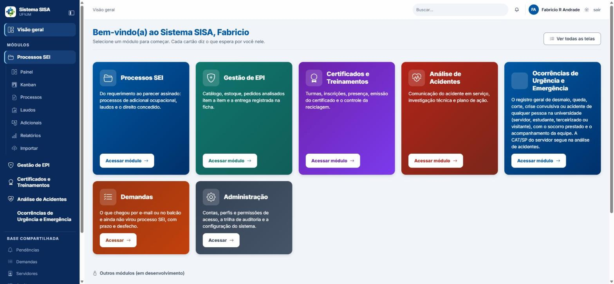
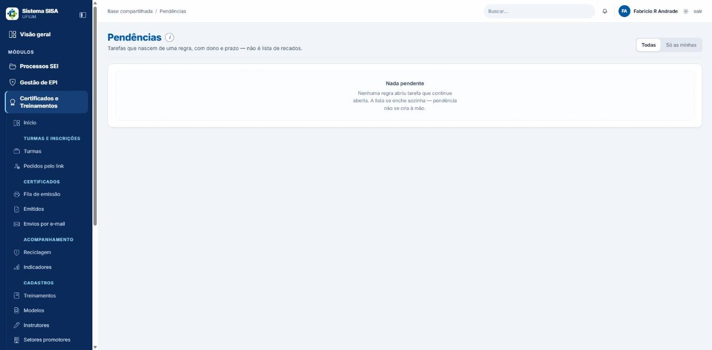

# Manual do usuário: Acesso, conta e administração do SISA

## Para quem é

Para quem usa o Sistema SISA (UFVJM) no dia a dia e precisa entrar, cuidar da própria conta, achar informações, resolver pendências e, quando o seu perfil permite, cuidar de contas, servidores e configurações.

Este manual cobre as telas que não pertencem a um módulo só. Os exemplos usam nomes e e-mails fictícios.

## Antes de começar

- O login é o seu **e-mail**.
- O que aparece no menu depende do seu perfil e do acesso por módulo que você recebeu. Se uma tela não aparece, ou aparece a mensagem de recusa, o seu perfil não tem essa permissão.
- Resumo de quem pode o quê:

| Tarefa | Quem pode |
|---|---|
| Conceder ou encerrar perfil, acesso por módulo | Superintendente e administrador do sistema |
| Atestar habilitação | Superintendente e administrador do sistema |
| Criar conta e redefinir senha | Superintendente, administrador do sistema e administrador de TI (o administrador de TI cria a conta sem perfil e sem servidor) |
| Ver a auditoria | Coordenador, superintendente, administrador do sistema, administrador de TI e auditor interno |
| Gerar backup cifrado | Administrador de TI, superintendente e administrador do sistema |
| "Exportar tudo (.zip)" | Superintendente, coordenador e administrador do sistema (o administrador de TI é recusado) |
| Exportar CSV de processos | Quem tem a permissão de exportar e acesso ao módulo Processos SEI: coordenador, superintendente, engenheiro, médico do trabalho, técnico de segurança, consulta PROGEP, auditor interno e administrador do sistema. Secretaria, almoxarife, servidor e administrador de TI recebem recusa |
| Importar dados legados | Coordenador, superintendente e administrador do sistema |
| Limpar dados de teste | Só o administrador do sistema |
| Pendências e sino | Todos, exceto administrador de TI |

O **administrador do sistema** tem todas as permissões do sistema, menos assinar parecer e registrar laudo (atos que só o técnico habilitado pratica). Por isso aparece em quase todas as linhas acima.

## Sumário

1. Entrar, trocar a senha e sair
2. Esqueci minha senha
3. Cadastre-se e ativação de acesso
4. Visão geral e mapa de módulos
5. Minha conta
6. Busca global
7. Pendências e sino
8. Usuários e perfis
9. Servidores e fichas
10. Setores e aparência
11. Relatórios, configuração e auditoria
12. Importação, duplicados e limpeza de dados
13. Uso no celular
14. Mensagens comuns
15. Glossário
16. Limites conhecidos

---

## 1. Entrar, trocar a senha e sair

**Entrar**
1. Abra a tela de login.
2. Preencha **E-mail** e **Senha**.
3. Clique em **Entrar**.

Se a conta tiver senha provisória, o sistema pede a troca antes de qualquer outra coisa. Na tela de login há ainda os links **Esqueci minha senha** e **Cadastre-se**.

**Trocar a senha** (tela "Trocar senha"; também pelo link **Trocar senha** em Minha conta)
1. Preencha **Senha atual**, **Nova senha** e **Confirme a nova senha**.
2. Clique em **Salvar**. Ao final aparece "Senha trocada" e o botão **Continuar**.

A senha nova vale na hora e as outras sessões abertas da conta (outro navegador ou aparelho) são encerradas; a atual continua aberta. Errar a senha atual conta como tentativa de entrada.

Regras da senha: no mínimo 8 caracteres, com pelo menos 5 caracteres diferentes entre si, e não pode ser uma senha comum (como sequências óbvias).

**Segundo fator de entrada (opcional)**: em Minha conta, na seção Segurança, o botão **Segundo fator de entrada** liga um código de 6 dígitos, gerado por um aplicativo autenticador no celular (Google Authenticator, Microsoft Authenticator, Aegis, FreeOTP), que passa a ser pedido depois da senha.
1. Clique em **Ligar o segundo fator** e escaneie o código QR no aplicativo (ou digite a chave que aparece ao lado).
2. Digite o código de 6 dígitos que o aplicativo mostra e clique em **Ligar o segundo fator**.
3. Anote os **8 códigos de recuperação** que aparecem uma única vez e guarde-os longe do celular. Cada um vale uma vez, no lugar do código do aplicativo, se você perder o celular.

Na entrada, depois da senha, o sistema pede o código. Errar o código várias vezes seguidas bloqueia a conta por alguns minutos, como acontece com a senha. Para desligar, volte à mesma tela e confirme a senha atual. Se perdeu o celular e os códigos de recuperação, a administração do sistema desliga o segundo fator da sua conta em **Usuários**, e você pode ligar de novo depois.

**Sair**: use o link **sair** do topo. O sistema mostra a tela "Sair do sistema" e só encerra a sessão quando você clica em **Sair** (ou volta com **Continuar no sistema**).

**Inatividade**: a tela Minha conta informa que a sessão parada é encerrada sozinha depois de 60 minutos sem uso, com um aviso pouco antes. Em computador compartilhado, saia ao terminar.

**Mensagens na tela de login**: o sistema pode avisar que a sessão terminou, que houve inatividade, que o acesso foi ativado ou que a senha foi redefinida. São só avisos; entre de novo normalmente.

**Conta bloqueada**: após 5 erros de senha seguidos, aparece "Conta bloqueada até (hora) por 5 tentativas malsucedidas seguidas". O bloqueio é temporário (15 minutos, na configuração padrão) e termina sozinho; quem tem pressa pede a quem gerencia usuários que use o botão **Desbloquear** (capítulo 8). Há também um limite por endereço de rede: muitas falhas seguidas vindas do mesmo lugar também seguram a entrada por um tempo.

## 2. Esqueci minha senha

1. Na tela de login, clique em **Esqueci minha senha**.
2. Informe o **E-mail** e clique em **Receber o link**.
3. Aparece "Verifique o seu e-mail". Abra a mensagem e use o link.
4. Defina a nova senha.

O link vale **1 hora** (30 minutos para contas de administração) e só funciona uma vez. Se venceu, peça outro. Abrir o link só mostra um botão de confirmação; a senha só muda quando você conclui o formulário. A resposta é a mesma exista ou não conta com aquele e-mail; conta inativa não recebe link (quem decide é a equipe).

## 3. Cadastre-se e ativação de acesso

O caminho depende de quem você é.

### 3.1 Terceirizado ou discente: pedir uma conta
1. Abra **Cadastre-se** e escolha o seu vínculo: **Servidor**, **Terceirizado** ou **Discente**.
2. Preencha **E-mail** (para discente, **E-mail institucional**), **Nome completo**, **Senha** e **Repita a senha**. O formulário não pede empresa nem curso.
3. Marque a caixa **Tenho 18 anos ou mais**.
4. Clique em **Cadastrar**. A tela passa a dizer que o link foi enviado.
5. Abra o e-mail recebido e clique no link; a página abre com um botão para confirmar o e-mail, e é esse clique que libera a conta.

O link vale **24 horas** e é de uso único. Ao confirmar, a conta é liberada automaticamente e aparece "E-mail confirmado".

Para discente, o e-mail precisa terminar exatamente em `@ufvjm.edu.br`.

Com a conta, terceirizado e discente se inscrevem em treinamentos, veem os próprios certificados e comunicam acidentes. **Pedido de EPI é só para servidores.** O pedido de cadastro é apagado em até 90 dias.

Por segurança, a resposta é a mesma mesmo quando o e-mail já existe. Existe um teto de pedidos por hora vindos do mesmo endereço de rede (5 no Cadastre-se de terceirizado e discente, 8 no de servidor); passando dele, nada é enviado e a tela não avisa. Se nada chegar, veja a caixa de spam, espere e tente de novo, e só depois peça ajuda a quem gerencia usuários.

### 3.2 Servidor: ativar o acesso
1. Em **Cadastre-se**, escolha **Servidor**. A tela "Cadastro do servidor" pede **SIAPE** (7 dígitos), **E-mail institucional** (o seu @ufvjm.edu.br, que será o login), **Nome completo**, **Senha** e **Repita a senha**.
2. Clique em **Cadastrar**. Aparece "Confirme o seu e-mail".
3. Abra o e-mail e clique no link para confirmar. O acesso é ativado e você entra no sistema com a senha que escolheu.

O link vale **24 horas** e é de uso único. Se o SIAPE ainda não está no cadastro, o próprio pedido cria o cadastro do servidor (o sistema não confere o SIAPE). Se o SIAPE já está cadastrado, o link vai ao e-mail que consta na ficha, e o e-mail digitado precisa ser exatamente esse; se for outro, ou se a ficha estiver sem e-mail, nada é enviado e o sistema não explica. Nesse caso peça à secretaria ou a quem gerencia usuários que registre ou corrija o e-mail na sua ficha. Se o SIAPE ou o e-mail já pertencem a outro cadastro ou conta, a tela responde igual, mas o pedido não é atendido (a pessoa dona do e-mail recebe um aviso).

Servidor que já tem conta e quer ligar a ficha: em **Minha conta**, use **Ligar minha conta** (capítulo 5).

## 4. Visão geral e mapa de módulos

*Visão geral: um cartão por módulo.*

- **Visão geral** (`/inicio`, "Bem-vindo(a) ao Sistema SISA") mostra um cartão por módulo a que você tem acesso, com o que espera por você (por exemplo "4 pendências suas"), e sempre as áreas que são suas: "Meu espaço" e "Minha atividade". O link **Ver todas as telas** abre o mapa de módulos.
- **Mapa de módulos** (`/modulos`, "Módulos") lista todos os módulos e as telas de cada um, mais a "Base compartilhada" (pendências, demandas, servidores, catálogos, auditoria, usuários). CISSP e PGR aparecem em "Outros módulos (em desenvolvimento)", como "ainda não disponível".
- Os módulos em uso são Processos SEI, Gestão de EPI, Certificados e Treinamentos, Análise de Acidentes, Ocorrências de Urgência e Emergência e Demandas.
- Se a sua conta está sem perfil, o mapa mostra a mensagem de que a conta está sem acesso e "Nenhuma tela da base abre para você". O texto menciona a tela Usuários, mas você não precisa abri-la: peça a concessão de perfil ao superintendente ou ao administrador do sistema.

## 5. Minha conta

Na tela **Minha conta** você pode:

O título da tela é "Meu perfil"; o acesso é pelo seu nome no canto do menu (link "Minha conta"). Nela você pode:

- **Salvar dados** (seção "Dados pessoais"): alterar **Nome**, **Telefone** e **Ramal** (os dois últimos são opcionais, usados só pela equipe do setor, e se apagam deixando em branco).
- **Trocar e-mail**: o e-mail é o seu login. Pede a **Senha atual** (errar conta como tentativa de entrada). Se o e-mail já for de outra conta, o sistema recusa.
- **Trocar senha** (seção "Segurança").
- **Ligar minha conta** ("Sou servidor da UFVJM"), quando a conta ainda não está ligada: informe **SIAPE**, **Nome completo**, **Cargo** e **Lotação** (se não estiverem na lista, use "Não está na lista? Digite..."). O cadastro de servidor é criado e ligado na hora; o sistema não confere o SIAPE. Se o SIAPE já existe com o e-mail desta conta, ela só é ligada; se existe com outro e-mail, procure a equipe da Sisa.
- Depois de ligada, o servidor corrige o **próprio** cargo, função e lotação em **Corrigir cargo, função ou lotação**; a mudança vale a partir de hoje e o período anterior fica no histórico. Nome e SIAPE só a equipe corrige.
- Ver os **Perfis de acesso** da conta (somente leitura).
- Seção **Privacidade (LGPD)**: lista os direitos do art. 18 e orienta falar com o encarregado da UFVJM. Não há formulário nem contato nessa tela.

O selo "Conta de equipe" pode aparecer também para terceirizado e discente; é só rótulo e não dá acesso extra.

## 6. Busca global

1. Digite na caixa **Buscar em todo o sistema** (no topo; atalho Ctrl+K) e clique em **Buscar**. Serve para nome, SIAPE, NUP, laudo, protocolo do pedido de EPI, código da turma e chave do certificado.
2. Os resultados vêm agrupados por tipo (Servidores, Processos etc.), cada um levando à tela em que o item se trabalha.

Dicas:
- A busca só procura no que a sua conta já abre. O **nome** de um servidor só casa para quem pode ler nomes; quem vê o servidor como SRV-xxxx (secretaria, por exemplo) procura por SIAPE.
- Aceita o NUP completo, com pontuação (`23086.100009/2026-60`), o NUP completo sem pontuação (17 dígitos) e o formato curto `100009/2026`.
- A busca recusa qualquer número de 11 dígitos, que parece CPF, com a mensagem "A busca não aceita CPF...". Isso pega também um pedaço do NUP, como `23086.100008` ou `23086100008`; use o NUP completo ou o formato número/ano.

## 7. Pendências e sino

*Pendências.*

- O sino mostra quantas pendências são suas; o número bate com os cartões da tela **Pendências**.
- Pendência não se cria à mão: cada linha nasce de uma regra do sistema (parecer assinado à espera de inclusão no SEI, troca de EPI vencida, comprovante de EPI a anexar etc.). A coluna **Tarefa** diz o que fazer, e **Onde** leva à tela certa.
- Em **Pendências**, use **Todas** ou **Só as minhas**. Quando há atrasos, a tela informa quantas passaram do prazo. Mais abaixo há **Concluídas recentemente**.
- Para encerrar uma pendência, use o botão **concluir**. A conclusão fica na auditoria, com quem fechou.

Atenção: depois de concluída, a pendência não pode ser reaberta nem passada para outra pessoa. O sistema também não confere se o trabalho foi feito (por exemplo, a secretaria consegue concluir pendência de parecer sem que o número SEI esteja preenchido). Fechar sem fazer é o mesmo que apagar a regra: o motivo que abriu a tarefa continua valendo e o processo pode parar sem ninguém saber por quê. Confira antes de concluir.

O administrador de TI não tem sino e não abre Pendências.

## 8. Usuários e perfis

Disponível para superintendente e administrador do sistema, que fazem tudo o que este capítulo descreve. O administrador de TI também abre a tela, mas só cria conta, inativa e reativa conta comum, redefine senha e desbloqueia; não concede perfil nem vincula servidor. O coordenador não abre esta tela (recebe erro 403). O título da tela é "Usuários e governança de acesso"; cada conta tem um botão **Gerir** que abre as ações abaixo.

### 8.1 Criar uma conta
1. Em **Usuários**, abra **Cadastrar conta** e preencha: **Vínculo** (Equipe sem vínculo de titular, Servidor, Terceirizado ou Discente), **Nome**, **E-mail (login)** e, se tiver permissão, **Perfil de equipe (opcional)**, **Campus (escopo)** e **Ato normativo (opcional)**.
2. Se o vínculo for Servidor, informe **Servidor (SIAPE ou nome)**; em branco, o sistema liga sozinho o servidor que tiver o mesmo e-mail. Servidor, terceirizado e discente já nascem com o perfil do vínculo; terceirizado e discente não se ligam a servidor.
3. Clique em **Cadastrar conta**. Aparece "Conta criada (vínculo ..., perfil ...)" e a **senha provisória, mostrada uma única vez**, na faixa verde do topo da lista. Anote e entregue à pessoa com segurança; no primeiro acesso ela é obrigada a trocá-la.

Mensagens: "Nome e e-mail não ficam em branco."; "Conta não criada: o e-mail ... já é o login da conta de ...".
O administrador de TI vê: "Perfil e servidor pedem a permissão perfil.conceder: crie a conta sem eles."

### 8.2 Conceder e encerrar perfil
1. Use **Conceder perfil** (no alto da tela ou em **Conceder perfil a esta conta…**, dentro de Gerir): escolha **Usuário**, **Perfil**, **Campus (escopo)**, **Vigência início** e, se já se sabe, **Vigência fim**, e informe o **Ato normativo** se já saiu. Resultado: "Perfil concedido, com o ato normativo pendente." Se o ato ainda não saiu, deixe em branco e informe depois em **Ato normativo** e **Salvar ato**, dentro de Gerir.
2. Para tirar o perfil, use **Encerrar perfil…** (botão **Encerrar o perfil**). Uma concessão futura também se cancela por aí.

Recusas comuns: a pessoa já tem o perfil ("Encerre aquela concessão antes."); você não pode conceder a si mesmo; o perfil administrador_sistema só é concedido por um administrador_sistema; você não pode dar mais do que tem. O último concedente do sistema não pode ser encerrado.

### 8.3 Acesso por módulo
Cada módulo pode ficar em **Padrão do perfil**, **Sem acesso**, **Consulta** ou **Operação**, por perfil (tela **Acesso por módulo**, `/perfis/niveis`) e por pessoa (em **Gerir**, **Salvar acesso por módulo**). A exceção por pessoa só vale para quem tem perfil de equipe; quem tem vários perfis fica com a soma deles. Ninguém altera o próprio acesso. A **Matriz de perfis** (`/perfis`) mostra o que cada perfil pode; outros perfis a veem só para leitura, e quem ajusta é o administrador do sistema ou o superintendente.

### 8.4 Outras ações na conta
- **Dados da conta** (**Editar dados…**) e **Histórico desta conta**.
- **Setores promotores** (**Salvar setores**): definir os setores da conta; em Certificados e Treinamentos a conta só vê e gere as turmas desses setores.
- **Servidor vinculado** (**Salvar vínculo**): vincular pelo SIAPE ou nome; em branco, desvincula.
- **Resetar senha…** (botão **Resetar a senha**): gera nova senha provisória, mostrada uma vez, e encerra as sessões abertas da conta. A senha de conta de administração só é redefinida por quem concede perfil; a conta de administrador do sistema só por outro administrador do sistema.
- **Desbloquear**: aparece como "Bloqueada até (hora)" na conta bloqueada por erros de senha.
- **Inativar a conta** e **Reativar conta**.
- **Não há botão Excluir nesta tela.** Excluir existe só em Contas do Cadastre-se (8.5).
- **Habilitação**: atestar (superintendente e administrador do sistema), ligar conta, corrigir (número de conselho com até 8 caracteres) e **Encerrar a habilitação**. Não se liga conta que você mesmo criou ou cuja senha você redefiniu, nem conta ainda com senha provisória.

### 8.5 Contas do Cadastre-se
**Contas do Cadastre-se** (`/usuarios/pedidos`; link na tela Usuários, aberta também ao administrador de TI) lista as contas de terceirizados e discentes. A conta pedida pelo Cadastre-se é liberada sozinha quando a pessoa confirma o e-mail, então aqui você só age depois:

- **Bloquear** e **Desbloquear**: quem não deve entrar fica bloqueado e as sessões abertas caem.
- **Excluir**: apaga só a conta que ainda não tem registros no sistema. Se a conta já se inscreveu em turma, recebeu certificado, comunicou acidente ou aparece na trilha, o sistema não a apaga: **bloqueia no lugar**, e a mensagem avisa.
- **Aprovar** e **Recusar** só aparecem na seção "A conferir", que existe apenas para pedidos anteriores à liberação automática. Aprovar cria a conta e envia link (válido por 72 horas) para definir a senha; Recusar exige um motivo e avisa a pessoa por e-mail, sem o motivo.

A coluna "Empresa ou curso" aparece sempre com "—", porque o formulário atual não pergunta isso.

## 9. Servidores e fichas

Na tela **Servidores** use **Buscar** (por nome ou SIAPE; quem vê SRV-xxxx busca só por SIAPE) e abra a ficha. A chave do servidor é o SIAPE, nunca o nome, e o sistema não tem campo de CPF.

- **Cadastrar servidor**: SIAPE, nome, cargo, função, unidade, UORG, postos de trabalho e e-mail institucional. Se houver e-mail, o sistema cria uma conta de consulta (perfil servidor_consulta) sem senha; a pessoa define a senha pelo link de ativação.
- **Editar identificação** (**Salvar identificação**): SIAPE, nome, situação e e-mail. Quem não tem permissão de ver nomes não corrige nome nem SIAPE: a secretaria cria o servidor, mas não corrige, e o vê como SRV-xxxx (identificação protegida).
- **Registrar mudança** (lotação, cargo, função, postos): informe **A partir de**, a unidade e o **Documento que sustenta a mudança**; abre um período novo e fecha o anterior na véspera. A nova lotação não pode começar antes do início da atual. Corrigir a lotação depois altera só o documento e a observação. **Confira a data antes de salvar.**
- **Situação**: Ativo, Aposentado, Exonerado ou Cedido.
- **Importar servidores** (arquivo .csv ou .xlsx): veja o capítulo 12.
- Não existe excluir nem mesclar servidor.
- A ficha mostra Lotação e cargo, Processos, Pareceres, Adicionais, EPI recebido e Postos de trabalho, e tem o botão **Imprimir**.
- O próprio servidor corrige o seu cargo, função e lotação em Minha conta (capítulo 5).

## 10. Setores e aparência

Cada setor tem cor e ícone, que servem para reconhecê-lo nos cartões e nas listas. A cor é escolhida numa paleta fechada; fora dela o sistema responde "Cor fora da paleta do sistema". No seletor de unidade, a sigla pode aparecer repetida, como "(IECT) (IECT)"; é só visual.

**Catálogos** (menu "Base compartilhada", `/catalogos`): lista 13 catálogos (campi, unidades/UORG, postos de trabalho, cargos, agentes nocivos, tipos de risco, fundamentações legais, percentuais, textos padrão, portarias de localização, checklists modelo, autoridades destinatárias e setores emissores). Só coordenador, superintendente e administrador do sistema editam; os demais perfis com acesso apenas leem. Editar um catálogo não muda parecer já emitido, porque o parecer congela o conteúdo na emissão; textos padrão são versionados a cada mudança.

## 11. Relatórios, configuração e auditoria

**Relatórios** (`/relatorios`): hoje só do módulo Processos SEI. Por exercício (campo **Exercício**, botão **Ver**) mostra processos por unidade, pareceres por tipo de risco, lacunas de numeração, laudos nunca conferidos ou com mais de 24 meses e adicionais vigentes por laudo. O botão **Exportar processos (CSV)** traz dados nominais para quem pode ler nomes (para os demais, nome e SIAPE saem suprimidos); trate o arquivo como sigiloso. Quem tem "Sem acesso" a Processos SEI não exporta.

**Configuração** (ícone de engrenagem ao lado do seu nome; cada perfil vê só os blocos que pode usar):
- **SLA por coluna**: **Editar os prazos**, prazo em dias de 0 a 3650 (0 desliga o alerta), **Salvar SLA**. Respostas: "SLA atualizado." ou "Nada mudou: os prazos já eram esses." Só quem gerencia catálogos e edita processos (coordenador, superintendente e administrador do sistema).
- **Backup e exportação**: **Fazer backup cifrado agora** (AES-256-GCM, com a senha da instalação; botão **Fazer o backup agora**; resposta "Backup cifrado gerado: backups/csso-....enc") e **Exportar tudo (.zip)** (botão **Exportar tudo agora**). O .zip sai **em claro, sem senha**, com o banco inteiro, CSVs com nome e SIAPE e todos os anexos (sem os hashes de senha); uma cópia fica guardada na instalação e não é apagada sozinha. Nunca copie backups, exportações ou anexos para nuvem pessoal ou de terceiros.
- Blocos informativos: setor emissor e autoridade destinatária (cadastrados em Catálogos), integração com o SEI, retirada de EPI, onde o dado mora e envio de e-mail (estes dois, só para quem faz backup).

**Auditoria** (coordenador, superintendente, administrador do sistema, administrador de TI e auditor interno): filtros **Quem agiu**, **Conta afetada**, **Entidade** e **Tipo de evento**, botões **Filtrar** e **Limpar**. A lista traz 50 eventos por página, com **próxima »**. O botão **Conferir a cadeia inteira** verifica se a trilha foi alterada; o resultado esperado é "Cadeia conferida em (data) — N evento(s), encadeamento íntegro". Há também a lista de "Acessos a dado sensível" (25 por página, com a finalidade de cada leitura nominal).

## 12. Importação, duplicados e limpeza de dados

**Importar dados legados** (menu **Importar**, no módulo Processos SEI; coordenador, superintendente e administrador do sistema): duas cargas, **Planilha de pareceres** (.xlsx) e **Quadro do Trello** (JSON completo, não CSV). Cada uma tem a caixa **aplicar de verdade (sem marcar, só simula)** e o botão **Importar**; o Trello tem ainda **baixar os anexos agora** (as URLs expiram). A importação **simula por padrão**; só grava se você marcar a caixa. A mesma planilha enviada duas vezes não duplica. O que não entra aparece em **Rejeitados**, com o motivo. Mensagens: falta de arquivo, JSON inválido, "não parece um export do Trello". Não há tela para ajustar o mapeamento das listas do Trello.

**Importar servidores** (dentro de **Servidores**, bloco "Importar servidores"; arquivo .csv ou .xlsx; quem pode cadastrar servidor): colunas SIAPE; Nome; Cargo; UORG e, se houver, E-mail; Campus (**Baixar o modelo (.csv)**). Clique em **Ver prévia**, leia, e só então em **Confirmar importação**: nada é gravado antes. Cuidado: SIAPEs curtos ganham zeros à esquerda, nomes de servidores já existentes são atualizados, cargos inexistentes são criados e contas sem senha são criadas.

**Juntar cadastros duplicados** (`/treinamentos/participantes`, no módulo Certificados e Treinamentos): lista os possíveis cadastros repetidos de participantes e permite juntá-los; só abre para quem tem a permissão de mesclar participantes (coordenador, superintendente, engenheiro, médico do trabalho e administrador do sistema); técnico, secretaria e administrador de TI recebem recusa.

**Limpar dados de teste** (só administrador do sistema; `/config/limpar-dados`, também como bloco em Configuração): 1) **O que apagar**: marque os módulos (e, se quiser, a caixa **Apagar também** as contas, que só vale com todos os módulos marcados) e clique em **Simular** para ver o que sairia; 2) **Confirmar e apagar**: digite a frase "APAGAR DADOS DE TESTE", a identidade do banco mostrada na tela e a sua senha atual, e clique em **Fazer o backup e apagar**. Não é desfazível pela tela; use apenas em ambiente de teste.

## 13. Uso no celular

A tela do celular (`/celular`) tem atalhos grandes:
- **Balcão de EPI** (quem entrega EPI, como o almoxarife): registrar entrega (**Registrar entrega**, depois **Registrar outra entrega**).
- **Chamada** (quem tem permissão de avaliar turmas; o almoxarife não vê): lançar a presença de um dia, nome a nome.
- Servidor: **Meus treinamentos**, **Meus certificados**, **Comprovante de treinamentos** e **Minha ficha de EPI**.

Sem conexão, a tela abre mas nada se consulta nem se grava; o que não chegou ao servidor não foi gravado. Se não houver nada para o seu perfil (administrador de TI, por exemplo), aparece "Esta tela ainda não tem trabalho para você."

## 14. Mensagens comuns

| Mensagem | O que fazer |
|---|---|
| "Usuário ou senha inválidos." | Confira e-mail e senha; após 5 erros a conta bloqueia. |
| "Conta bloqueada até (hora)..." | Espere o horário (15 minutos) ou peça o desbloqueio a quem gerencia usuários. |
| "Senha atual incorreta. Restam N tentativas..." | Digite a senha atual correta antes que bloqueie. |
| "A confirmação não confere." | Digite a mesma senha nos dois campos. |
| "Senha fraca: ..." | Escolha senha mais longa e variada. |
| "A senha nova é igual à atual: escolha outra." | Use uma senha diferente. |
| "Link vencido ou inválido" | Peça novo link (24 h na confirmação do Cadastre-se, 1 h na recuperação de senha e 30 min para contas de administração; 72 h no link de pedido aprovado pela equipe). |
| "A busca não aceita CPF..." | Use o NUP completo ou número/ano. |
| "Cor fora da paleta do sistema" | Escolha uma cor da paleta. |
| Recusa citando permissão (por exemplo perfil.conceder) | Seu perfil não permite; peça a quem tem. |
| "Digite o SIAPE com 7 dígitos." / "Use o seu e-mail institucional (@ufvjm.edu.br)." | Corrija o SIAPE ou o e-mail no Cadastre-se de servidor. |
| "a nova lotação precisa começar em ou depois do início da atual (2027-01-01)" | A data (ano-mês-dia) fica antes da lotação atual; informe data posterior. |
| "A conta de ... já tem registros no sistema ... foi bloqueada no lugar" | Esperado ao excluir conta com histórico; ela fica bloqueada, não apagada. |

## 15. Glossário

- **Perfil**: conjunto de permissões da pessoa (por exemplo coordenador, técnico, secretaria).
- **Acesso por módulo**: ajuste fino do que a pessoa vê em cada módulo.
- **NUP**: número único do processo.
- **SIAPE**: matrícula do servidor.
- **SLA**: prazo, em dias, por etapa.
- **Trilha de auditoria**: registro encadeado de quem fez o quê.
- **Senha provisória**: senha de uso inicial, mostrada uma única vez, que obriga a troca.
- **LGPD**: lei de proteção de dados pessoais.

## 16. Limites conhecidos

- **Lista de usuários**: a tela **Usuários** não tem busca, filtro nem paginação e fica pesada com muitas contas.
- **Lotação futura errada**: não há como desfazer pela tela; confira a data antes de salvar e, se errar, avise a gestão.
- **Autocadastro de servidor**: o sistema não confere o SIAPE informado; a gestão deve conferir os cadastros.
- **Pendências**: concluir não confere pré-requisitos e não tem reabrir nem reatribuir.
- **Exportação de processos (CSV)**: o download não deixa registro na Auditoria (já o "Exportar tudo (.zip)" deixa).
- **Auditoria**: alguns eventos de alteração de dados guardam valores pessoais (nome, e-mail, SIAPE); trate a tela como confidencial.
- **Conta automática**: servidor com e-mail na ficha ganha conta automaticamente, qualquer que seja o domínio do e-mail; confira o e-mail ao cadastrar.
- **Busca**: números de 11 dígitos são recusados, inclusive o começo do NUP; NUP sem pontuação não encontra.
- **Secretaria**: cria servidor, mas não consegue conferir nem corrigir nome e SIAPE; peça a quem tem a permissão.
- **LGPD**: a tela de privacidade não traz canal nem formulário de pedidos do titular.
- **Gestão de contas** concentrada em poucas pessoas: em ausência, o acesso demora.
- **Textos desatualizados**: a tela Limpar dados fala em quatro módulos, mas são cinco; há texto de versão antigo em Configuração; o seletor de unidade repete sigla; alguns erros de data e de nível aparecem como texto técnico; o domínio exigido do discente pode variar entre telas.
- **Importação**: a do Trello não tem mapeamento; a de CSV de servidores altera dados existentes sem aviso por linha, então leia a prévia.
- **Não verificado nos testes**: primeiro acesso do sistema (`/primeiro-acesso`, que só existe enquanto não há usuário e depois leva ao login), desconexão por 60 minutos de inatividade (a tela Minha conta a anuncia, mas não foi cronometrada), envio real de e-mails (nos testes o envio estava desligado e as mensagens ficaram na fila de saída), execução de Limpar dados, importação de .xlsx, fusão de duplicados, o teto de pedidos por hora e o bloqueio por endereço de rede.
