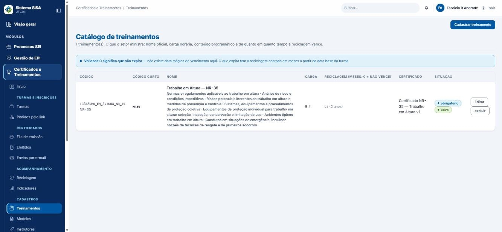
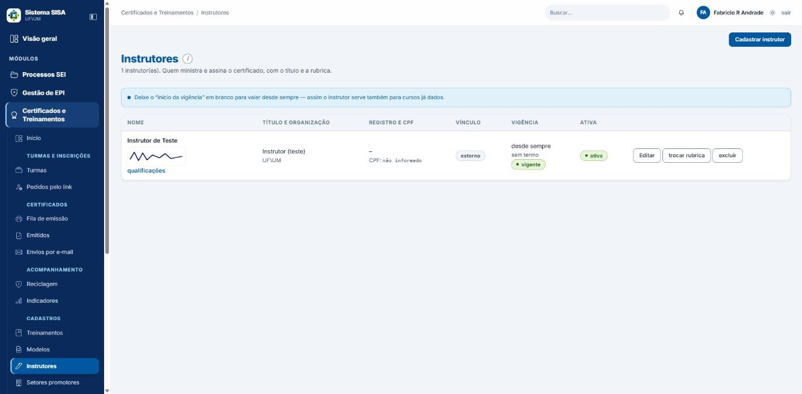
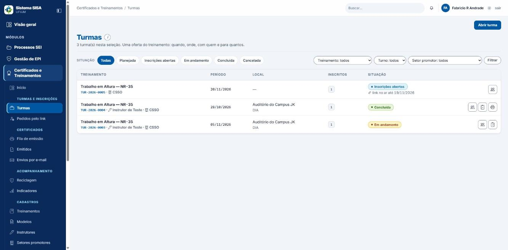
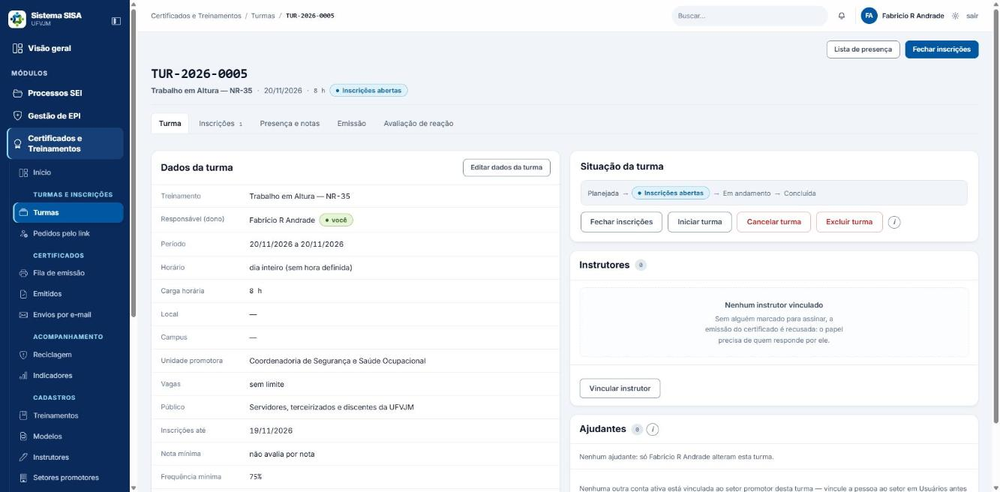
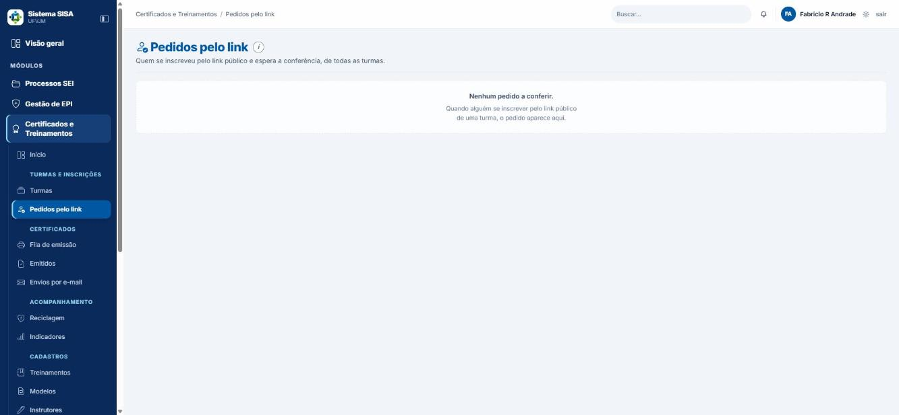
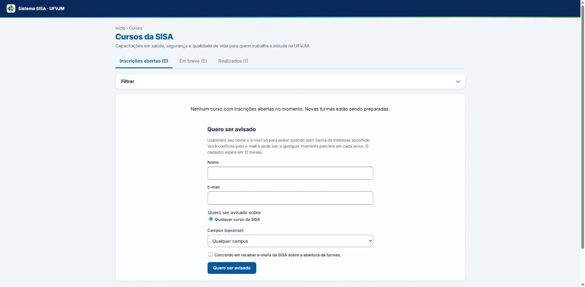

# Manual do usuário: Treinamentos, turmas e inscrições

Sistema SISA (UFVJM), módulo "Certificados e Treinamentos", parte de turmas.

Os nomes de telas, botões e mensagens aparecem entre aspas, do jeito que estão no sistema. Os nomes, códigos e datas dos exemplos são fictícios.

## Para quem é este manual

Para quem usa o módulo no dia a dia:

- **Técnico, engenheiro e médico do trabalho**: abrem turmas, inscrevem, lançam presença, concluem e emitem certificados.
- **Secretaria da CSSO**: abre turmas, inscreve, confere pedidos, lança presença, conclui e emite.
- **Ajudante de uma turma**: pessoa que o dono da turma autorizou a operar só uma parte dela.
- **Servidor e participante com conta**: se inscreve, desiste e avalia pelo "Meus treinamentos".
- **Quem recebe o link ou o QR** (sem conta): pede a vaga pelo formulário público.

Decisões de gestão e configuração (quem pode o quê no sistema, setores promotores etc.) ficam no manual do coordenador.

## Antes de começar

1. Entre no sistema com a sua conta. Na lateral, abra o módulo **Certificados e Treinamentos**.
2. O que você enxerga depende do seu perfil:

| Perfil | O que faz no módulo |
|---|---|
| Coordenador e superintendente | Tudo. |
| Engenheiro e médico do trabalho | Tudo, inclusive anular certificado. |
| Técnico de segurança | Tudo, menos anular certificado (cadastra local, inclui e retira setor promotor, abre "Modelos"). |
| Secretaria da CSSO | Abre "Início", "Turmas", "Pedidos pelo link", "Treinamentos" (só leitura), "Locais" (só leitura), "Setores promotores" e "Avaliação de reação". Cria turma, inscreve, lança presença, conclui e emite. Não abre "Instrutores" nem "Modelos" (a tela volta "403 — acesso negado") e não cadastra local. |
| Servidor | "Meus treinamentos". Vê a ficha da turma só para leitura (aba "Turma") e pode se inscrever pelo botão "Inscrever-se" da ficha ou de "Meus treinamentos". A lista "Turmas" dele não traz o filtro "Filtrar por setor promotor" nem a coluna "Ações". "Setores promotores" também abre para ele, só para ler. |
| Almoxarife e administrador de TI | Não têm acesso ao módulo (nenhuma tela, nem "Meus treinamentos"). |

**"Início" do módulo.** Quem opera o módulo cai em "Início" (**/treinamentos**): cartões na ordem do trabalho, com os mesmos nomes e ícones da lateral e só os que o seu perfil abre (Treinamentos, Modelos, Instrutores, Turmas, Pedidos pelo link, Presença e notas, Fila de emissão, Emitidos, Envios por e-mail, Reciclagem, Possíveis duplicados, Indicadores, Setores promotores e Locais), vários com a contagem do que espera ali (o cartão "Possíveis duplicados" só aparece quando há o que conferir), o botão "Abrir turma" no topo e as listas "Turmas encerrando" e "Próximas turmas". A lista "Turmas encerrando" mostra também turma planejada que vai acabar nos próximos dias, com "nada pendente: só concluir no término": não é alarme de problema. O servidor comum não tem "Início" (recebe 403) e entra por "Turmas" ou "Meus treinamentos".

3. **Regra do dono.** Ter permissão não basta para mexer numa turma. Quem altera uma turma é:
   - o **dono** (quem a abriu; aparece em "Responsável (dono)" na ficha);
   - o **superintendente**;
   - a **coordenação do mesmo setor**, quando o dono é de perfil abaixo dela;
   - o **ajudante** que o dono designou, só nos papéis que recebeu.

   Os outros só consultam. Na ficha aparece o aviso "Só consulta. Esta turma é de {nome}; só ele ou a coordenação acima pode alterar.", os botões somem, e se a pessoa tentar mesmo assim, o sistema responde "403 — acesso negado" com a mesma frase. Isso vale também para a secretaria: ela não altera turma aberta por técnico, engenheiro ou médico. Nesse caso, peça ao dono para fazer a ação ou para designar você como ajudante. O texto que vem logo depois da frase, falando em "concessão do perfil", não é o caminho certo.
4. As turmas e os treinamentos de exemplo que vêm de fábrica pertencem à coordenação. Um técnico só consulta essas turmas. Para operar, abra a sua.

## Sumário

1. [Treinamentos (catálogo)](#1-treinamentos-catálogo)
2. [Instrutores e qualificações](#2-instrutores-e-qualificações)
3. [Locais](#3-locais)
4. [Abrir uma turma](#4-abrir-uma-turma)
5. [A ficha da turma e a situação da turma](#5-a-ficha-da-turma-e-a-situação-da-turma)
6. [Instrutores e ajudantes da turma](#6-instrutores-e-ajudantes-da-turma)
7. [Inscrever participantes](#7-inscrever-participantes)
8. [Link público e QR](#8-link-público-e-qr)
9. [Pedidos pelo link](#9-pedidos-pelo-link)
10. [Vitrine pública de cursos](#10-vitrine-pública-de-cursos)
11. [Presença e notas](#11-presença-e-notas)
12. [Concluir a turma](#12-concluir-a-turma)
13. [Turma já realizada e correção depois de concluída](#13-turma-já-realizada-e-correção-depois-de-concluída)
14. [Emitir os certificados da turma](#14-emitir-os-certificados-da-turma)
15. [Avaliação de reação](#15-avaliação-de-reação)
16. [Meus treinamentos (servidor e participante)](#16-meus-treinamentos-servidor-e-participante)
17. [Quem pede a vaga pelo link ou pela vitrine](#17-quem-pede-a-vaga-pelo-link-ou-pela-vitrine)
18. [Receitas completas](#18-receitas-completas)
19. [Mensagens comuns e o que fazer](#19-mensagens-comuns-e-o-que-fazer)
20. [Glossário](#20-glossário)
21. [Limites conhecidos](#21-limites-conhecidos)

---

## 1. Treinamentos (catálogo)

*Catálogo de treinamentos.*

Caminho: menu **Cadastros > Treinamentos**. A tela lista Código, Código curto, Nome, Carga, Reciclagem (em meses; 0 = não vence), Certificado, Situação e Ações.

Todo curso precisa estar aqui antes de ganhar uma turma. A secretaria só consulta o catálogo.

### Cadastrar um treinamento

1. Clique em **"Cadastrar treinamento"**. O nome e a carga horária bastam.
2. Preencha:
   - **"Nome (sai no certificado)"**.
   - **"Carga horária (horas)"**.
   - **"Validade da reciclagem (meses)"**: 0 ou vazio quer dizer que não vence.
   - **"Código (opcional)"**: em branco, o sistema monta a partir do nome (por exemplo, BRIGADA_DE_INCENDIO). Depois de criado, não muda.
   - **"Código curto (entra no número do certificado)"**: de 2 a 10 letras ou algarismos, sem traço, único. Se ficar em branco, o sistema sugere pelo nome (Brigada de Incêndio virou "BI"; Primeiros Socorros virou "PS"). Pode ser mudado depois, na edição, e os certificados já emitidos guardam o número com que saíram.
   - **"Norma de referência"**, a caixa **"exigido por norma"** e **"Conteúdo programático (um tópico por linha)"**.
3. Grave. O sistema responde, por exemplo: "Treinamento “Brigada de Incêndio” cadastrado (código BRIGADA_DE_INCENDIO)."

### Editar

Na linha do treinamento, abra a edição. Além dos campos acima, aparecem **"Modelo do certificado"**, **"Instrutor padrão"** e a caixa **"ativo"**. Ao gravar: "Treinamento: alteração gravada."

Cuidados:

- Só o dono do treinamento (quem o cadastrou) e a hierarquia acima dele alteram. Para os demais, a linha mostra a etiqueta "só consulta" e "de {dono}".
- Desmarcar **"ativo"** tira o treinamento da lista de escolha ao abrir turma. Treinamento inativo não abre turma: "'Brigada de Incêndio' está inativo no catálogo — reative-o antes de abrir turma."
- Só se exclui treinamento que nunca teve turma. Se já teve: "BRIGADA_DE_INCENDIO já tem 1 turma(s): não se exclui. Desmarque “ativo” para tirá-lo das listas de escolha."

### Erros comuns

| Mensagem | O que fazer |
|---|---|
| "Informe o nome do treinamento." | Preencha o nome. |
| "Carga horária inválida: informe um número maior que zero." | Digite as horas em número. |
| "Validade inválida: informe meses inteiros, ou 0 para não expira." | Use número inteiro de meses, ou 0. |
| "Já existe treinamento com esse código ou nome (...)." | Use o treinamento que já existe ou mude o nome. |
| "O código curto NR35 já é do treinamento “...”: cada treinamento tem o seu..." | Escolha outro código curto (a mensagem sugere um). |

---

## 2. Instrutores e qualificações

*Lista de instrutores.*

Caminho: **Cadastros > Instrutores** (a secretaria não abre esta tela). É aqui que se cadastra quem dá o curso e assina o certificado, com título e rubrica.

### Cadastrar instrutor

1. Clique em **"Cadastrar instrutor"**.
2. Para instrutor da UFVJM, escolha em **"Instrutor da UFVJM"** (lista de servidores com SIAPE). Para quem é de fora, marque **"instrutor externo"** e preencha **"Nome (só para externo)"**.
3. Preencha **"Título de assinatura"**, **"Conselho"**, **"Registro"** e **"Organização"**.
4. **"CPF (só se o certificado exigir)"**: preencha só se o modelo de certificado pedir. A tela nunca mostra o número depois (aparece "CPF: ***.***.***-**").
5. **"Vigência — início"** e **"Vigência — fim"**: em branco, vale desde sempre e sem termo.
6. Grave: "Assinatura de {nome} cadastrada."

### Rubrica

Na linha, clique em **"enviar rubrica"** e escolha uma imagem PNG ou JPEG. Resposta: "Rubrica de {nome} guardada."

### Editar e excluir

- **"Editar"**: confira que a caixa **"ativa"** está marcada antes de salvar. Sem ela, a assinatura é inativada.
- No instrutor da UFVJM, o nome não se edita aqui: vem do cadastro de servidores. No externo, o nome se corrige no "Editar" da linha.
- **"excluir"**: só vale para quem nunca esteve numa turma. Quem já esteve: desmarque "ativo" ou feche a vigência.
- O sistema avisa que o instrutor "está em N turma(s): não se exclui" nesse caso.

### Qualificações do instrutor

Na linha do instrutor, clique em **"qualificações"** e depois em **"Cadastrar qualificação"**.

Campos: **"Descrição"**, **"Treinamento que habilita"**, **"Norma"**, **"Instituição emissora"**, **"Data de emissão"**, **"Válida até"** (vazio = sem validade) e **"Comprovante (PDF, PNG ou JPEG)"** (até 4 MB).

Preencha o treinamento, a norma, ou os dois. Para inativar, use o botão da linha: "Qualificação «...» inativada."

Para que serve: ao vincular o instrutor a uma turma, o sistema confere se ele tem qualificação ativa para aquele treinamento durante todo o período. Se não tiver, avisa ("Atenção: {nome} não tem qualificação cadastrada que o habilite para ..."). O aviso não impede nada. Cadastre o comprovante na ficha do instrutor. Trinta dias antes de a qualificação vencer, nasce uma tarefa em Pendências.

### Erros comuns

| Mensagem | O que fazer |
|---|---|
| "Instrutor da UFVJM precisa estar vinculado a um servidor." | Escolha o servidor na lista, ou marque "instrutor externo". |
| "Informe o nome do instrutor." | Preencha o nome do externo. |
| "O fim da vigência não pode ser anterior ao início." | Corrija as datas. |
| "Informe a instituição emissora." / "Data de emissão inválida." | Complete a qualificação. |
| "Informe o treinamento que ela habilita, a norma, ou os dois." | Preencha pelo menos um. |
| "A validade não pode ser anterior à data de emissão." | Corrija as datas. |
| "O comprovante precisa ser um PDF ou uma imagem PNG/JPEG." | Troque o arquivo. |

> Atenção: o sistema não impede cadastrar a mesma pessoa duas vezes nem deixar o título em branco. Antes de cadastrar, olhe a lista para ver se a pessoa já está lá, e preencha o título.

---

## 3. Locais

Caminho: **Cadastros > Locais** (tela "Locais de treinamento"). Todos veem; cadastrar, editar e inativar exige permissão de gerenciar o catálogo (a secretaria não tem).

1. Clique em **"Cadastrar local"**. O nome basta.
2. Campos: **"Nome"**, **"Campus"** (— qualquer campus), **"Capacidade (pessoas)"**, **"Endereço, bloco ou sala"**, **"Observações"**.
3. Na linha: **"Editar"**, **"inativar"** e **"reativar"**.

Efeitos:

- O local cadastrado aparece no campo "Local" ao abrir turma. Sem nenhum local cadastrado, o campo é texto livre.
- Local inativo não aparece em turma nova. As turmas que já o usam continuam com ele.
- Editar o nome renomeia as turmas que ainda não encerraram.
- Uma turma de um campus só oferece os locais desse campus e os sem campus.
- Ao salvar uma turma, o sistema avisa (sem bloquear) se as vagas passam da capacidade ("Vagas acima da capacidade: ...") ou se há outra turma na mesma sala e no mesmo horário ("Choque de sala: ...").

Mensagens:

| Mensagem | O que fazer |
|---|---|
| "Preencha o nome do local: o campo não pode ficar em branco." | Informe o nome. |
| "Capacidade: informe quantas pessoas cabem (um número maior que zero), ou deixe em branco." | Corrija o número. |
| "Já existe o local “Sala 12” no campus ... — use o “Editar” da linha dele." | Edite o que já existe. |

---

## 4. Abrir uma turma

*Lista de turmas, com o botão "Abrir turma".*

Caminho: **Turmas** (lista) > botão **"Abrir turma"** (abre um popup; o mesmo botão está em "Início"). O servidor comum não vê o botão.

A lista "Turmas" tem os filtros **Situação** (Todas, Planejada, Inscrições abertas, Em andamento, Concluída, Cancelada), **"Filtrar por treinamento"**, **"Filtrar por turno"** (Manhã, Tarde, Noite, Dia inteiro) e **"Filtrar por setor promotor"**, com o botão **"Filtrar"**. Nas linhas, **Inscritos** aparece como "3 de 10", e pode vir "N a conferir" quando há pedidos pelo link esperando.

### Passo a passo

1. Em **"Como a turma começa"**, escolha:
   - **Planejada**: você inscreve pela lista ou um por um, e o link pode ser ligado depois.
   - **Aberta com link público**: as inscrições abrem e o link com QR já aparece na tela seguinte. Exige preencher "Inscrições até".
2. Escolha o **"Treinamento"** (só aparecem os ativos).
3. Preencha **"Início"** e **"Término"**.
4. Preencha **"Carga horária da turma"**. É sobre ela que a frequência é calculada. O campo mostra "usa a do catálogo" como sugestão: em branco, a turma herda a carga do treinamento, e a ficha (cabeçalho e "Dados da turma"), a lista de presença e a vitrine já mostram a carga que vale, sem avisar que veio do catálogo. **Preencha sempre que a carga da turma for diferente da do catálogo**, e confira o número na ficha depois de gravar.
5. **"Hora de início"** e **"Hora de término"** (vazio = dia inteiro; o horário vale para todos os dias da turma).
6. **"Local"** (lista dos locais cadastrados, do campus escolhido) ou, se o local não está na lista, **"Outro local"** com o nome escrito à mão; **"Campus"**; **"Unidade promotora"** (o setor que promove; só aparecem os setores promotores a que a sua conta está vinculada, e se for um só ele entra sozinho).
7. **"Vagas"** (vazio = sem limite) e **"Inscrições até"**.
8. **"Nota mínima (0 a 10)"** (vazio = não avalia por nota) e **"Frequência mínima (%)"** (padrão 75).
9. Marque **"Aceita comunidade externa"** se a turma for aberta ao público de fora. Marcada, o link público aceita também visitantes e outros de fora da UFVJM; desmarcada, só servidores, terceirizados e discentes.
10. **"Data base do vencimento"**: deixe em branco, salvo se a norma contar o prazo a partir da avaliação prática. Em branco, vale a data de término.
11. **"Descrição do evento"** (pode sair no certificado; o link "usar a da última turma deste treinamento" copia a anterior) e **"Observações"**.
12. Clique em **"Abrir turma"** no popup. Resposta: "Turma TUR-2026-0006 aberta." Você vira o dono da turma. Se escolheu "Aberta com link público", a tela que se abre já é a do link e do QR (veja o capítulo 8), e o endereço aparece aí logo de saída.

O código da turma tem a forma TUR-AAAA-NNNN. O ano é o do **início** da turma. O código nunca muda nem volta. Para trocar o ano, cancele a turma e abra outra.

Você pode registrar turma com datas passadas, para um curso que já aconteceu (veja o capítulo 13).

### Erros comuns ao abrir turma

| Mensagem | O que fazer |
|---|---|
| "Escolha o treinamento da turma." | Selecione o treinamento. |
| "Informe a data de início (AAAA-MM-DD)." / "Informe a data de término (AAAA-MM-DD)." | Preencha a data. |
| "O fim da turma não pode ser anterior ao início." | Corrija as datas. |
| "Vagas: informe um número maior que zero, ou deixe em branco." | Corrija ou apague. |
| "Nota mínima: use um valor entre 0 e 10." / "Frequência mínima: use um percentual entre 0 e 100." | Corrija o valor. |
| "Carga horária da turma: informe um número maior que zero." | Corrija o valor. |
| "O prazo de inscrição já passou." | Use uma data de hoje em diante. |
| "As inscrições têm de fechar até o início da turma (...), e não em ...". | "Inscrições até" não pode passar do início. |
| "Hora de início: use HH:MM, entre 00:00 e 23:59 (por exemplo, 08:00)." | Corrija o horário. |
| "Informe a hora de início: a hora de término sozinha não diz quando a turma começa." | Preencha as duas horas. |
| "A data base do vencimento não pode ser anterior ao início da turma." | Corrija a data. |
| "Turma aberta com link precisa de “inscrições até”: ..." | Preencha "Inscrições até". |
| "Turma com link público precisa começar depois de hoje: ..." | Abra como "Planejada" e inscreva pela equipe. |
| "... não está entre os setores que promovem treinamentos. Escolha um setor da lista ..." | Escolha outro setor, ou peça à coordenação para incluir o seu em "Setores promotores". |
| "Escolha o setor promotor da turma: a sua conta está vinculada a mais de um setor." | Escolha o setor em "Unidade promotora". |
| "Você só pode atribuir a turma a um dos setores promotores a que a sua conta está vinculada." | Escolha um dos seus setores. |

Quando há erro, a tela volta com os campos já preenchidos.

---

## 5. A ficha da turma e a situação da turma

*Ficha da turma, com a situação e os botões de cada etapa.*

Clique na turma na lista para abrir a ficha (**/turmas**). Ela tem as abas **"Turma"**, **"Inscrições"** (com o total), **"Presença e notas"**, **"Emissão"** e **"Avaliação de reação"**.

A aba **"Turma"** traz os "Dados da turma" (treinamento, responsável, período, horário, carga horária, local, campus, unidade promotora, vagas, público, inscrições até, nota e frequência mínimas, data base, observações), os instrutores e os ajudantes. No topo há o botão **"Lista de presença"**.

### Editar dados

Clique em **"Editar dados da turma"**. O código e o treinamento não mudam depois que a turma é aberta. Resposta: "Turma atualizada." (e avisos de local, se houver). A ficha de turma que você só consulta mostra no alto "Só consulta. Esta turma é de {nome}...".

| Mensagem | O que fazer |
|---|---|
| "A turma já tem 3 inscrito(s): reduzir para 2 vaga(s) deixaria gente inscrita fora da conta." | Mantenha as vagas em pelo menos o número de inscritos. |
| "Turma cancelada não se edita — ..." / "Turma concluída não se edita — ..." | Em turma concluída, use "Corrigir dados da turma" (capítulo 13). Turma cancelada não se corrige. |

### Situações da turma

| Situação | O que significa |
|---|---|
| **Planejada** | A turma existe, mas ainda não recebe pedidos do público. A equipe pode inscrever. |
| **Inscrições abertas** | Recebe inscrições, inclusive pelo link e por "Meus treinamentos". |
| **Em andamento** | O curso começou. A equipe ainda inscreve retardatários. O link público para de aceitar pedidos. |
| **Concluída** | A turma terminou e o resultado de cada pessoa foi apurado. É situação final. |
| **Cancelada** | A turma não vai acontecer. É situação final. |

### Botões de situação

Na ficha, abaixo da linha "Planejada → Inscrições abertas → Em andamento → Concluída", aparecem, conforme a situação, os botões **"Abrir inscrições"**, **"Fechar inscrições"** (volta a turma para Planejada), **"Iniciar turma"**, **"Concluir turma…"**, **"Cancelar turma"** e **"Excluir turma"**. Até o último dia da turma, no lugar do botão de concluir, a ficha diz "“Concluir turma” aparece a partir de {data}, o último dia da turma."

Caminhos permitidos:

- Planejada vai para Inscrições abertas, Em andamento, Concluída (só se o término já passou) ou Cancelada.
- Inscrições abertas vai para Planejada (é a forma de fechar as inscrições sem cancelar a turma), Em andamento ou Cancelada.
- Em andamento vai para Concluída ou Cancelada. **Não volta** para Inscrições abertas nem para Planejada.
- Concluída e Cancelada não mudam mais.

Passo a passo:

- **Abrir inscrições**: clique no botão. Resposta: "TUR-2026-0006: inscrições abertas." Se a turma já terminou: "A turma terminou em ... — não há como abrir inscrição para ela."
- **Iniciar turma**: use no dia em que o curso começa, se quiser marcar o andamento. Resposta: "TUR-2026-0006: em andamento." **Não dá para desfazer**, e o sistema não confere a data: clicar com a turma ainda distante a deixa "Em andamento" e fecha o link público. É opcional: você consegue lançar presença e concluir sem iniciar.
- **Concluir turma…**: veja o capítulo 12.
- **Cancelar turma**: escreva o **motivo** (obrigatório). Resposta: "TUR-2026-0007: cancelada." As inscrições vivas (pedido a conferir, Inscrita e Confirmada) são canceladas junto, com o motivo "Turma cancelada: ...", e quem tem e-mail no cadastro recebe um aviso sem o motivo (capítulo 21).
- **Excluir turma**: só para turma planejada ou com inscrições abertas, sem história. Informe o **"Motivo da exclusão"**. O código não volta para a sequência ("Turma TUR-... excluída. O código não volta para a sequência."). As inscrições que a própria equipe lançou vão junto com a turma. O sistema recusa, listando os motivos na própria janela, quando já há presença ou nota lançada, certificado (mesmo anulado), e-mail que já saiu para algum inscrito, ou pedido feito pela própria pessoa (link público ou "Inscrever-se"); turma concluída ou cancelada também não se exclui. Nesses casos, cancele a turma com o motivo.

| Mensagem | O que fazer |
|---|---|
| "Cancelar exige o motivo: ..." / "Excluir exige o motivo: ..." | Escreva o motivo. |
| "Transição proibida: Em andamento → Inscricoes abertas. De “Em andamento” dá para ir a: Cancelada, Concluida." | Esse caminho não existe. O texto vem sem acento, é só a forma de a mensagem aparecer. |
| "TUR-2026-0006 termina em 11/12/2026: só se conclui turma que já aconteceu. ..." | Espere o último dia da turma. |

---

## 6. Instrutores e ajudantes da turma

### Vincular instrutor à turma

1. Na aba **"Turma"**, bloco "Instrutores", clique em **"Vincular instrutor"**.
2. Escolha no seletor **"Assinatura de instrutor"**. Ao lado do nome pode aparecer "sem qualificação para este treinamento".
3. Confira a caixa **"assina o certificado"**. Ela vem **marcada**; desmarque só para quem dá aula e não assina. Cada instrutor da turma aparece na tabela com a etiqueta "assina" ou "não assina".
4. Clique em **"Vincular"**. Resposta: "{nome} vinculado à turma." Pode vir junto um "Atenção: ..." sobre qualificação.

Sem ao menos um instrutor marcado para assinar, não dá para emitir certificados (aparece "... não tem nenhum instrutor marcado para assinar o certificado").

A marcação não se altera depois. Se vinculou como "não assina" por engano, remova o instrutor pelo botão **"tirar"** da linha ("Instrutor desvinculado da turma.") e vincule de novo, com a caixa marcada. Tentar vincular quem já está dá "{nome} já é instrutor desta turma."

Regras:

- Só vale instrutor ativo e com vigência no dia do início da turma: "A assinatura de {nome} não vigora em ..., quando a turma começa." / "A assinatura de {nome} está inativa — reative-a antes de vinculá-la à turma."
- Em turma concluída que ainda não emitiu nenhum certificado, o instrutor ainda pode mudar. Depois do primeiro certificado (mesmo anulado): "Turma encerrada não muda de instrutor." Turma cancelada nunca muda.
- Mensagens soltas: "Escolha o instrutor." / "Assinatura de instrutor não encontrada."

### Designar ajudante

O dono pode dividir o trabalho. No bloco **"Ajudantes"**, clique em **"Designar ajudante"**:

1. Em **"Conta da equipe do setor"**, escolha a pessoa.
2. Marque os papéis:
   - **Inscrições**: inscrever, aceitar ou recusar pedidos (também os do link) e cancelar inscrição.
   - **Presença e notas**: lançar presença e notas.
   - **Emissão**: emitir, anular, reemitir e enviar os certificados da turma.
3. Clique em **"Designar"**. Resposta: "Ajudante designado. Ele opera a turma só nos papéis marcados."
4. Para trocar papéis, designe a mesma conta de novo. Para tirar, use **"retirar"**: "Ajudante retirado: a conta volta a só consultar a turma."

Fica só com o dono ou a coordenação: editar dados, mudar situação, instrutores, link público, vitrine, excluir, registrar como realizada, corrigir dados e designar ajudantes. O ajudante não designa ninguém.

| Mensagem | O que fazer |
|---|---|
| "Escolha a conta do ajudante." | Selecione a conta. |
| "Marque ao menos um papel para o ajudante." | Marque um papel. |
| "O dono da turma já pode tudo nela: não precisa ser ajudante." | Escolha outra pessoa. |
| "Escolha uma conta ativa da equipe do setor promotor da turma." | Use uma conta ativa do setor. |

> A lista de ajudantes traz também contas sem acesso ao módulo (como o almoxarife). Quem não tem acesso ao módulo continua sem acesso mesmo depois de designado. Escolha técnicos, engenheiros, médicos ou a secretaria.

---

## 7. Inscrever participantes

Aba **"Inscrições"** da ficha. Precisa do papel Inscrições. O cabeçalho mostra "N vaga(s) livre(s) de M".

A equipe pode inscrever quando a turma está Planejada, com Inscrições abertas ou Em andamento. Em turma concluída ou cancelada: "TUR-2026-0008 está concluída e não recebe inscrição." / "... está cancelada e não recebe inscrição."

Ocupam vaga: Inscrita, Confirmada, Presente, Ausente, Aprovado e Reprovado. Não ocupam: "Pedido pelo link, a conferir" e Cancelada.

A tabela mostra Participante, Identificador (SIAPE e um código PTC-XXXXXXXX), Vínculo, E-mail, Situação, Origem e "ações". A inscrição feita pela equipe já nasce **Confirmada**.

### 7.1 Inscrever um por um

1. Em **"Procurar por"**, digite nome, SIAPE, e-mail ou PTC-… e clique em **"Procurar"**. (Sem a permissão de ver certificados, a busca por nome não funciona: só SIAPE e PTC-….)
2. O resultado vem em duas listas: **"Já participaram de alguma turma"** (botão **"inscrever"**) e **"Servidores da UFVJM ainda sem turma"**.
3. Se a pessoa não aparece, use **"Cadastrar participante externo"**: **"Nome"**, **"Vínculo"** (Terceirizado, Discente, Visitante, Outro), **"Organização"**, **"E-mail"**, **"Matrícula ou nº do contrato"** (nunca CPF nem RG) e **"CPF (só se o certificado exigir)"**. Clique em **"Cadastrar e inscrever"**.
4. Resposta: "Joaquim Terceirizado Silva inscrito(a) em TUR-2026-0006."

Se já existe alguém parecido, o sistema pergunta antes de criar um cadastro novo ("Sim, inscrever PTC-…" para usar o que já existe). Servidor da UFVJM entra pelo SIAPE, nunca como externo.

> A busca desta aba não ignora acento. Procurar "Cintia" não acha "Cíntia". Digite com acento ou use um pedaço do nome, o SIAPE ou o e-mail.

### 7.2 Inscrever em lote

1. Clique em **"Inscrever em lote"**.
2. Cole a lista da planilha, uma pessoa por linha (até 300 linhas; a linha de cabeçalho é ignorada). As colunas podem estar em qualquer ordem, separadas por tabulação, ponto e vírgula ou vírgula. O sistema entende: 7 dígitos = SIAPE; com @ = e-mail; primeiro texto = nome; segundo texto = organização.
3. Escolha **"Quem não for servidor entra como"** e, se quiser, a **"Organização (quando a linha não trouxer)"**.
4. Clique em **"Conferir a lista"**. É só uma simulação, que mostra cada linha: "será inscrito", "já na turma" ("Repetida na lista." ou "Já consta na turma como confirmada.") ou "recusada" (por exemplo, "SIAPE 9999999 não está no cadastro de servidores.").
5. Se alguma linha "parece com" alguém cadastrado, escolha **"usar este"** ou **"criar novo"** nessa linha. Essas linhas não entram sozinhas.
6. Clique em **"Inscrever todos"**. Depois de gravar, a caixa fica só com as linhas recusadas.

A conferência começa por uma frase ("Conferência: 3 seriam inscrito(s). Nada foi gravado ainda. 2 já estava(m) na turma. 1 recusada(s).") e a tabela traz a coluna "Como foi achado" ("servidor, pelo SIAPE", "servidor, pelo nome", "já participou, pelo nome", "externo novo").

Cuidados: linha só com nome, sem SIAPE, procura primeiro um servidor com esse nome (sem diferenciar acento) e, se achar só um, inscreve esse servidor ("servidor, pelo nome"); se não achar, entra como participante externo novo ("externo novo"). Por isso confira a coluna "Como foi achado" antes de gravar: um homônimo pode ser tratado como a pessoa errada, e uma linha com grafia diferente vira externo novo. Prefira o SIAPE. CPF e telefone não entram pela lista. O cabeçalho da tela do lote mostra quantas vagas livres restam.

### 7.3 Ações em cada inscrição

Na linha da pessoa, o botão **"ações"** abre o painel dela, com "Cancelar a inscrição", "Cadastro repetido? Juntar ... com outro cadastro" e "CPF".

- **"Cancelar a inscrição"**: escreva o **"Motivo do cancelamento"**, que é obrigatório. Resposta: "{nome}: cancelada." O cancelamento devolve a vaga. Inscrever de novo a mesma pessoa pelo botão de inscrever é recusado ("... já consta em TUR-... como cancelada."); para desfazer, use a reativação abaixo.
- **"reativar"** (na linha de inscrição **cancelada**; só quem responde pela turma, com a permissão de concluir turma, e só com a turma Planejada ou com Inscrições abertas): abre o painel "Reativar" com o campo **"Motivo"** (obrigatório) e o botão **"Reativar inscrição"**. Resposta: "{nome}: inscrição reativada." A pessoa volta **Confirmada**, ocupa vaga de novo e o motivo fica na trilha. Sem vaga: "TUR-... não tem vaga: ...". Turma concluída ou cancelada: "... não recebe inscrição." Sem motivo: "Reativar a inscrição exige o motivo: fica na trilha." Não se reativa a inscrição cancelada pelo cancelamento da turma.
- **Presente, Ausente, Aprovado, Reprovado**: não se digitam. Vêm da presença e da conclusão da turma ("Presença, ausência e resultado não se digitam...").
- **"CPF"** > **"Gravar"**: grava o CPF para o certificado. Para apagar, marque "apagar". O sistema nunca mostra o número depois. Mensagens: "PTC-...: CPF gravado para o certificado." / "...: CPF apagado." / "Digite o CPF, ou marque “apagar”."
- **"corrigir"** > **"Gravar a correção"**: corrige nome, vínculo e organização de participante externo. Se já houver certificado emitido, use "Corrigir certificado" na ficha dele. Nome de servidor se corrige no cadastro de servidores ("O nome de servidor vem do cadastro de servidores: corrija-o lá.").

### Erros comuns na inscrição

| Mensagem | O que fazer |
|---|---|
| "TUR-2026-0006 não tem vaga: 3 de 3 ocupadas." | Aumente as vagas (editar dados) ou cancele alguém. |
| "Escolha alguém já cadastrado, um servidor da base, ou informe o nome de um participante externo." | Procure ou cadastre a pessoa. |
| "Servidor da UFVJM entra pelo cadastro de servidor, pelo SIAPE — não como participante externo." | Procure o servidor pelo SIAPE. |
| "CPF inválido: confira os dígitos (11 números, com o verificador)." | Corrija o CPF. |
| "{nome} já consta em TUR-... como confirmada." | A pessoa já está. Nada a fazer. |
| "Vínculo desconhecido: ..." | Escolha uma das opções da lista. |

---

## 8. Link público e QR

O link permite que as pessoas peçam a vaga sozinhas, sem conta.

### Gerar

1. A turma precisa estar com **Inscrições abertas** e ter **"Inscrições até"** preenchido.
2. Na aba **"Inscrições"**, bloco **"Inscrição pública por link"** (mostra "desligado", "ligado" ou "ligado, mas fora do prazo ou da situação"), clique em **"Gerar o link e o QR"**.
3. A tela **"Link público de inscrição"** (com "vale até {data}" e o público aceito) mostra: o **Endereço**, **"Copiar link"**, **"Abrir o formulário"**, a **"Mensagem pronta"** (com **"Copiar mensagem"**) e o QR Code com **"Baixar o QR (PNG)"**.

Para ver de novo, use **"Ver o link e o QR"** (quem pode editar a turma; cada consulta fica registrada). Se aparecer "Este link não pode ser revisto...", gere um novo. **Cuidado:** clicar de novo em gerar troca o endereço e o link anterior, já divulgado, deixa de funcionar ("Link de inscrição inválido"). Para trocar o endereço, use **"Gerar um link novo (o atual para de funcionar)"**. Para encerrar, **"Desligar o link"** ("Link público desligado: o endereço deixou de funcionar.").

| Mensagem | O que fazer |
|---|---|
| "Defina antes até quando TUR-... recebe inscrição (aba Turma, “inscrições até”) ..." | Preencha "Inscrições até" em "Editar dados da turma". |
| "TUR-... está em andamento: só se inscreve em turma com inscrições abertas." | O link só funciona com a turma em "Inscrições abertas". |

### Quando o link deixa de funcionar

- depois da data de "Inscrições até";
- quando as vagas acabam;
- quando a turma sai de "Inscrições abertas" (a página ainda abre, mas mostra o aviso);
- quando o link é desligado ou trocado.

Link que não existe mostra "Link de inscrição inválido".

> Atenção: em sala, com todo mundo no mesmo Wi-Fi, só 8 pedidos por 10 minutos passam (veja o capítulo 21). Se o curso for presencial, prefira inscrever em lote.

---

## 9. Pedidos pelo link

*Pedidos pelo link (sem pedidos a conferir).*

Caminho: menu **"Pedidos pelo link"** (a mesma lista aparece na aba "Inscrições"). Precisa da permissão de inscrever (ou do papel Inscrições).

Chega aqui **todo** pedido feito pelo link e ainda não decidido: o sem e-mail, o com SIAPE que não bate com o cadastro e também o que tem e-mail mas cuja pessoa ainda não clicou em "Confirmar" (some da lista quando ela confirma, porque vira inscrição confirmada). Eles ficam como **"Pedido pelo link, a conferir"** e não ocupam vaga até a pessoa confirmar o e-mail ou você aceitar. Você pode aceitar um pedido mesmo que ele tenha e-mail e ainda não tenha sido confirmado. Cada turma guarda no máximo 200 pedidos em espera. Quem aceita um pedido com SIAPE divergente fica com o vínculo "Outro", porque "Servidor da UFVJM" só vem do cadastro de servidores.

A tabela mostra Marcar, Nome, Vínculo, E-mail, Pedido em e avisos, como "Pedido pelo link: o SIAPE ... não confere com o cadastro de servidor." ou "Parece com PTC-…".

### Aceitar

1. Marque os pedidos (ou use **"Aceitar os N pedidos"**).
2. Clique em **"Aceitar os marcados"**. Resposta: "3 pedido(s) aceito(s): já ocupam vaga."
3. O aceito vira inscrição **Confirmada**. Quem deixou e-mail recebe "Inscrição confirmada — {treinamento}". Quem não deixou, **você precisa avisar por outro meio**.

### Recusar

1. Marque os pedidos e escreva o **"Motivo da recusa"** (obrigatório; fica registrado, mas não vai no e-mail).
2. Clique em **"Recusar os marcados"**. Resposta: "1 pedido(s) recusado(s)."

Quando o aviso diz "Parece com PTC-…", escolha entre usar o cadastro existente ou marcar "não é a mesma pessoa".

| Mensagem | O que fazer |
|---|---|
| "Marque os pedidos." | Marque ao menos um. |
| "Para recusar, escreva o motivo: ..." | Preencha o motivo. |
| "...: 5 pedidos marcados e 3 vagas livres — nenhum foi aceito; desmarque 2 e aceite de novo." | Aceite só até o número de vagas. |
| "... a turma está lotada — nenhum foi aceito" | Aumente as vagas, se for o caso. |

Cada pedido abre uma tarefa em Pendências ("Confirmar inscrição pedida pelo próprio participante"), que se fecha quando você decide.

---

## 10. Vitrine pública de cursos

*Vitrine pública de cursos, aberta a quem não tem conta.*

A vitrine é uma página aberta a qualquer pessoa, em **/cursos** ("Cursos da SISA"), com as abas "Inscrições abertas", "Em breve" e "Realizados" e filtros por Setor, Campus e Modalidade.

### Publicar uma turma na vitrine

Na aba **"Inscrições"**, bloco **"Vitrine de cursos"** (dono ou coordenação):

1. Preencha **"Título na vitrine (opcional)"**, **"Modalidade"** (Presencial, Online, Híbrido), **"Público"** (Servidores, Terceirizados, Estudantes, Comunidade) e **"Pré-requisito (opcional)"**.
2. Marque **"Divulgar na vitrine pública"**.
3. Clique em **"Salvar"**.

Para publicar, o sistema exige: "Informe o setor promotor da turma.", "Informe até quando as inscrições ficam abertas.", "Marque ao menos um público.", "Escreva a descrição do curso (ao menos 40 caracteres).", "Informe o local (ou marque a modalidade online)." A descrição é a "Descrição do evento" da turma. Se faltar algo, aparece "Falta para publicar: ..." Sucesso: "Turma publicada na vitrine de cursos." Se só os dados forem salvos: "Dados da vitrine salvos; a turma não está publicada."

Para retirar, salve sem a caixa marcada. A página pública passa a dar erro 404, e nada é apagado.

### O que a pessoa vê

- Cartão da turma com data, local, carga, vagas ("12 de 12 vagas · inscrições até 10/12/2026": vagas livres de vagas totais), público, selos como "Certificado incluso" e "Vale como reciclagem NR-35", "Inscrever-se" e "Detalhes". A carga mostrada é a da turma (ou a do catálogo, se a turma não tem a sua).
- Na ficha do curso: quando, onde, carga, vagas, conteúdo, certificado e o bloco **"Divulgue"** ("Compartilhar no WhatsApp", "Enviar por e-mail", "Baixar cartaz (PDF A4)", "Adicionar à agenda (.ics)") e o formulário **"Pedir a vaga"**.
- Turma planejada mostra "As inscrições ainda não abriram."

### Arte da turma

No bloco **"Arte da turma"**, campo "Arquivo da arte" (e "Texto alternativo (opcional)", que descreve a imagem para quem usa leitor de tela), envie uma imagem PNG, JPEG ou WEBP de até 3 MB, entre 600×750 e 2160×2700 px, de preferência em proporção 4:5 (botão "Enviar a arte"). Marque a declaração obrigatória sobre pessoas identificáveis. Sem arte, a vitrine usa uma capa gerada. Para tirar: "Arte retirada: a vitrine volta a usar a capa gerada." Mensagens: "A imagem tem 100×100 px e o mínimo é 600×750." / "A arte precisa ser PNG, JPEG ou WEBP ... SVG e GIF não são aceitos. Nada foi gravado." Os dados de localização da foto são removidos ao gravar.

### Aviso de interesse ("Quero ser avisado")

No rodapé da vitrine há o formulário de aviso (Nome, E-mail, interesse, Campus e consentimento). A pessoa recebe um e-mail para confirmar. O aviso só começa depois da confirmação (cadastro não confirmado é apagado em 7 dias; o confirmado vale por 12 meses). Quando a turma publicada abre inscrições, quem pediu é avisado uma vez.

Na aba "Inscrições", a equipe vê só a contagem em "Quem pediu aviso". A coordenação liga e desliga o recurso com "Ligar o aviso de interesse" (veja o capítulo 21: com ele desligado o formulário ainda coleta dados).

Se alguém pedir para consultar ou apagar os seus dados desse aviso, quem tem a permissão de gerenciar o catálogo usa o link **"Pedido do titular"**, com **"Consultar por e-mail"** e **"apagar"**.

---

## 11. Presença e notas

Aba **"Presença e notas"** (papel Presença e notas). Dá para lançar presença desde a turma Planejada, mas só de dia que já aconteceu.

O painel mostra "Carga da turma", "Frequência mínima", "Nota mínima" e "Na apuração N". A grade tem uma coluna por dia, com a caixa **"presente"** e **"ajustar horas"** em cada dia, além de "Horas", "Frequência", "Nota" e "Situação".

### Lançar

1. Marque **"presente"** de cada pessoa em cada dia. Atalhos: em turma de vários dias, o botão **"Lançar a folha de um dia"** marca todo mundo presente naquele dia, com as horas que você informar (inclusive quem já estava lançado como falta; depois desmarque quem faltou e salve). Em turma de 1 dia, o botão é **"Marcar todos presentes (N h)"**. Em turma de vários dias esse botão não aparece.
2. Se alguém ficou só parte do dia, use **"ajustar horas"**. As horas do dia são a carga dividida pelo número de dias.
3. Se a turma tem nota mínima, preencha a **"Nota"** (0 a 10). Para tirar uma nota, use **"apagar nota"**.
4. Clique em **"Salvar folha"**. Resposta: "Folha salva: 12 presença(s) e 3 nota(s) gravada(s)." (a contagem de presenças inclui as faltas gravadas: marcar 2 de 3 pessoas num dia de aula resultou em "3 presença(s)"). O que não puder ser gravado volta escrito ("Ficaram como estavam — ..."), e o resto fica salvo. Antes de concluir, a coluna "Situação" da grade já diz o que falta a cada pessoa ("Falta presença", "Falta a nota", "Faltam presença e nota", "Frequência abaixo de 75%", "Nota abaixo de 7", "Em dia").

Como o sistema conta:

- **Frequência** = soma das horas em que a pessoa esteve presente dividida pela carga da turma. Falta justificada continua sendo falta.
- **Aprovado**: frequência igual ou maior que a mínima e, se há nota mínima, nota igual ou maior que ela.
- **Reprovado**, com o motivo, que aparece na prévia de concluir e na aba "Emissão": "não há presença registrada", "frequência de 0% abaixo do mínimo de 75%", "nota 5 abaixo da mínima 7" ou "nota não lançada, e a turma exige no mínimo 7".
- Quem faltou em todos os dias fica "Ausente".

| Mensagem | O que fazer |
|---|---|
| "10/12/2026 ainda não chegou: presença só se lança do dia que já aconteceu." | Espere o dia. |
| "20/10/2026 não é dia de TUR-..., que vai de ... a ..." | Use um dia do período da turma. |
| "TUR-... tem 2 dias: marque dia a dia. ..." | O "marcar todos" não vale para turma de vários dias. |
| "30h num dia só passa da carga da turma (4h)." / "As horas do dia não podem ser negativas." | Corrija as horas. |
| "A nota é inválida: informe um número." | Digite a nota em número. |
| "Informe a nota (0 a 10) ou use “apagar nota” — campo em branco não apaga o que já está lançado." | Para apagar, use "apagar nota". |
| "Inscrição não encontrada nesta turma." | Atualize a tela e tente de novo. |

### Depois de a turma estar concluída

Presença e nota passam a ser **retificação**, e exigem o **motivo** por escrito (aparece o campo "Motivo da retificação" na folha; sem ele volta "Ficaram como estavam — ...: retificação exige o motivo por escrito"; com ele, "Folha salva: 1 nota(s) gravada(s)."). Com o motivo, o resultado é recalculado (por exemplo, de Reprovado para Aprovado). Se a pessoa já tem certificado válido, o sistema não deixa mexer: anule o certificado com motivo, corrija e reemita (capítulo 13).

### Lista de presença para imprimir

O botão **"Lista de presença"** (topo da ficha) gera um arquivo Word (por exemplo, Lista_Presenca_TUR-2026-0008.docx) na hora, com cabeçalho da turma e a tabela Nº, Participante, Identificador, Vínculo e Assinatura. Quem se inscreveu na véspera já entra. Em turma de vários dias, há uma única coluna de assinatura: imprima uma folha por dia ou anote o dia na própria folha.

---

## 12. Concluir a turma

Só a partir do **último dia** da turma. O botão **"Concluir turma…"** só aparece nessa data.

1. Antes, lance a presença de todos os dias e as notas.
2. Clique em **"Concluir turma…"**. O popup "Concluir TUR-..." mostra uma prévia: "Com os lançamentos de agora: 2 aprovado(s) e 1 reprovado(s). 1 inscrito(s) ainda sem nenhuma presença lançada — sairá reprovado." e, logo abaixo, a lista de quem sairá reprovado com o motivo de cada um (até 10 nomes; os demais estão na aba "Presença e notas"), por exemplo "Bruno Sacramento Vilela: nota não lançada, e a turma exige no mínimo 7".
3. Confirme em **"Concluir e apurar os N"**. Resposta: "TUR-2026-0008: concluída. Confira os dados e emita os certificados." A tela leva para a aba "Emissão".

O que acontece: o sistema calcula a frequência de cada inscrito e grava Aprovado ou Reprovado. Depois, se o e-mail do sistema estiver ligado, envia o convite de avaliação de reação.

> A faixa de destaque da prévia (vermelha) só trata de quem está **sem presença**. Quem está **sem nota** aparece apenas na lista de reprovados, com o motivo "nota não lançada...", sem alerta próprio. Em turma com nota mínima, esse inscrito sai Reprovado. Leia a lista inteira e confira a coluna "Nota" antes de confirmar. Se errar, corrija com retificação e motivo.

Concluída e cancelada não voltam atrás. Depois de concluída, a turma não se edita pela tela normal (capítulo 13).

---

## 13. Turma já realizada e correção depois de concluída

### Registrar turma já realizada (atalho para curso já dado)

Use quando o curso aconteceu e ninguém lançou presença.

1. Abra a turma com as datas reais (passadas), vincule o instrutor com "assina o certificado" marcado e inscreva os participantes. (Se o instrutor ainda não foi vinculado, dá para vinculá-lo depois de concluída, enquanto nenhum certificado tiver sido emitido.)
2. Clique em **"Registrar turma já realizada"**. O botão marca todos presentes pela carga inteira e conclui a turma.
3. Resposta: "TUR-2026-0010 registrada como realizada: 2 presença(s) e turma concluída. Emita os certificados."

Só funciona em turma **sem nenhuma presença lançada** (senão: "TUR-... já tem presença lançada: confira a aba Presença e notas e conclua a turma por lá."). Quem faltou precisa ser tratado antes, na aba "Presença e notas". Se a turma exige nota mínima, só a presença é lançada: "N presença(s) lançada(s). A turma exige nota mínima: lance as notas e depois conclua a turma."

### Corrigir dados da turma (turma concluída)

1. Clique em **"Corrigir dados da turma"**.
2. Altere o que precisa (datas, local, descrição, campus, unidade promotora, carga horária, data base, observações) e escreva o **"Motivo da correção"** (obrigatório). Vagas, nota mínima e frequência mínima não se corrigem aqui, porque mudariam quem passou.
3. Clique em **"Gravar a correção"**. Resposta: "TUR-...: dados corrigidos. N certificado(s) em vigor continuam com o dado antigo: use “Reemitir os certificados”." Se nada mudou: "Nada a corrigir: os dados são os mesmos."

Se a nova carga mudaria o resultado de quem já tem certificado, o sistema bloqueia e lista as pessoas. Corrija a presença delas antes, ou anule o certificado.

### Reemitir os certificados

Na aba **"Emissão"**, **"Reemitir os certificados…"** anula os certificados da turma e emite novos, com motivo obrigatório. Isso é só de quem pode anular (o técnico não tem). Os números antigos não voltam. Resposta: "2 certificado(s) reemitido(s): ... → ...".

---

## 14. Emitir os certificados da turma

Aba **"Emissão"**. A turma precisa estar **Concluída** ("TUR-... ainda não foi concluída — o certificado atesta um curso que terminou").

1. Se o modelo de certificado pede dados, preencha os blocos **"Dados do certificado desta turma"** e **"Dados do certificado por participante"** e clique em **"Salvar"**.
2. Na tabela "Emissão dos certificados" (Participante, Resultado, Certificado, "O que falta"), quem está pronto aparece como **"apto"**.
3. Emita um a um pelo botão **"emitir"** da linha, ou todos de uma vez em **"Emitir N certificado(s)…"** > **"Emitir os N agora"**. O popup avisa que o número consumido não volta.
4. Resposta: "Certificado CSSO-NR35-2026-0001 emitido para Ana Presente Um." Em lote: "TUR-2026-0008: 1 emitido(s), 0 travado(s)."

O número do certificado tem a forma SIGLA-CÓDIGO CURTO-ANO-SEQUÊNCIA.

Depois de emitir:

- **"Baixar todos em PDF"** gera um PDF único com os certificados da turma. Cada linha também tem o botão **"PDF"**.
- Quando o modelo é em Word, aparece também **"Baixar todos em Word (.zip)"**.
- **"Enviar por e-mail os não enviados"** coloca na fila o envio a quem tem e-mail. Resposta, por exemplo: "0 certificado(s) na fila de envio; 2 sem e-mail cadastrado." Quem não tem e-mail cadastrado fica de fora e precisa receber de outro jeito.

| Mensagem | O que fazer |
|---|---|
| "Ninguém apto a emitir nesta turma." | Veja a coluna "O que falta". |
| "Emissão bloqueada: {nome} está reprovado(a): ..." | Só se emite para aprovado. Corrija a presença ou nota, com motivo, se houver erro. |
| "Emissão bloqueada: {nome} já tem o certificado ...: anule-o com o motivo antes de reemitir" | Anule antes (quem pode anular). |
| "... 0 emitido(s), 2 travado(s). Travou porque ... não tem nenhum instrutor marcado para assinar o certificado." | Vincule o instrutor marcando "assina o certificado" (capítulo 6) e emita de novo. |

Detalhes de cada certificado (anulação, segunda via, reciclagem) estão no manual de Certificados.

---

## 15. Avaliação de reação

É uma pesquisa curta de satisfação, **anônima**, depois do curso.

### Quem tem conta

Em **"Meus treinamentos"**, na linha da turma já encerrada em que a pessoa frequentou, clique em **"Avaliar"**. A tela "Como foi o treinamento?" pede seis notas de 1 a 5 (conteúdo e objetivos; instrutor(es); material e recursos; local e infraestrutura; carga horária; recomendaria) e um **"Comentário (opcional)"** de até 1000 caracteres. Botões: **"Enviar a avaliação"** e **"Voltar sem responder"**.

- Prazo: 60 dias depois do fim da turma ("Responda até ...").
- Antes do fim da turma: "A avaliação de TUR-... abre quando a turma terminar."
- Depois de enviar: "Obrigado! Sua avaliação de TUR-... foi registrada sem o seu nome: a equipe vê só o conjunto das respostas." A linha passa a mostrar "avaliação enviada". Não dá para responder duas vezes.
- Se faltar alguma nota, o envio é recusado.

### Quem não tem conta

O convite sai por e-mail quando a turma é concluída, com um link próprio. Isso só acontece se o e-mail do sistema estiver ligado nesse momento, e só para quem tem e-mail cadastrado.

### Para a equipe

A aba **"Avaliação de reação"** da turma mostra quantas pessoas responderam e até quando recebe respostas. A tela **/treinamentos/avaliacao-de-reacao** reúne tudo por treinamento e por instrutor. Para proteger o anonimato, com menos de 3 respostas só aparece a contagem ("menos de 3 respostas: médias não exibidas"), e os comentários aparecem embaralhados.

---

## 16. Meus treinamentos (servidor e participante)

Caminho: **Meus treinamentos** (bloco "Meu espaço"). A tela tem duas partes: "Turmas com inscrições abertas" e "Minhas inscrições". Se a sua conta não está ligada a um cadastro de servidor, a tela explica por que está vazia.

### Inscrever-se

> **Inscrição direta não é "pedido".** Quem entra com conta (servidor, terceirizado ou discente) e clica em "Inscrever-se" fica **Confirmado na hora**, havendo vaga: a equipe não aprova nada. "Pedido pelo link, a conferir" existe só para quem pede a vaga **sem conta**, pelo link público, pelo QR ou pela vitrine (capítulo 17).

1. Em "Turmas com inscrições abertas", use os filtros de turno se quiser.
2. Veja as vagas: "Restam 4 vagas", "Resta 1 vaga", "Lotada" ou "Sem limite de vagas". As lotadas vão para o fim.
3. Clique em **"Inscrever-se"**.
4. Havendo vaga, a inscrição fica **Confirmada** na hora: "Inscrição confirmada em TUR-2026-0006. A vaga é sua; se não puder ir, desista até a véspera para liberá-la a outra pessoa."

| Mensagem | O que significa |
|---|---|
| "Você já está inscrito(a) em TUR-...". | Você já tem vaga. |
| "TUR-... está cancelada: só se inscreve em turma com inscrições abertas. Fale com a equipe responsável." (também para planejada ou concluída) | A turma não recebe inscrição agora. |

### Minhas inscrições

A lista mostra Treinamento, Período, Situação e Ações. As situações possíveis são Confirmada, Cancelada (com o motivo, inclusive "Turma cancelada: ..." quando a turma foi cancelada), Aprovado e Reprovado.

- **"Adicionar à agenda"**: baixa um arquivo .ics com a data do curso, só da sua inscrição.
- **"Desistir"**: abre o popup "Desistir de TUR-..." com **"Motivo (opcional)"**. Vale **até a véspera** do início. Resposta: "Desistência registrada em TUR-.... A vaga voltou para a turma e o motivo ficou escrito — nada foi apagado." Depois do início, o sistema recusa: "TUR-... começou em ...: a partir do início a falta é registrada como ausência, não desfeita como desistência."
- **"Avaliar"**: capítulo 15.
- Se o seu pedido veio pelo link e está "a conferir", você pode retirá-lo: "Pedido de vaga em TUR-... retirado. O registro fica, com o motivo — nada foi apagado."

> **A desistência é definitiva para você nesta tela.** Não há botão para voltar atrás: a tela diz "para voltar, fale com a equipe responsável", e é a equipe que reativa a inscrição (com motivo), se a turma ainda recebe inscrição e houver vaga. Só clique em "Desistir" se tiver certeza.

O servidor também abre **"Turmas"** e a ficha (aba "Turma"), só para ler: vê instrutores, local, responsável e a linha "Minha inscrição: ...", mas não vê a lista dos inscritos. Na ficha de turma com inscrições abertas, o botão "Inscrever-se" (com "Havendo vaga, a inscrição já sai confirmada.") faz a mesma inscrição de "Meus treinamentos": direta, já confirmada, sem ninguém aprovar. Na lista "Turmas com inscrições abertas", a turma em que você desistiu mostra "Você desistiu — fale com a equipe responsável" no lugar do botão (veja o aviso acima: quem reativa é a equipe), e a turma lotada mostra "Lotada" e "sem vaga".

---

## 17. Quem pede a vaga pelo link ou pela vitrine

Esta parte é para repassar a quem vai se inscrever, sem conta.

1. Abra o link ou escaneie o QR. Aparece o cartaz da turma e o formulário **"Pedir a vaga"**.
2. Preencha **"Nome completo"**, **"Vínculo com a UFVJM"** (Servidor da UFVJM, Terceirizado, Discente, Visitante, Outro), **"SIAPE"** (só para servidor, com 6 ou 7 dígitos), **"E-mail"** (recomendado) e **"Empresa, curso ou setor"**.
3. Marque **"Li e concordo com o uso dos dados."**
4. Envie.

Depois do envio:

- A tela responde "Pedido recebido. Se você informou e-mail, enviamos a ele um link para confirmar: confirmado, e havendo vaga, a inscrição fica garantida na hora. Sem a confirmação, a equipe responsável confere o pedido." A resposta é a mesma em qualquer caso, para não revelar se a pessoa já está cadastrada.
- **Com e-mail**: chega a mensagem "Confirme a sua inscrição · TUR-...". Abra o link e clique em **"Confirmar"**. Com vaga, a inscrição fica confirmada na hora ("Inscrição confirmada — A vaga é sua em ..."). O link vale por 48 horas e uma vez só ("Link vencido ou já usado"). Cada e-mail recebe no máximo 3 mensagens de confirmação por dia. Se a pessoa não confirmar, a equipe ainda pode aceitar o pedido.
- **Sem e-mail, ou com SIAPE que não bate**: o pedido fica "a conferir" até a equipe aceitar. Procure a equipe depois, porque sem e-mail ninguém consegue avisar você.
- O sistema responde igual para pedido novo ou repetido. Pedir duas vezes não cria duas inscrições.

| Mensagem | O que fazer |
|---|---|
| "Informe o nome completo." | Escreva nome e sobrenome. |
| "Escolha o vínculo." | Selecione uma opção. |
| "Servidor da UFVJM: informe o SIAPE (6 ou 7 dígitos)." | Digite o SIAPE. |
| "O e-mail não parece completo." | Corrija o e-mail. |
| "Para pedir a vaga é preciso concordar com o uso dos dados descrito acima." | Marque a caixa de concordância. |
| "Envios demais deste endereço. Espere alguns minutos e tente de novo. ..." | Espere alguns minutos, ou peça à equipe para inscrever você. |
| "... só se inscreve em turma com inscrições abertas." | O prazo ou a abertura da turma não permite inscrição agora. |

O link **"Pedir a vaga para outra pessoa"** reabre o formulário limpo.

---

## 18. Receitas completas

### A. Da turma ao certificado (técnico ou secretaria; turma de 2 dias, com nota)

1. **Cadastros > Treinamentos**: confira nome, carga e validade.
2. **Cadastros > Instrutores**: confira o instrutor, a vigência e, se a norma exigir, as "qualificações".
3. **Turmas > "Abrir turma"** como Planejada, com datas, horário, vagas, "Unidade promotora", "Nota mínima" e "Frequência mínima". Preencha a carga da turma se for diferente do catálogo.
4. Na ficha, **"Vincular instrutor"** marcando "assina o certificado".
5. **"Abrir inscrições"**.
6. Inscreva por lote, um por um, ou gere o link e confira os "Pedidos pelo link".
7. Imprima a **"Lista de presença"**.
8. No primeiro dia, se quiser, **"Iniciar turma"** (não se desfaz).
9. Aba **"Presença e notas"**: marque cada dia, ajuste horas, lance notas e **"Salvar folha"**.
10. No último dia, **"Concluir turma…"** > **"Concluir e apurar os N"**.
11. Aba **"Emissão"**: preencha os dados do modelo e **"Emitir N certificado(s)…"**.
12. **"Baixar todos em PDF"** e/ou **"Enviar por e-mail os não enviados"**.

### B. Curso já dado

Abrir turma com as datas passadas > vincular instrutor com "assina o certificado" > inscrever > **"Registrar turma já realizada"** > aba "Emissão".

### C. Participante pelo link

Recebe link ou QR > **"Pedir a vaga"** > com e-mail, confirma o e-mail e fica Confirmada; sem e-mail, espera a equipe aceitar em "Pedidos pelo link".

### D. Servidor

**Meus treinamentos** > **"Inscrever-se"** > **"Adicionar à agenda"** > **"Desistir"** (até a véspera, se precisar) > **"Avaliar"** depois do curso.

---

## 19. Mensagens comuns e o que fazer

| Mensagem | Causa e solução |
|---|---|
| "Esta turma é de {nome}; só ele ou a coordenação acima pode alterar." | Você não é o dono. Peça ao dono para fazer a ação ou para designar você como ajudante. |
| Tela "403 — acesso negado" em um menu | Seu perfil não tem acesso a essa tela. Fale com a coordenação. |
| "Transição proibida: ..." | Aquele caminho de situação não existe (por exemplo, voltar de "Em andamento"). |
| "... não pode ser excluída: ..." | A turma já tem história. Cancele com motivo. |
| "TUR-... não tem vaga: ..." | Turma lotada. Aumente as vagas em "Editar dados da turma". |
| "... já consta em TUR-... como cancelada." | A inscrição está cancelada. A equipe responsável pode reativá-la (capítulo 7, item 7.3, "Ações em cada inscrição"), havendo vaga. |
| "Falta para publicar: ..." | A vitrine exige os itens listados. Complete-os. |

---

## 20. Glossário

- **Treinamento**: o curso no catálogo (nome, carga, validade).
- **Turma**: uma oferta do treinamento, com datas, local, instrutor e vagas. Código TUR-AAAA-NNNN.
- **Dono**: quem abriu a turma. Altera tudo nela.
- **Ajudante**: pessoa que o dono autorizou a operar só alguns papéis.
- **Unidade promotora**: o setor que promove a turma. Define a sigla do número do certificado.
- **Inscrições até**: último dia para pedir vaga. Não pode passar do início da turma.
- **Link público**: endereço que permite pedir vaga sem conta. Tem QR Code.
- **Pedido pelo link, a conferir**: pedido que ainda não ocupa vaga e espera a equipe.
- **PTC-XXXXXXXX**: código que identifica o participante no sistema (no lugar do nome, em registros internos).
- **Frequência**: horas em que a pessoa esteve presente dividido pela carga da turma.
- **Retificação**: correção de presença ou nota depois de a turma concluída. Exige motivo.
- **Reciclagem**: prazo para refazer o curso (em meses; 0 = não vence).
- **Vitrine**: página pública /cursos com as turmas divulgadas.

---

## 21. Limites conhecidos

Pontos em que o sistema não se comporta como seria de se esperar. Saber deles evita surpresa.

1. **Inscrição cancelada só volta pela equipe.** A pessoa não reativa sozinha (nem desistência, nem cancelamento): a equipe responsável reativa com motivo, se a turma ainda recebe inscrição e houver vaga. Inscrição cancelada porque a turma foi cancelada não se reativa.
2. **Cancelar a turma cancela as inscrições e avisa por e-mail só quem tem endereço.** O aviso não traz o motivo (ele aparece em "Meus treinamentos" e na ficha). Quem não tem e-mail precisa ser avisado por outro meio (telefone, mensagem).
3. **Limite de 8 pedidos por 10 minutos por rede** no link e na vitrine. Em sala de aula, com todos no mesmo Wi-Fi da universidade, só 8 pessoas passam em 10 minutos. Para turmas presenciais, inscreva pela lista em lote, ou peça aos participantes que usem a rede do celular.
4. **A marcação "assina o certificado" não pode ser alterada depois de vincular** o instrutor. A caixa já vem marcada, mas quem a desmarcar por engano precisa remover o instrutor ("tirar") e vincular de novo.
5. **O cadastro de instrutor aceita duplicata e título em branco.** Confira a lista antes de cadastrar e preencha o título.
6. **A busca da aba "Inscrições" diferencia acento.** A inscrição em lote não diferencia.
7. **"Iniciar turma" não se desfaz e não confere a data.** Iniciar cedo demais deixa a turma "Em andamento" e fecha o link público. Só inicie no dia.
8. **Concluir a turma não dá alerta destacado para quem está sem nota.** Quem não recebeu nota numa turma com nota mínima sai Reprovado ("nota não lançada, e a turma exige no mínimo 7"). O motivo aparece na lista da prévia, mas sem a faixa de alerta que a falta de presença ganha. Confira antes.
9. **O formulário "Quero ser avisado" continua na vitrine mesmo com o aviso de interesse desligado**, e continua recebendo nome e e-mail. Quem gerencia o catálogo deve saber disso ao desligar o recurso.
10. **O texto do erro "Esta turma é de {nome}..." traz uma orientação genérica sobre "concessão do perfil".** O caminho certo é pedir ao dono que faça a ação ou designe você como ajudante.
11. **A lista de ajudantes inclui contas sem acesso ao módulo** (como o almoxarife). Designar essas contas não dá acesso nenhum.
12. **A lista de presença em Word tem uma só coluna de assinatura.** Em turma de vários dias, use uma folha por dia.
13. **A carga horária em branco herda a do catálogo sem dizer que herdou.** A ficha, a lista de presença e a vitrine mostram a carga que vale (a da turma, ou a do catálogo se a turma não tem a sua), mas só o campo de abrir turma lembra, no texto "usa a do catálogo". Se as horas da turma forem diferentes, preencha "Carga horária da turma".
14. **O nome do arquivo do certificado em Word (.zip) usa uma sequência diferente do número impresso** no certificado. Vale o número impresso.
15. **A avaliação de reação só chega por e-mail e só se o e-mail estiver ligado quando a turma é concluída.** Quem não tem e-mail cadastrado não é convidado.
16. **Alguns alertas do início e da lista de turmas podem aparecer sem necessidade** (por exemplo "Turmas encerrando"), e o contador "Inscrições" da aba conta também as canceladas.
17. **Ao editar um treinamento ou um instrutor, mantenha os campos de caixa e de seleção como estão.** Se alguns campos não forem enviados, dados como modelo, norma, conteúdo ou a situação "ativo" podem ser apagados. Na tela normal, o formulário já vem completo: só mexa no que precisa mudar.
18. **Há dois controles de público na turma.** O "Público" da vitrine é só informativo. Quem decide quem pode se inscrever é a caixa "Aceita comunidade externa". Além disso, "Desligar o link" não tira a turma da vitrine, que é outra porta.
19. **Pedido por e-mail confirmado pela própria pessoa entra Confirmado sozinho**, mesmo que o SIAPE informado não bata com o cadastro. Confira essas inscrições na lista.
20. **Mensagens e rótulos imprecisos.** Alguns textos aparecem sem acento (por exemplo, em "Transição proibida") ou com a mesma resposta de sucesso quando nada mudou (como cancelar uma inscrição já cancelada). Isso não indica erro seu.
21. **Não foram testados** o acesso dos perfis terceirizado e discente, o envio real de e-mails (nos testes os e-mails ficaram na fila "PENDENTE", porque o envio estava desligado), a avaliação por link de e-mail, a função "Juntar" cadastros repetidos (botão na linha de cada inscrição) e a aparência de telas e PDFs (só se conferiu o texto). Se algo se comportar diferente do descrito aqui para esses casos, avise a coordenação.
